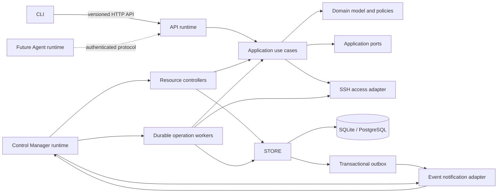
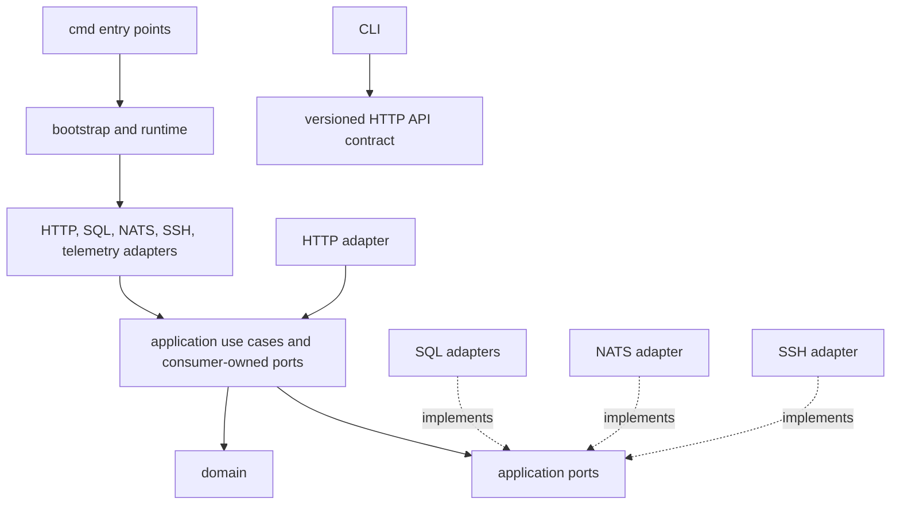
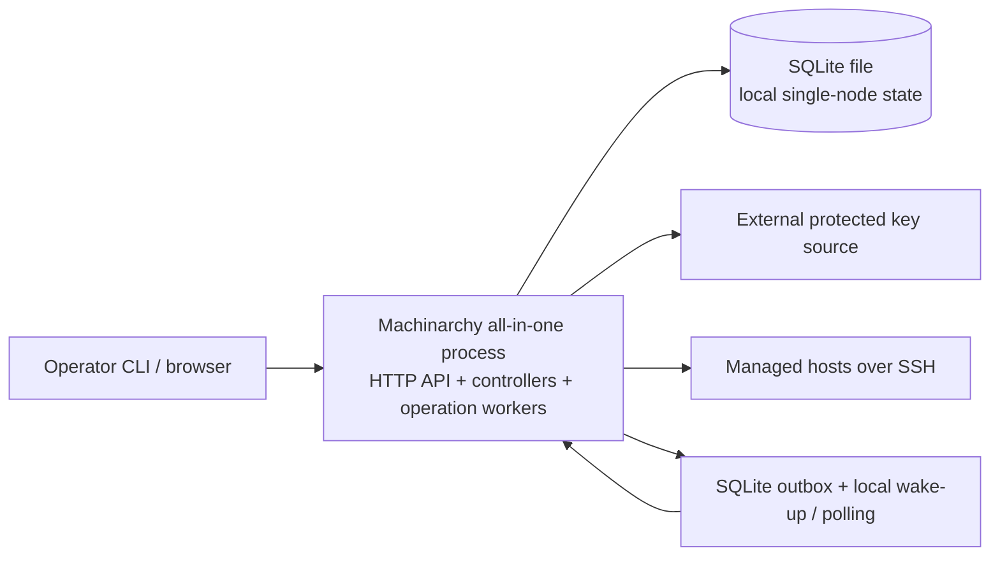
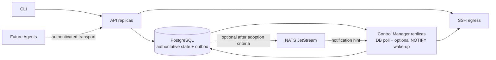

# Phase 1 — Target Architecture and Component Boundaries

**Status: Approved to proceed to Phase 2 on the recommended baseline.** The approval keeps the modular-monolith direction, SQLite single-node/PostgreSQL multi-process deployment path, and Control Manager-owned durable Operation workers as a separate subsystem. The original NATS timing was later amended by ADR-018: no broker is required for all-in-one mode, and JetStream is deferred until adoption criteria are met. It does not claim these behaviors are implemented or approve package reorganization.

## Objective and constraints

Keep Machinarchy a modular Go application with independently executable API and Control Manager roles, shared application/domain behavior, CLI-over-API access, SQLite for single-node use, and PostgreSQL for shared multi-process deployments. Keep SSH in Go. Treat database state as authoritative; events wake work but do not define current resource state. Separate continuous reconciliation from individual operations such as command runs.

Near-term sizing assumes the roadmap's 10–100+ SSH-host range. Larger scale is an evolution requirement to validate with measurements, not a reason to introduce microservices now.

## Target architecture

The diagram shows logical ownership, not a requirement that every box be a process. In the single-node mode, API, controllers, and operation workers run in one process and share infrastructure. In distributed mode, API and Control Manager are separate processes. An Agent remains a future runtime and is not a dependency of the initial deployment.

## Component responsibility matrix

| Component | Owns | Must not own |
|---|---|---|
| Domain | Host/resource identity and invariants, desired/observed state types when introduced, operation lifecycle rules, authorization policy, selectors, event facts | Echo, SQL, NATS, SSH library, process startup, secret-provider implementations |
| Application | Use cases and transaction orchestration for inventory, identity/access, targeting, runs, audit, runtime configuration and secrets | HTTP status codes, SQL dialect details, NATS ack mechanics, OS process lifecycle |
| API | HTTP routing, authentication boundary, request/response validation and mapping, stable errors, API-level rate limits, health/readiness | Direct multi-step business workflows, remote command execution, persistence implementation |
| Control Manager | Controller lifecycle, work scheduling, startup recovery, periodic resync, bounded controller concurrency, per-resource coordination, worker supervision | Authoritative state, database implementation, HTTP API behavior, event payload as current state |
| Operation workers | Claim and execute durable individual operations, cancellation, deadlines, results, operation-level audit and recovery | Desired-state reconciliation semantics |
| Persistence adapters | SQL schema/migrations, query implementation, transaction isolation, optimistic/conditional writes, outbox persistence, encryption at rest | Product authorization decisions or HTTP behavior |
| Event adapter | Publish/consume versioned integration notifications, trace propagation, broker-specific retries/acknowledgements | Business reconciliation decisions or durable source-of-truth state |
| SSH adapter | Host-key verification, credential use, connection lifecycle, command transport, output bounds and error classification | Inventory lifecycle, authorization, target selection |
| Bootstrap/runtime | Load and validate process settings, construct role-specific dependency graphs, start components, own shutdown order | Product use cases or dynamic mutation of process environment |
| CLI | Resolve local API target/context, invoke API, render stable human/machine output | Direct database, broker, or SSH access |
| Future Agent | Authenticate to the control plane, report liveness/capabilities, execute explicitly assigned work under local policy | Trusting unauthenticated commands or independently becoming the source of desired state |

### Explicit package responsibility decisions

- **`internal/service`:** useful current use cases, but one package has grown broad. Target is to rename to `internal/application` and split by cohesive capability only as work is moved: inventory/targeting, identity/access, audit, operations, and configuration/secrets. Avoid one package per function. HTTP handlers should invoke these use cases instead of calling stores for workflows.
- **`internal/store`:** retain as persistence composition and migration ownership. Keep SQLite and PostgreSQL implementations separate under their existing subpackages. Move contracts toward the application capability that consumes them; keep the adapters implementing those narrow ports. Do not let application code depend on `*sql.DB`.
- **`internal/broker`:** keep the NATS adapter responsibility, but make NATS optional to the single-node profile. Define event ports at the application/controller consumer boundary. Broker code owns transport delivery and ack/retry behavior; controllers own the meaning of notifications.
- **`internal/controlmanager`:** retain the name for the independently executable runtime role. Expand it to compose controllers and operation workers while keeping those as separate logical subsystems. It must load latest state by stable ID before reconciling. It is not itself a generic event broker or a replacement for the application layer.
- **`internal/config`:** narrow to immutable bootstrap/process settings and startup validation. Keep CLI target configuration in `internal/cli/config`. Runtime configuration revisions and secret management should be separate application capabilities, not fields added to a generic settings map.
- **`internal/bootstrap`:** retain as the composition root. Build only the components needed by the selected role, rather than opening all shared infrastructure unconditionally.
- **`internal/domain`:** initially retain the current package to avoid speculative package fragmentation. As resource boundaries are approved in Phase 2, split only stable cohesive models (for example host/inventory, identity/access, operations, audit) where doing so removes real coupling. Keep JWT claims out of core domain types when that boundary is next touched.
- **`pkg/sshclient` and `pkg/netpolicy`:** move behind an internal infrastructure/adapter boundary or remove their dependency on `internal/domain`; `pkg/` is documented as reusable and should not import application internals. The SSH capacity limiter belongs to application/runtime policy, not a general-purpose SSH connection pool.
- **`internal/telemetry`:** retain process-level provider setup; component instrumentation belongs beside the component, with bounded metric labels and explicit shutdown ownership.
- **`cmd/agent`:** keep the entry point as an explicit placeholder until an Agent protocol, enrollment, trust model, and update lifecycle are approved.

These are target boundaries, not authorization to reorganize packages yet.

## Dependency direction

Dependencies point inward at compile time. Adapters implement small interfaces owned by their consumers. Domain policy does not import an adapter. Avoid a global `Repository` or broad `Broker` interface; ports should represent concrete operations used by one application capability.

## Startup and bootstrap lifecycle

1. Each executable loads its own immutable bootstrap configuration from supported environment variables, config file, and flags (precedence to be specified in a later configuration decision). Validate required secrets, database settings, listener settings, and enabled features before opening listeners.
2. The runtime composition root creates telemetry providers and the selected database adapter, runs versioned migrations, then creates only the adapters required for that runtime role.
3. Initialize the Secret Store with a key-encryption key supplied outside the database. The runtime must fail closed if required key material is unavailable or cannot decrypt persisted secrets.
4. Construct application services and narrow ports. API construction registers HTTP routes and readiness dependencies; Control Manager construction registers controllers, operation workers, and recovery routines.
5. Recover incomplete operations and load controller state from persistent storage before reporting the worker role ready. Event subscriptions are wake-up paths; startup and periodic scans recover missed notifications.
6. Start servers and worker loops under a shared cancellation context. Liveness reports process state; readiness checks only dependencies required to serve this role.
7. On shutdown, stop admission, drain or cancel workers within bounded deadlines, stop subscriptions, close the broker and database, then flush telemetry. Shutdown ownership remains with the runtime.

## Runtime topology and deployment modes

### Single-node / local deployment

The all-in-one process is the recommended SQLite mode. SQLite remains single-node storage with one active application runtime as the supported deployment assumption. A local durable outbox and periodic scan avoid requiring NATS solely to notify another goroutine in the same process. Backups must protect both the DB file and the separate encryption key.

### Independently deployed and distributed evolution

PostgreSQL is required for the supported shared multi-process topology. Initial cross-process delivery uses durable DB queue/outbox polling with optional NOTIFY wake-ups; NATS JetStream is deferred until the criteria in ADR-018/Phase 4 are met. The outbox and database remain authoritative. Multiple Control Manager replicas require conditional claims/leases or equivalent per-resource coordination, bounded concurrency, duplicate-safe handlers, and recovery; those guarantees must be designed and validated before claiming horizontal scale. An Agent protocol is a later evolution and must have explicit enrollment, identity rotation, revocation, and transport security.

### Modular monolith versus microservices

| Choice | Benefits | Costs and fit |
|---|---|---|
| Modular monolith with API and Control Manager executables | Shared domain/use cases, low operational overhead, independent role deployment, straightforward SQLite development, one migration and authorization model | Process-local limits remain local; package boundaries and DB transaction contracts must be enforced. **Recommended now.** |
| Microservices | Independent release/scaling/fault domains and technology choices | Distributed auth, schema evolution, retries, observability, network security, and eventual consistency become mandatory. No measured scale or team ownership need currently justifies this cost. Reconsider only with evidence. |

## Proposed decisions and open questions

Draft ADRs under `decisions/` record the recommended direction. They are deliberately marked **Proposed** until the owner answers the questions below. No Phase 2 domain design or implementation is implied.

### Decisions requiring owner input

1. **Installation trust boundary:** Should one installation represent one trusted operator team, or must it isolate multiple organizations/customers? Options: (a) one shared workspace per installation; (b) multiple independently authorized tenants in one installation. **Recommendation:** (a), consistent with ADR 0003 and the current access model. Option (b) changes workspace lifecycle, membership, migration, API authorization, and audit scope, so it should be an explicit product commitment rather than an assumed scale feature.
2. **Operation executor ownership:** Should accepted runs keep executing in API processes, or should the Control Manager runtime own a separate durable operation-worker subsystem? **Recommendation:** Control Manager-owned workers, logically separate from reconciliation. This removes execution from request-serving replicas, but requires a well-defined database claim/lease, duplicate-safety, cancellation, and recovery protocol before implementation. Keeping execution in API is simpler for one process but preserves process-local ownership and limits independent API scaling.
3. **NATS in single-node mode:** Should the all-in-one SQLite deployment require NATS, or use durable database state with local wake-ups and polling? **Recommendation:** do not require NATS for all-in-one. Use PostgreSQL plus transactional outbox and NATS wake-ups for independent distributed components. Requiring NATS everywhere simplifies adapter composition but adds an operational dependency to a local install without a cross-process need.
4. **Initial scale target:** Should Phase 1 optimize for the roadmap's 10–100+ hosts or assume thousands of hosts per installation immediately? **Recommendation:** 10–100+ with measured load and recovery behavior, then scale based on evidence. Designing for thousands now may force partitioning, fleet-wide admission control, and operational machinery before the repository demonstrates the need.

### Acceptance criteria for Phase 1

- Owner confirms the installation trust boundary and intended first scale profile.
- Owner decides the runtime that owns durable operation execution.
- Owner confirms whether NATS is optional in all-in-one SQLite mode.
- The proposed component ownership and package boundary direction is approved or amended.
- ADRs are updated to Accepted only after those decisions; Phase 2 remains gated on explicit approval.

## Evidence and limitations

This proposal builds on the Phase 0 source review, including the current API-process RunManager, minimal Control Manager event logger, SQLite/PostgreSQL adapters, NATS JetStream adapter, SSH policy, and environment-loaded server configuration. Runtime configuration revisions, a Secret Store, outbox, reconciliation controllers, and Agent runtime are target capabilities, not current implementations. Automated checks were not run for this proposal.
