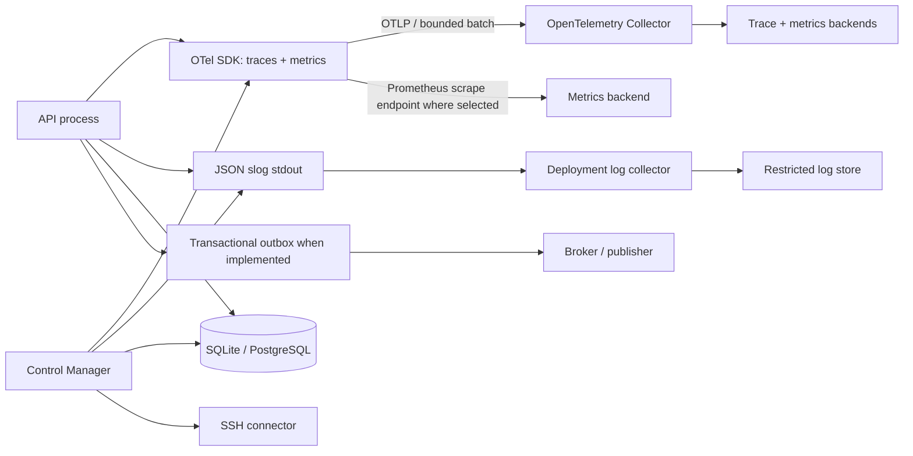

# Phase 10 — Observability, Reliability and SRE

**Status:** Accepted as the working design baseline when Phase 11 was authorized
**Scope:** Production telemetry, health, service objectives, shutdown, failure behavior, backup and recovery. This is a design review, not an operational readiness certification.

## 1. Executive assessment

Machinarchy has a useful starting point: JSON `slog`, HTTP request logging and Prometheus metrics, database-pool/SSH gauges, optional OTLP trace and metric exporters, HTTP and NATS trace instrumentation, `/healthz/live`, dependency-based `/healthz/ready`, signal handling, bounded HTTP shutdown, run heartbeats and startup recovery. The implementation does not yet provide a complete production signal model. The Control Manager currently subscribes to one event and has no reconciliation queue; there is no outbox, so outbox metrics do not exist. The current Prometheus metrics are separate from the OpenTelemetry metric provider, and application-level reconciliation, run, SSH outcome, configuration apply, and secret decrypt metrics are largely absent. Shutdown budgets are inconsistent, and readiness currently exposes check names and dependency errors through logs while metrics/health endpoints are public unless deployment networking restricts them.

The target model uses OpenTelemetry APIs and semantic conventions for application instrumentation, OTLP for export, and a collector as the deployment boundary. Prometheus scraping may remain a supported metrics ingestion path. Logs remain structured `slog` output with trace/request correlation; avoid dual-writing logs until operational value justifies the added pipeline. Telemetry must never include secret values, raw command arguments/output, tokens, or sensitive host identity/address labels.

## 2. Observability architecture

Responsibilities:

| Component | Responsibility |
|---|---|
| Application instrumentation | Record bounded metrics, spans, and structured operational/security events at use-case and adapter boundaries; do not decide retention or alerting. |
| `internal/telemetry` bootstrap | Configure service resource identity, sampler, OTLP exporters, metric reader, propagation, and bounded shutdown; fail startup only for invalid local configuration or required telemetry mode. |
| OpenTelemetry Collector | Receive OTLP, redact/drop sensitive attributes, batch, retry within limits, and route signals to approved backends. It is deployment infrastructure, not a database or durable work queue. |
| Prometheus-compatible scrape | Expose bounded-cardinality metrics on private management network; scrape failure must not block application work. |
| Structured logs | `slog` JSON to stdout/stderr, collected by platform agent. Keep audit records separate and durable. |
| Operations/health listener | Minimal liveness/readiness and metrics endpoints, private network or explicit ACL. Health is not a diagnostic dump. |
| SRE dashboards/alerts | Page on user-visible SLO burn and recovery hazards; use runbooks and deployment-specific routing. |

Instrument once through OTel Meter/Tracer APIs. Avoid maintaining parallel Prometheus and OTel metric implementations for the same signal. Existing Prometheus HTTP/DB/SSH instruments can migrate or be bridged deliberately; do not silently duplicate them. OpenTelemetry Go documents separate API/SDK setup for manual instrumentation and supports stable traces and metrics; its semantic conventions should be used where applicable. [Go instrumentation](https://opentelemetry.io/docs/languages/go/instrumentation/), [semantic conventions](https://opentelemetry.io/docs/concepts/semantic-conventions/)

## 3. Logging conventions

Use one JSON record per event through `log/slog`. Required fields when known: `time`, `level`, stable `event`, `service.name`, `service.version`, `deployment.environment`, `request_id`, `trace_id`, `span_id`, and a typed safe error class. Add `workspace_id`, `resource_id`, `operation_id`, `worker`, or `revision` only in logs where access controls and retention permit; these are not metric labels. Correlation IDs are opaque random IDs, not user-supplied trusted values. Accept a caller correlation ID only after length/character validation; always generate a local request ID and keep the external value separate.

Rules:

- Log route templates, not raw URL paths or query strings; log method, status, and duration. Current middleware already logs route template, request ID, duration, and trace/span IDs.
- Use stable event names (`reconcile.completed`, `operation.transitioned`, `config.apply_failed`, `secret.decrypt_failed`, `outbox.publish_failed`) and bounded enums for `outcome`/`error_class`.
- Never log credentials, token values, secret plaintext/ciphertext, encryption material, request/response bodies, raw argv, remote stdout/stderr, SQL parameters, or full Host records. Avoid logging raw SSH addresses, usernames, or hostnames unless an access-controlled incident workflow specifically requires them.
- Error messages may contain target paths or provider details; log a safe class and opaque correlation ID, with a separately access-controlled diagnostic detail only if scrubbed.
- Treat authentication failures and authorization denials as security audit facts as well as operational counters where required. Do not turn audit into a debug log or let telemetry sampling drop required audit events.
- Prevent newline/control-character log injection; cap field size; redact before serialization; test redaction at logger boundaries.
- Metrics and traces may be sampled/dropped. Security audit and durable operation state may not be inferred from sampled telemetry.

The existing request logger does not log bodies, which is a good baseline. It currently adds error type but no stable event or normalized error class; service log sites also use inconsistent event names and sometimes include numeric resource IDs. Phase 9's audit policy remains separate.

## 4. Metric catalog and conventions

Metric names use the `machinarchy.` namespace, lowercase snake case, and units in OTel metadata. Counters end in `_total` in Prometheus exposition; durations use seconds. Labels are bounded enumerations such as `controller`, `result`, `reason`, `method`, route template, and `dependency`. Never label by Host ID/name/IP, user/token ID, operation ID, secret ID, arbitrary event subject, error text, or config revision. Resource attributes identify process/service (`service.name`, version, environment, deployment/region where safe); process instance IDs are traces/logs only.

| Signal | Instrument / labels | Purpose and alert use |
|---|---|---|
| API requests | `http.server.request.duration` histogram; request counter with method, route template, status class | Rate, errors, latency; derive API SLI. Existing `machinarchy_http_requests_total` and `machinarchy_http_request_duration_seconds` cover part of this. |
| DB pool | open, in-use, idle, max-open gauges; wait counter/duration; query duration/error class by bounded operation | Saturation, connection starvation, slow DB. Do not label SQL or table row identifiers. |
| Reconciliation | `reconcile.attempts` counter by controller/result; `reconcile.duration` histogram by controller; `reconcile.errors` by controller/error class; `reconcile.in_flight` gauge | Detect controller failure and convergence delay. Only after target workqueue/reconcile implementation exists. |
| Workqueue | depth and oldest-item-age gauges by queue/controller; enqueue/dequeue/retry/drop counters; queue wait histogram; active workers gauge | Queue health, starvation, retry storms. Queue names from fixed registry only. |
| Operations | submitted/accepted counter by kind/result; active gauge; terminal counter by terminal state; duration histogram; cancellation/recovery/interruption counters | Capacity and completion. Exclude command, target selector, user, Host and Operation IDs from labels. Current process-local active run state is not a fleet-global count. |
| SSH | active connections gauge, configured limit gauge, capacity rejection counter; connect/handshake/command duration histograms; errors by bounded class (DNS denied, policy denied, timeout, auth, host-key, network, output limit) | Connector saturation and failure class. Never emit endpoint, host-key fingerprint, credential ref, or remote username as a metric dimension. |
| Outbox | pending rows gauge; oldest pending age; publish attempts/errors; publish latency; dead-letter/expired count | Alert on rising age/backlog and poison delivery. Future metric; outbox is not implemented yet. |
| Configuration propagation | persisted revision and applied revision gauges per process only if revision cardinality bounded (prefer version lag gauge); reload attempts/success/failure counters; apply duration; last-success timestamp | Detect stale processes and failed reload. Use service instance in resource/log context, not unbounded label. Do not expose config values. |
| Secret Store | resolution/decryption attempts, failures by bounded cause, latency, key-provider availability, rotation work age | Alert on key loss, auth failure, and unexpected failure spikes. Never label secret ID/name, key ID if high-cardinality, or plaintext-derived data. Audit each security-relevant access separately. |
| Broker | connection/reconnect state, publish/consume/ack/nak counters, delivery age, consumer pending | Broker availability/backlog. Future distributed signal; broker health does not prove reconciliation. |
| Process/runtime | Go runtime, heap, goroutines, file descriptors, process CPU/RSS | Capacity and leak detection. Existing process and Go collector covers some. |

For async configuration versions, expose `config_revision_lag` (persisted minus applied) per process only via a fixed service identity or an aggregate distribution; avoid one time series per ephemeral replica. Queue depth and oldest age are required together: depth alone does not indicate a stuck oldest item. Histograms require consistent buckets and backend aggregation rules.

## 5. Tracing and correlation

Use W3C Trace Context (`traceparent`/`tracestate`) across HTTP and broker boundaries. Incoming trace context is untrusted metadata: validate through the SDK propagator and never use it for authorization. Continue separate request ID for support lookup and trace ID for distributed path correlation. If incoming `X-Request-ID` is accepted, sanitize/limit it; do not let it overwrite generated ID.

Span boundaries:

1. HTTP server span (existing `otelhttp`) with route template, method, status, and request ID as a safe attribute.
2. Application command/query span for meaningful user-visible actions.
3. DB client spans via a supported database/sql instrumentation adapter, with parameter capture disabled and statement/tenant data minimized.
4. Reconciliation span per attempt, linked to triggering notification/resync when available; include resource kind and generation only if allowed, never resource name/IP.
5. Operation span from accepted work through claim, connector calls, and final result. Long operations may outlive the API request; use span links/correlation IDs instead of keeping an HTTP parent open indefinitely.
6. SSH spans for DNS policy, connection, host-key verification, authentication, and command execution; avoid command/host/credential attributes.
7. Outbox publish/consumer spans propagated through event envelope; do not put secret-bearing payload fields into spans.

Sampling: parent-based ratio sampling with a conservative configurable default is appropriate for traces, with tail sampling at Collector if available for errors/slow traces. Do not use trace sampling for metrics or audit. Bound exporter queues and timeouts; exporter outage must not block reconciliation/API handlers. Never use OpenTelemetry baggage to carry secrets, user permissions, raw host metadata, or large correlation state.

Current `internal/telemetry` defaults to 10% trace sampling and optional OTLP endpoint export; `otelhttp` and NATS spans exist. It does not add HTTP request ID as span attribute, and no application metric instruments are created through OTel API. Its OTel exporter setup and Prometheus exposition are parallel systems. Establish an explicit telemetry policy for endpoint, TLS/auth, resource attributes, sampling, queue sizing, and shutdown flush.

## 6. Health, liveness, and readiness

Health endpoints answer narrow orchestration questions and return generic dependency names/status only. Keep them on a private management listener/ACL; do not expose stack traces, database addresses, broker subjects, key IDs, or Host details. Readiness timeout is bounded and shorter than the orchestrator probe timeout.

| Process | Liveness | Readiness | Degraded capability behavior |
|---|---|---|---|
| API | Process can make progress and is not in shutdown; no dependency checks | Required DB is reachable; routes initialized; API is accepting work. Include broker only while synchronous app code requires it; with transactional outbox, broker outage should not make durable DB-backed writes unready. | If DB unavailable, reject durable mutations and report unready; existing read operations may also fail. Keep process alive for recovery. |
| Control Manager | Worker process/event loop alive; avoid liveness depending on external DB/broker | DB, required Secret Store/key provider, loaded config snapshot, and subscription/queue consumer are initialized; worker pool is accepting work. | If broker unavailable but DB resync path is available, remain ready for level-triggered resync and mark notification path degraded. If key provider unavailable, mark connector/secret-dependent work unavailable, not all metadata/API operations. |
| All-in-one | Same process liveness independent of DB/remote Hosts | API dependencies plus Control Manager workers ready; expose per-component check status privately. | API may be ready while remote Host work is impaired; do not fail global readiness for individual Host outage. |

`/healthz/live` must not restart a process merely because a dependency is down. `/healthz/ready` should transition false before shutdown/drain. A host being offline is resource condition/operation result, not process unhealthiness. A missing encryption root key is a startup failure in a deployment that requires secret use; while running, key-provider loss should be surfaced as degraded secret-dependent capability and a critical alert, with operations failing closed.

Current HTTP readiness checks DB plus injected broker and Control Manager checks. Control Manager readiness means its subscription is active, not that reconciliation is converging. `NewOperationsServer` has readiness but API includes `/metrics`, health, OpenAPI, and Scalar on its main listener. Make management endpoints private and align readiness semantics with durable outbox behavior as those designs are implemented.

## 7. SLO proposals

These are proposed starting objectives for a production PostgreSQL deployment with redundant API/Control Manager processes and managed telemetry/database dependencies. A single-node SQLite deployment cannot claim multi-instance availability; publish measured service-level objectives for that installation separately. Review after 6–8 weeks of production histograms and incident data.

| Service objective | Initial target | Measurement boundary |
|---|---|---|
| API availability | 99.9% successful non-health requests over rolling 30 days, excluding expected 4xx, client disconnects, and explicitly planned maintenance | External synthetic through ingress; exclude `/healthz` and `/metrics`. Track 5xx and transport failures. |
| API latency | 99% of eligible read requests < 500 ms and write-acceptance requests < 1 s over 30 days | Route class; exclude long polling and remote execution (which is asynchronous). Revisit after baseline. |
| Durable Operation acceptance | 99.9% of authorized, valid submissions persist and return an Operation ID within 1 s when DB quorum/storage is healthy | API acceptance is not remote execution success. |
| Operation state completion | 99% of accepted Operations reach a terminal state by configured deadline + 2 minutes when worker, DB, and required key provider are healthy | Remote-host failure may be a completed failed Operation; track success separately by result class and target availability. Never claim exactly-once execution. |
| Reconciliation freshness | 99% of eligible changed resources begin reconciliation within 60 s and converge or publish a classified condition within 5 min while DB, worker, connector and remote target are available | Edge notification + periodic resync; exclude explicitly blocked/manual states and unavailable target windows. Measure queue age and state freshness. |
| Outbox freshness | 99% of committed notifications publish or are safely superseded within 60 s while broker available | Pending count and oldest age; DB remains source of truth. Broker outage is measured separately. |
| Configuration propagation | 99% of running processes apply a valid revision within 60 s; failed reload keeps last-known-good snapshot and raises alert within 1 min | Per-process persisted/applied version; process restart-required settings excluded from hot-reload target. |
| Recovery objectives | Proposed initial RPO ≤ 15 min / RTO ≤ 4 h for PostgreSQL PITR; SQLite single-node RPO ≤ backup interval / RTO ≤ 4 h | Must be backed by scheduled backup verification and restore exercise. These are targets, not current guarantees. |

Do not page on every remote Host failure. Alert on control-plane SLO burn, queue age, worker exhaustion, broad SSH failure ratio, persistent DB errors, secret key loss, audit/outbox age, backup failures, configuration version lag, and telemetry pipeline loss. Pair each page with a runbook and action owner.

## 8. Failure-mode matrix

| Failure | Observable signals | Required behavior and recovery |
|---|---|---|
| API process crash | Process down, external synthetic/target unavailable, last logs | Orchestrator restarts; durable DB state survives; clients retry idempotently. Do not lose accepted request if commit succeeded; response may be ambiguous, so idempotency key/status lookup is required. |
| Control Manager crash | Worker liveness down, queue age rises, reconcile freshness degrades | Restart; startup recovery lists authoritative DB state, rebuilds queues, resumes durable claims; no event-only correctness. Alert on stale work and interrupted leases. |
| Reconcile worker crash | In-flight gauge falls, lease expires, retry/error metric | Lease expires or worker recovery requeues key; latest state is reloaded; idempotent controller retries with capped exponential backoff and jitter. |
| Operation worker crash | active Operation lease/heartbeat expires; running Operation stale | Mark interrupted/unknown outcome, persist reason; never automatically replay a possibly dispatched non-idempotent command. Require explicit safe retry with idempotency semantics. Current `Recover` sweep marks stale Runs interrupted. |
| Database outage | DB readiness false; pool wait/error; request errors | API stops accepting durable writes; liveness remains true; CM pauses/retries with bounded backoff; in-flight remote work follows cancellation/persistence uncertainty policy. Restore DB, then verify migrations, audit/outbox and resource recovery. |
| Broker outage | connection/reconnect/publish errors; outbox backlog and age | With target outbox, continue durable writes and replay when broker returns; consumers also periodically resync. Current direct broker dependency may block some API events and marks readiness false; deploy degraded behavior only once outbox exists. |
| SSH target unavailable | connect/timeout counters by bounded failure class; individual resource condition | Fail that host/Operation within deadline, continue other targets under bounded concurrency; retry reconciliation with backoff, but do not retry uncertain commands. Host failure does not make API/CM globally unready. |
| Secret key/provider unavailable | provider health, decrypt failure count, alert | Fail closed for secret-dependent action; retain last config snapshot only if it does not require key access for the attempted action; never substitute empty/default secret. Restore key provider and verify secret access before resuming. |
| Configuration reload invalid/fails | reload failure counter, applied revision lag, last-success time | Validate and prepare before atomic publication; retain last-known-good snapshot. Alert after threshold; distinguish persisted revision from applied version. Restart-required values remain unapplied and show status. |
| Partial component availability | per-dependency readiness/degraded signals | Degrade only affected capability; keep metadata reads/health available where safe. Return explicit retriable service-unavailable for operations needing failed component; do not report accepted/complete incorrectly. |
| Telemetry exporter/collector failure | exporter errors, queue drops, backend heartbeat gap | Application continues; bounded retry/queue and self-health signal; alert on sustained loss. Audit and durable state are not sent only through telemetry and remain intact. |
| Graceful shutdown during long work | stopping/readiness false, active workers, drain duration/timeouts | Stop admission; finish short HTTP requests; stop claiming new work; allow bounded safe work to finish; cancel remote sessions at deadline; persist interrupted/unknown outcomes; close broker/DB last; flush telemetry within remaining budget. |

## 9. Shutdown and worker draining

Use one process lifecycle coordinator with ordered phases and explicit budgets. Proposed sequence:

1. Receive SIGTERM/SIGINT; atomically mark process stopping and readiness false.
2. Stop accepting new HTTP connections and new Operation/reconcile claims. Keep liveness true during drain.
3. Drain in-flight HTTP requests within a bounded deadline (initial proposal 10 seconds).
4. Stop pulling new broker/outbox work; unsubscribe/close subscription after in-flight callback handling is bounded.
5. Let idempotent reconciliation attempts finish or cancel at their per-attempt deadlines; persist retry scheduling/current resource condition.
6. Let Operations finish within their configured deadline only if process termination grace allows it. Otherwise cancel SSH session, record `interrupted`/`outcome_unknown`, and do not blindly replay.
7. Flush transaction/outbox state and security audit; close broker, database, and SSH pools only after workers stop.
8. Flush telemetry providers with a small remaining timeout; exit before orchestrator kill deadline.

The orchestrator termination grace period must exceed application drain budget plus cleanup reserve. A starting policy is 60 seconds total (10s HTTP, 35s worker drain, 5s persistence/broker close, 5s telemetry flush, 5s reserve), while remote commands longer than the drain window are interrupted and recovered from durable state. Make budgets configurable within safe maxima and report drain timeout counts. Do not wait for an unbounded SSH command or worker. Existing API uses a 10-second HTTP shutdown; Control Manager uses 10 seconds to await engine stop; `Runtime.Close` allows a separate 30-second run-manager close, which is longer than the caller process budget in some paths. Consolidate these into one budget before claiming graceful drain.

## 10. Backup, restore, and recovery

The database and external encryption keyring must be recoverable as one security system. Brokers/notifications are not authoritative; database state and outbox/inbox rows are. Backups must protect Host credentials, configuration, secret ciphertext, Operations, audit and outbox data.

### SQLite single-node

- Use SQLite's online backup mechanism or a coordinated consistent filesystem snapshot; do not copy only the main database while WAL writes are active. Include/coordinate WAL and SHM state, checkpoint policy, permissions, and encrypted-volume backup.
- Keep database on a supported local filesystem; do not claim multi-node shared-file SQLite HA. Protect backup artifact and external KEK backup independently.
- Test restore into an isolated host, run schema migration checks, verify audit chain, decrypt a canary secret with the external keyring, replay unsent outbox rows, and confirm no duplicate unsafe Operation dispatch.

### PostgreSQL distributed deployment

- Use managed/durable snapshots plus WAL/PITR where RPO requires; verify TLS/auth, role grants, schema migrations, and application version compatibility on restore.
- Back up keyring metadata/KEKs under separate access control and retention from the database. Never store KEKs only in the same DB backup.
- Test PITR to a timestamp, then reconcile workers from restored DB; expire/revoke workload credentials as required after restore.

### Runbooks and recovery contract

Maintain documented procedures for full restore, point-in-time restore, encryption key loss/rotation, audit anchor gap, outbox backlog replay, broker replacement, DB failover, and worker restart. Perform at least quarterly restore exercises for production systems and retain evidence/time/RPO/RTO. Alert on backup age/failure and restore-test age. Database restore to an older point may rewind config/security revisions and revoke/restore state; require explicit reconciliation and review before re-enabling remote execution. Recovery with lost external KEK cannot recover encrypted secret versions; mark impacted resources unavailable and rotate credentials through an approved process.

## 11. Operational requirements

- Separate service identity and service version for API and Control Manager (`service.name`, `service.version`, environment); add deployment/region only where useful. Never attach secrets or raw environment dumps.
- Private/authenticated management endpoints; collector/backend credentials and TLS validation; scrape/export egress allowlist.
- Retention, access control, encryption, region, deletion, and incident access defined separately for logs, traces, metrics, audit, and backups.
- Alert inventory contains symptom, SLO effect, severity, runbook, and owner. Avoid pages on one Host's expected unavailability.
- Dashboards cover API SLI, DB, process/runtime, Control Manager readiness, queue freshness, Operation state/age, SSH capacity/failure class, outbox, config revision lag, secret provider, audit export, backup age, and telemetry loss.
- Capacity-test worker count, DB pool, SSH limiter, queue bounds, and telemetry exporter queues. Per-process concurrency limits multiply across replicas; define fleet-wide admission/quotas for Operations.
- Apply cardinality budgets and telemetry field allowlists in code review. Treat traces/logs as sensitive infrastructure metadata; use least privilege and access audit.
- Define retention for completed Operation data/output separately from logs. Keep remote stdout/stderr out of standard logs and traces.
- Document incident handling for suspected secret disclosure, telemetry leak, audit loss, key provider failure, and widespread remote execution failure.
- Failure injection/restore tests and SLO dashboards are future implementation acceptance criteria; this design phase does not run them.

## 12. Go package boundaries

- Keep exporter/provider construction and lifecycle in `internal/telemetry`; expose instrumentation constructors or narrow recorders rather than global state and arbitrary string labels.
- Add bounded domain/application telemetry at `internal/service` use-case boundaries for Operations, configuration, Secret Store, and future reconciliation; adapters (`internal/transport/http`, `internal/broker`, `internal/store`, `pkg/sshclient`) record their own technical spans/errors without owning business outcomes.
- Health checks remain an operations/transport adapter over narrow readiness ports. Health endpoints do not embed business logic or probe every Host.
- `internal/bootstrap` composes providers, service recorders, health dependencies, and shutdown hooks. Entry points own signal handling and ordered process lifecycle.
- Durable audit remains in its own application/store boundary and is never implemented as a metric/log exporter.

## 13. ADRs

- ADR-042: Use OpenTelemetry APIs and OTLP with bounded optional export; keep audit separate.
- ADR-043: Separate liveness, readiness, and capability degradation; remote Host outages do not fail process health.
- ADR-044: Enforce low-cardinality, secret-safe telemetry conventions.
- ADR-045: Coordinate graceful shutdown and worker draining under one process deadline.
- ADR-046: Treat database backups and external encryption keys as one tested recovery contract.

## 14. Review boundary

This document proposes targets and SLOs, not guarantees the current code meets. The Control Manager reconciliation queue, transactional outbox, runtime configuration snapshots, Secret Store, global worker coordination, and complete application metrics are not implemented. SLO numbers are initial targets for discussion and must be validated against observed load and operational constraints. Phase 11 should proceed only after owner review of this baseline.
