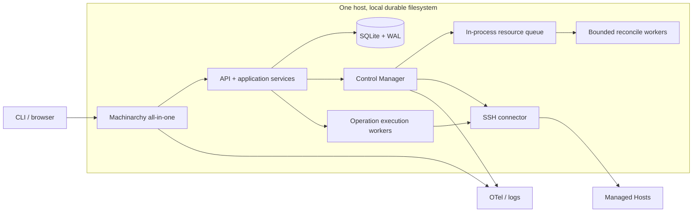
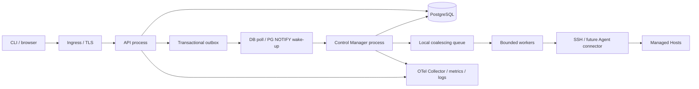
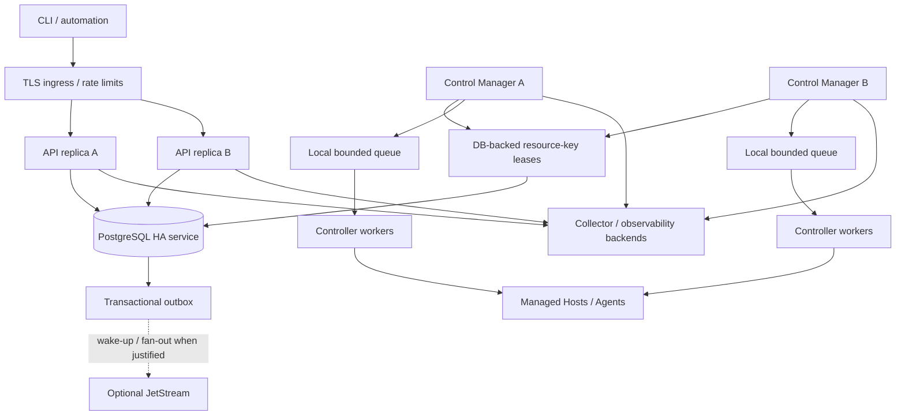

# Phase 11 — Deployment, Scalability and Future Evolution

**Status:** Accepted as the working design baseline when Phase 12 was authorized
**Scope:** Deployment modes, database and worker coordination, capacity assumptions, optional broker/Agent/Kubernetes evolution. Numbers below are planning envelopes, not measured throughput or benchmark claims.

## 1. Executive recommendation

Start with one all-in-one process on one node using SQLite on a local durable filesystem, one Control Manager, one in-process bounded workqueue, and the approved five-minute jittered resync/four-worker Host reconciliation profile. Keep the API and Control Manager binaries independently runnable, but do not use that fact to imply that SQLite supports independent-node scaling. Keep remote execution limits explicit and ensure the production egress policy approved in Phase 9 is enforced.

Move to PostgreSQL before independently scaling API and Control Manager, before running multiple Control Manager replicas, or when observed SQLite write contention/latency violates the service objectives. The database-backed resource-key queue/lease/fencing contract is the first distributed coordination layer. Keep NATS JetStream optional until a demonstrated need for independent durable fan-out, Agent delivery, or measured PostgreSQL polling pressure. Kubernetes remains one optional deployment target; Machinarchy should also run as a process, systemd service, or ordinary container without Kubernetes.

At 100 hosts, a single-node SQLite profile is the expected starting fit. At 1,000 hosts, select SQLite versus PostgreSQL based on write rate, reconciliation duration, and availability requirements; PostgreSQL is preferred if the Control Manager/API are separated. At 10,000 Hosts, plan around PostgreSQL, bounded multi-replica worker pools, and explicit DB-backed leases; validate queue and Agent heartbeat writes under load before sizing production. Host count alone is not a benchmark or a guarantee.

## 2. Deployment architecture diagrams

### All-in-one single node

This is the simplest SQLite deployment. The in-memory queue is disposable; startup resync reconstructs work from DB state. Back up SQLite consistently with WAL and back up external encryption keys separately. Loss of the node is service loss until restore; no HA claim.

### Independently executable API and Control Manager

Standalone API without a live Control Manager can accept durable CRUD and Operations only if the advertised contract/status makes pending work visible; it cannot claim reconciliation or Operation execution will progress. Standalone Control Manager exposes only private operations health and consumes the same PostgreSQL-backed state. Do not use separate SQLite files per process.

### PostgreSQL multi-replica control plane

PostgreSQL and fenced claims coordinate correctness. Notifications/brokers reduce latency but do not own state or prevent duplicate work. Every replica has fixed local worker/SSH budgets plus a fleet-wide admission policy where a global limit matters.

## 3. Runtime topology and responsibilities

| Runtime | Owns | Deployment guidance |
|---|---|---|
| All-in-one (`cmd/monolit`) | API, Control Manager, local queues, current API-run execution path, DB/broker connections | Default single-node installation. SQLite or PostgreSQL. For SQLite use one process/instance. |
| Standalone API (`cmd/api`) | HTTP API, authn/authz, application commands/queries, DB access, durable Operation acceptance; current code also constructs RunManager | One or more stateless replicas only with PostgreSQL, shared signing/session configuration, consistent API version, and distributed rate limits. Until operation execution is moved/claimed by the CM role, the API RunManager remains process-local and concurrency multiplies by replica count. |
| Standalone Control Manager (`cmd/controlmanager`) | Notification subscription, resync, resource queue/controller workers, future Operation workers, SSH/Agent connector work | Single instance first. Multiple replicas only after DB leases/fencing and worker recovery are implemented. PostgreSQL required for supported horizontal coordination. |
| CLI (`cmd/machinarchy`) | User-facing commands, API client and output | No direct DB, SSH, broker, or secret-store access. |
| Agent (`cmd/agent`) | Future Host-local connector endpoint, observations, task execution within granted capabilities | Not implemented. Keep disabled until enrollment, mTLS identity, protocol, upgrade, authorization, and lease model are complete. |

Current state matters: the Control Manager subscribes to NATS and logs a reconnect event; reconciliation is still a TODO. Current imperative Runs execute in the API process. A future target moves resource reconciliation and independently scheduled Operations to bounded Control Manager workers with durable claims. Do not configure additional replicas before that implementation and its failure behavior exist.

## 4. SQLite and PostgreSQL deployment requirements

| Concern | SQLite | PostgreSQL |
|---|---|---|
| Supported topology | One node and one active application composition; local filesystem | Independent API/CM processes, multiple replicas, shared state |
| Queue | One in-memory queue rebuilt by startup/resync; no multi-node queue claim service | Durable key/lease rows, conditional claims/fencing; `FOR UPDATE SKIP LOCKED` suitable for queue-like claim batches |
| Write concurrency | WAL supports concurrent readers with a single writer; one open connection is current default; short transactions and low write amplification matter | Concurrent transactions/row locks; still capacity-plan pool sizes, hot rows, indexes, WAL, and connection limits |
| Filesystem | Never place WAL DB on network filesystem; processes must share same host; persistent local volume and consistent backup | DB server owns storage; clients use authenticated TLS and network controls |
| Failover | Restore/restart node; no automatic multi-node HA | HA/PITR depend on selected managed/operator deployment; application tolerates failover and retries transient transactions safely |
| Migration ownership | One process performs migrations at startup today; keep one active instance | Prefer a controlled migration job/release step; do not let every replica race through DDL |

SQLite WAL has one writer, requires processes on the same host, and does not work over a network filesystem; this supports the single-node boundary rather than shared-file scaling. [SQLite WAL](https://www.sqlite.org/wal.html) PostgreSQL's `SKIP LOCKED` intentionally permits queue-like consumers to skip rows locked by peers, but it returns an inconsistent view and is not a general-purpose query strategy; pair it with leases, ordering/fairness policy, fencing, and recovery. [PostgreSQL SELECT locking](https://www.postgresql.org/docs/current/sql-select.html)

The same logical application contract must work for both engines. Use PostgreSQL when replicas require durable coordination; do not point several machines at a shared SQLite file. SQLite can still run API and worker roles in separate processes on the same host only if treated as a single deployment unit and validated for locking/operational behavior; the default remains all-in-one.

## 5. Multi-replica and database-backed work coordination

### Initial single-node mode

- One Control Manager, four bounded reconciliation workers, five-minute jittered full resync, resource-key coalescing, and existing process SSH bulkhead as an independent ceiling (Phase 3 approved baseline).
- In-memory queues store keys only. Startup/resync recovers missed notifications. One process-wide admission budget bounds remote work.
- Current execution path is per-API-process; all-in-one currently has one API process. Preserve 32 SSH slots per process and current run limits only as observed implementation defaults, not as fleet-wide limits.

### PostgreSQL distributed mode

Use a durable `work_items`/lease table keyed by `(resource_kind, workspace_id, resource_id)` or equivalent stable key. Enqueue is idempotent and coalesces generations; each row tracks dirty generation/revision, next eligible time, attempts, lease owner/expiry, and monotonically increasing fencing epoch. Claim in a short transaction, optionally with `FOR UPDATE SKIP LOCKED`; release transaction before SSH/network I/O. Renew leases while working. Completion updates observed state only if both latest generation and fencing epoch still match. A lost/expired worker cancels where possible and cannot commit stale status. Lease expiry reschedules with bounded backoff; startup and periodic scans remain authoritative recovery.

Requirements before more than one CM replica:

1. Durable enqueue and claim semantics tested against PostgreSQL; SQLite path stays single-manager.
2. Lease renewal, fencing tokens, desired-generation CAS, worker crash takeover, and lease-loss cancellation.
3. Fairness across resource kinds/tenants and a fixed worker pool per replica.
4. Fleet-wide concurrency/admission limits for expensive operations; local `SSHCapacity` alone multiplies with replica count.
5. One logical owner for each controller kind or safe per-key lease; no singleton leader needed for ordinary per-resource controllers. Leader lease is appropriate only for singleton chores such as migrations/pruning, if those cannot be made idempotent/partitioned.
6. Separate Operation claims from reconciliation claims; uncertain remote execution is reported, never blindly replayed.

### API replicas

API replicas are stateless with respect to durable user/resource state and can load-balance behind an authenticated TLS ingress. Shared keys/configuration, token revocation storage, stable migrations, distributed login/API rate limits, idempotency keys, and request correlation are required. Avoid per-process assumptions for service limits: request quotas, active Operation caps, and egress ceilings must be global or explicitly multiplied in capacity planning. Database pool total equals replica count × per-process pool settings; size under DB connection limits, leaving admin/backup/worker headroom.

## 6. Event and broker evolution

Implement the approved SQLite/PostgreSQL transactional outbox and local queue first. For PostgreSQL, `LISTEN/NOTIFY` may wake a poller after commit; notifications are lossy hints, so poll durable outbox/queue state on a bounded interval and at startup. Do not enable JetStream simply because API/CM are separate processes.

Adopt JetStream when one or more of these are demonstrated:

- Agents or other components need authenticated durable delivery while disconnected, beyond an outbox relay and database polling model.
- Several independent consumers need different durable cursors/fan-out and replay without loading the primary database.
- Measured DB polling/claim load or notification latency violates a reviewed SLO after query/index/poll tuning.
- Broker-managed buffering materially improves fault isolation and an operator can support its HA, ACL, TLS, retention, backups, monitoring, and recovery.

If adopted, the outbox remains the source for integration facts; NATS delivery is at least once, consumers deduplicate and reread DB state, and local resource queues remain bounded. Kafka remains deferred unless measured throughput, long replay retention, stream processing, or consumer-group requirements exceed PostgreSQL + JetStream and justify operating a streaming platform.

## 7. Agent communication and lifecycle

The Agent is a future execution adapter; Hosts remain domain resources and do not acquire Agent-specific identity fields as their primary identity. Model an access profile with connector mode/reference, and a separate Agent enrollment/identity record bound to one workspace and Host. Agent mode is not permitted until protocol and credential lifecycle are implemented.

### Registration

1. Owner or authorized operator creates an enrollment request for an existing/new Host with expiry, one-time nonce, intended Host binding, and narrow bootstrap capability.
2. Agent proves the one-time token over TLS to a private/publicly exposed enrollment endpoint. Token is stored hashed, single-use, short-lived, rate-limited, and does not grant normal API access.
3. Server validates the binding and issues a unique short-lived client certificate/workload credential through the configured CA. Certificate identity maps to exactly one Agent and Host; no shared fleet certificate.
4. Record registration, certificate fingerprint/serial metadata, version, negotiated capabilities, owner and audit event; never store private key plaintext centrally if Agent generates the key locally.
5. Revoke enrollment token and prior credential on re-enrollment; notify/deny previous identity.

### Connection, heartbeat, and lease

- Prefer Agent-initiated outbound mutually authenticated TLS streaming (gRPC or HTTPS long-poll) to avoid inbound access into managed networks. This is a future protocol decision, not a current implementation commitment. Control plane authorizes every message by certificate identity, bound Host, workspace, capability, and message type.
- Initial sizing assumption: heartbeat every 30 seconds with randomized jitter; a 90-second lease after three missed beats marks the Agent disconnected. These are tunable starting values, not product guarantees. Use monotonic lease expiry from server time, avoid using Agent wall clock for authorization, and tolerate clock skew.
- Heartbeat renews presence/capability lease and may carry bounded observations; it does not directly overwrite desired state. Persist lease renewal with bounded write amplification; persist status transition on connected/disconnected edges. At 10k Hosts, 30-second durable lease renewal is roughly 333 updates/s before other writes and must be measured; batch/partition or lengthen interval only if failure detection and database load remain acceptable.
- Agent reconnect uses jittered exponential backoff, certificate renewal before expiry, replay-safe sequence/event IDs, and bounded message queues. Server restart never loses desired Host/Operation state; Agent reconnect reloads tasks from durable Operation assignment rows.
- A lease expiring marks the connector unavailable and cancels or expires claims; it does not delete the Host or mean a remote command did not execute. Operation results carry operation ID, assignment epoch, and idempotency token; stale epochs are rejected.
- Task protocol is typed and capability-limited (for example collect observation, run approved Operation, report result). No arbitrary server command over a generic shell channel. Agent update compatibility, signed artifacts, minimum supported version, revocation, and rollback are prerequisites for production use.

For many live long-lived Agent streams, introduce a dedicated gateway only when session routing/connection limits require it. PostgreSQL remains durable state; a future NATS integration may provide gateway-to-worker wake-ups but must not become the only copy of task assignments/results.

## 8. Container and Kubernetes deployment

### Containers

Provide OCI images for API, Control Manager, and all-in-one when packaging becomes part of implementation. Run non-root, read-only root filesystem where feasible, drop Linux capabilities, set CPU/memory/FD limits, mount only required CA/config/key paths, never bake secrets into image layers, pin image digests in production, publish SBOM/signatures, and use a private health/metrics listener. SQLite needs a persistent local volume with WAL-safe backup and a single replica; a container restart is not durable storage. PostgreSQL deployments can scale stateless API/CM containers independently.

### Kubernetes is optional

Kubernetes can manage stateless API Deployments and bounded Control Manager Deployments, rolling updates, probes, resource limits, and secrets/config mounts. It is useful for teams already operating Kubernetes, not a Machinarchy runtime dependency. A Docker Compose/systemd/VM deployment remains supported. Do not deploy SQLite replicas against a shared network volume. For Kubernetes SQLite, use one all-in-one replica with a supported persistent volume and document node/storage failure behavior; PostgreSQL is the normal choice for multiple replicas.

For API rollouts, use readiness and graceful termination so a Pod stops receiving traffic before drain. For Control Manager replicas, rollout safety depends on DB leases/fencing and worker drain, not just Deployment readiness. Use a startup probe for migration/config initialization if needed and keep liveness independent of transient database/broker outages; Kubernetes distinguishes startup, liveness, and readiness probe purposes. [Kubernetes probes](https://kubernetes.io/docs/concepts/workloads/pods/probes/), [Deployment rollout](https://kubernetes.io/docs/concepts/workloads/controllers/deployment/)

## 9. Upgrade and compatibility strategy

- Version API, database schema, event envelope, runtime configuration schema, Agent protocol, and container image independently. Advertise build/schema/protocol versions in private diagnostics.
- Use expand-migrate-contract for database changes: add backward-compatible columns/tables/indexes; deploy code that reads old/new; backfill in bounded batches; switch writes; remove old schema only after all binaries are past the compatibility window. No down migration is assumed for destructive data changes.
- In distributed mode, run migrations once through controlled release job or explicit lock; never make every replica perform conflicting startup DDL. Verify all old/new API and CM versions can coexist for the rolling window.
- Integration event consumers ignore unknown optional fields, reject unsupported major schema versions to quarantine, and retain replay compatibility for the configured event window.
- Agents support a defined compatibility window (recommended current and previous protocol minor; exact range set when protocol is designed). Server rejects too-old/revoked Agents safely and reports upgrade required; do not deliver new task types to an Agent that did not advertise the capability.
- Runtime config has schema version and atomic last-known-good application. A rollout must not silently downgrade an unsupported persisted configuration revision; block startup/readiness for required incompatible config and provide documented rollback/migration.
- Secret ciphertext key IDs and configuration revisions must remain decryptable/restorable across database rollback and rolling deploys. Key rotation and schema rotation use overlap windows.
- Before rollout, backup DB and external keys; after rollout, monitor migration duration, error rate, readiness, queue lag, config apply lag, Operation state, and Agent version distribution. Roll back binaries only if schema/config remains backward compatible.

## 10. Capacity planning scenarios

The table is a load-test planning envelope. It uses these explicit hypotheses: one jittered full resync per five minutes (Phase 3 baseline); 2 seconds average controller attempt as a sizing variable (not measured); 2× worker headroom; one external automation status read per Host per minute and one mutation per Host per 10 minutes; resource notifications average one per Host per 10 minutes with 10× bursts; optional Agent heartbeat every 30 seconds. Actual customer request rates and reconcile duration must replace these assumptions before sizing. Human CLI traffic is additional.

For worker sizing, approximate `workers ≈ (hosts / resync interval) × average attempt seconds × headroom`. For queues, assume keys coalesce by Host and no-op reconciles avoid database writes. A startup resync can enqueue every Host at once, so startup sharding/jitter matters.

| Planning measure | 100 Hosts | 1,000 Hosts | 10,000 Hosts |
|---|---:|---:|---:|
| Full resync discovery average (N / 300s) | 0.33 Host/s | 3.3 Hosts/s | 33.3 Hosts/s |
| Reconcile worker estimate at 2s × 2× headroom | ~2; use baseline 4 | ~14; test 16–32 | ~134; test 128–256 across CM replicas |
| Automation API read model (one/Host/min) | 1.7 req/s | 16.7 req/s | 166.7 req/s |
| Automation mutation model (one/Host/10min) | 0.17 req/s | 1.7 req/s | 16.7 req/s |
| Change-notification average (one/Host/10min) | 0.17 event/s | 1.7 events/s | 16.7 events/s |
| Notification burst envelope (10× average) | 1.7 events/s | 17 events/s | 167 events/s |
| Optional 30s Agent heartbeat rate | 3.3/s | 33/s | 333/s |
| Startup queue keys without sharding | 100 | 1,000 | 10,000 |
| Queue drain time at selected workers × 2s average (no new work) | ~50s at 4 workers | ~125s at 16 workers | ~156s at 128 workers |
| Config revision checks per second (1 / 4 / 8 processes polling every 30s) | 0.03/s | 0.13/s | 0.27/s |
| SSH ceiling starting point | 32/process (current bulkhead) | 32–64 total after load test | 128–256 total after load test and global policy |
| Database write pressure | Host changes + operation/audit/outbox; low under no-op resync assumption | Same, plus optional ~33 lease renewals/s | Same, plus optional ~333 lease renewals/s; PostgreSQL expected |

API request math is a synthetic automation profile, not expected market demand. Config-check process counts are scenario assumptions, and each process loads a full config snapshot only after observing a newer revision. Queue drain assumes 2-second independent tasks, no retries, and no new arrivals; real SSH handshake/command latency may be much longer, remote rate limits may dominate, and retries/bursts add load. The per-process SSH bulkhead of 32 and current four active runs × up to 20 per-run hosts do not create a global cap: the shared 32 slots constrain one process, while replicas multiply capacity. The proposed fleet SSH numbers are sizing candidates, not safe defaults; egress policy, credential limits, and target capacity may require far lower ceilings.

### Per-scenario deployment guidance

| Size | Initial topology | Key risks / scale gate |
|---|---|---|
| 100 Hosts | One all-in-one + SQLite; 4 reconcile workers, existing SSH bulkhead, 5-minute jittered resync | Validate backup restore, WAL growth, worst-case Operation bursts, SSH cap, and local storage latency. PostgreSQL only if HA/independent processes are required. |
| 1,000 Hosts | Single node remains possible for low write volume; prefer PostgreSQL if API/CM split, higher availability, or Agent heartbeats | Load-test queue scan/index behavior, DB write latency, API read profile, resync duration, worker fairness, event/outbox throughput; decide SQLite from measurements. |
| 10,000 Hosts | PostgreSQL, multiple stateless API replicas as needed, multiple CM replicas only after lease/fencing, bounded worker pools, likely Agent connector for hosts behind NAT | Test 10× event burst, 333 heartbeat/s if 30s durable lease, DB pool/lock/WAL pressure, queue recovery, fleet-wide SSH admission, NATS adoption criteria, and backup/PITR recovery. No automatic NATS/Kubernetes requirement follows from this count alone. |

### Required load tests before production capacity claims

Measure API mix/p95/p99 and DB pool waits; cold startup resync and full queue drain; noisy resource updates and coalescing; bounded queue saturation/retries; N concurrent SSH connections with realistic latency; max Operation fan-out/cancellation; event burst and broker outage recovery; Agent reconnect/heartbeat storms; PostgreSQL lease claim contention and takeover; config rollout to all processes; WAL/database size and backup/restore. Test failure injection at target and dependency latencies. Do not publish throughput claims until these tests run on production-like hardware/data.

## 11. Migration path from single node to distributed deployment

1. **Single-node baseline:** all-in-one, SQLite local file, one CM, local queue, startup+5-minute resync, one DB backup/key recovery procedure. Establish dashboards and collect actual SLI/load data.
2. **Reliability foundation:** implement transactional outbox/inbox as needed, durable Operation and resource lease contracts, generation/fencing checks, and stale-work recovery; keep single CM in production until validated.
3. **Database migration:** move SQLite to PostgreSQL with an offline/controlled data migration, preserve workspace/resource IDs and revisions, verify audit chain and secret decryption, test rollback/switchover. Keep one API and one CM at first.
4. **Separate runtimes:** deploy API and CM independently on PostgreSQL; maintain one CM replica, verify readiness, queue replay, config apply, and Operation status.
5. **Scale API:** add API replicas after shared auth/session/config, distributed throttling, DB pool budgets, and idempotent request semantics are in place. API replicas do not imply more Control Manager workers.
6. **Scale workers:** add CM replicas only after DB-backed leases, fencing, global concurrency limits, lease-loss cancellation, and multi-replica chaos/load tests pass. Keep a gradual replica ramp and watch queue age/duplicate side effects.
7. **Add Agent transport:** start with a small approved cohort, mTLS identities, enrollment/revocation, protocol compatibility, lease recovery, secure signed updates, and task-result dedupe; then expand by deployment/network segment.
8. **Add broker/Kubernetes selectively:** introduce JetStream only when Phase 4 criteria are measured; add Kubernetes only when the operator's platform and lifecycle needs justify it. Neither is required for steps 1–7.

## 12. ADRs

- ADR-047 — SQLite remains single-node; PostgreSQL is the supported multi-process coordination store.
- ADR-048 — Use durable per-resource leases/fencing before multiple Control Manager replicas.
- ADR-049 — Scale through bounded pools and measured thresholds; defer JetStream/Kafka until criteria are met.
- ADR-050 — Future Agents use unique outbound mTLS identities and durable assignment/lease state.
- ADR-051 — Kubernetes is an optional packaging/orchestration target, not a runtime dependency.
- ADR-052 — Rollouts use expand-contract schema and protocol compatibility windows.

## 13. Review boundary

The estimates and topology above are proposals for discussion. Actual throughput, DB capacity, worker sizing, RPO/RTO, and Agent heartbeat interval require owner requirements and load/recovery testing. This phase adds design documentation only; it does not add deployment manifests, migrations, queue claims, broker changes, containers, Agents, or code. Phase 12 should wait for approval of this evolution path.
