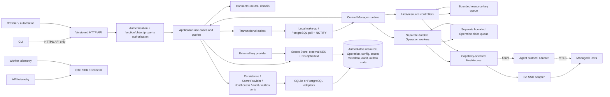
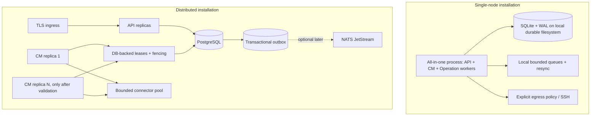
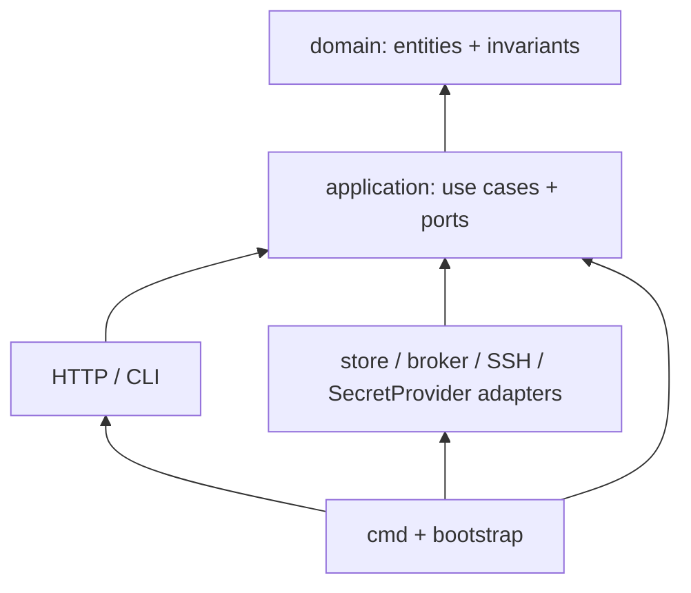

# Phase 12 — Architecture Validation and Final Blueprint

**Status:** Independent review complete; final blueprint owner approval pending
**Decision:** Conditionally coherent as an implementation guide after the cross-phase contracts and gates below are honored. This is not production approval and does not authorize implementation.

## 1. Independent review summary

The architecture is directionally sound: a modular Go monolith with separately executable API and Control Manager roles; connector-neutral Host resources; Operations separate from reconciliation; database-authoritative state; event hints into a level-triggered queue; explicit SQLite single-node and PostgreSQL distributed profiles; CLI-over-API; and security/observability boundaries.

It is not yet a complete executable design in every area. The repository does not implement most target capabilities, and there are cross-phase contract mismatches. Most material are: current NATS is a startup requirement despite the later deferral; current Runs execute inside API processes despite the target Control Manager ownership; current Host creation performs SSH before persistence despite the approved pending/async resource lifecycle; and API storage handlers still cross the desired application boundary in places. The blueprint below resolves the target behavior and makes implementation order conditional on durable contracts, not on the presence of diagrams or ADRs.

**Architecture recommendation:** accept this blueprint only as a staged target architecture, with the P0 contract gates and production security conditions below. Do not call the system production-ready or horizontally scalable until the acceptance checklist has evidence.

## 2. Final system architecture

Events are durable facts or coalescible wake-up hints. The DB owns current state. Controllers always read the latest row. Operation delivery/execution, resource reconciliation, and event delivery are distinct lifecycles. Neither an event acknowledgment nor an Operation submission means the external effect succeeded.

## 3. Final runtime topology

| Mode | Database | API | Control Manager | Supported boundary |
|---|---|---|---|---|
| Local/dev or first production node | SQLite | All-in-one preferred | One in-process manager | One host, one active composition, local durable filesystem, no HA claim |
| Standalone API + standalone CM | PostgreSQL | Independent API role | One CM first | Shared DB, outbox/poll/wake-up, separate process identities |
| Multiple API replicas | PostgreSQL | Stateless replicas behind TLS ingress | One CM initially | Shared auth/config, distributed rate limits, DB pool budget, idempotent request contract |
| Multiple CM replicas | PostgreSQL only | Independent | Leased/fenced workers | Not supported until lease, fencing, global admission, crash/takeover tests pass |
| Kubernetes/container | SQLite only for one all-in-one replica; PostgreSQL for multiple replicas | OCI image optional | OCI image optional | Kubernetes is optional; it does not replace Machinarchy's own queue or leases |

The CLI talks only to the API. A standalone API may persist accepted work while no CM is available, but it must expose queued/pending state and must not promise progress. The current implementation has a direct broker requirement and API-local Run execution; both are migration gaps, not target topology requirements.

## 4. Final component and package architecture

| Package/component | Final ownership | Validation disposition |
|---|---|---|
| `cmd/*` | Thin process entry points, flags, signal root context, exit code | Keep; avoid product logic |
| `internal/bootstrap` | Role-specific object graph, startup ordering, health wiring, shutdown coordinator | Keep; current shared `Runtime` is useful but should not force every process to own every adapter |
| `internal/config` | Immutable bootstrap inputs and validation | Keep for startup-only settings; runtime revisions belong in an application capability |
| `internal/domain` | Host, Operation, AccessProfile references, invariants, transitions, conditions, typed IDs/events | Keep initially; split only for cohesive ownership, not to create empty subpackages |
| `internal/application` (incremental rename from `internal/service`) | Use cases, authorization, transaction coordination, persistence/connector ports | Recommended target; move capability by capability, do not big-bang rename |
| `internal/controller/host` and `internal/controlmanager` | Host reconcile logic in controller package; manager owns registry, queue, resync, retry, leases, worker lifecycle | Add when reconciliation is implemented; no generic plugin framework |
| Operation worker package | Durable Operation claim, execution, cancellation, recovery, results | Separate worker pool/lifecycle from controller workers; target runtime owner is CM, not API |
| `internal/store`, `internal/store/sqlite`, `internal/store/postgres` | Migrations, SQL, transaction/claim implementations, readiness/stats | Keep shared logical contracts; no dialect leakage into application |
| Outbox/inbox/event adapter | Event persistence and delivery contracts in application; DB adapters own durable rows; optional NATS adapter owns transport ack | Keep outbox as source of delivery truth; avoid generic domain broker abstraction |
| Secret Store | Secret metadata/version use case and provider port; DB ciphertext adapter; external key provider adapter | Separate management, reference assignment, and plaintext resolution authorization |
| Host access | Application capability ports; SSH adapter uses Go SSH and network policy; future Agent adapter maps async tasks | Keep Host free of SSH/Agent protocol fields |
| `internal/transport/http` | HTTP transport, auth middleware, DTOs, health, safe errors | Keep handlers thin; remove multi-step store workflows from transport |
| `internal/cli` | API client, local context, presentation and exit codes | Keep; no DB, connector, authorization policy, or target expansion |
| `internal/telemetry` | OTel provider/export lifecycle and bounded recorder construction | Unify current Prometheus/OTel signals deliberately; audit is separate |
| `pkg/sshclient`, `pkg/netpolicy` | Current low-level adapters | Consider moving to `internal/hostaccess/ssh` when ownership is made private; no forced package move before use-case work |

### Dependency direction

Interpretation: arrows show compile-time import dependency. Domain imports no infrastructure or transport. Application defines the ports it consumes; adapters implement them. HTTP and CLI invoke application/API contracts but do not own business rules. Bootstrap is the composition root. No component imports SQL dialect, Echo, NATS, or `x/crypto/ssh` into domain.

### Duplicate responsibility review

- **`internal/domain` metrics versus observability metrics:** not the same domain. `SystemStats`/`DataPoint` are Host runtime diagnostics/history; OTel/Prometheus metrics are Machinarchy process behavior. Rename/document to prevent confusion, but do not merge data models.
- **Domain type-level leakage:** the current domain package contains SSH-shaped Host access fields/errors and an auth token response DTO. These do not import SSH or HTTP packages directly, but they couple domain contracts to transport/connector details. Move credential/profile and connector errors behind access-profile/application ports; keep token response DTOs in transport/application response models.
- **Prometheus and OpenTelemetry metrics:** current duplicate instrument/export paths. Target OTel API instrumentation with either OTLP or a deliberate Prometheus scrape bridge/exporter; one logical instrument set.
- **`internal/service` and application layer:** current service package is broad, and HTTP reaches stores directly in some paths. Consolidate workflows at the application boundary incrementally; do not add parallel duplicate use-case and service layers.
- **`internal/broker` and outbox:** broker is transport delivery, outbox is durable application event state. Keep distinct. NATS must not be both the source of truth and a duplicate local event store.
- **Host reachability and Operation execution:** do not maintain two independent SSH/auth stacks. Both use the same connector/security policy; Operation remains separately authorized and scheduled.

## 5. Final domain and persistence design

### Host and Operation

`Host` is a workspace-owned resource with opaque stable ID, mutable name/labels/environment, connector-neutral `AccessProfileRef`, desired spec, observed status/conditions, generation, storage revision, and optional deletion timestamp. Domain excludes SSH clients, network addresses as identity, credential bytes, and Agent wire protocol. `Generation` increments on desired spec changes; status writes do not change it. `ObservedGeneration` records the latest generation examined. `Revision`/ETag changes on every externally visible write and supports optimistic concurrency.

`Operation` is a separate durable resource with immutable typed intent, actor, fixed target IDs/profile revisions, status and per-target result. Run is its initial typed kind. It does not live in Host history. Submission returns accepted/persisted/queued state; worker start and terminal completion are later transitions. Command execution is not reconciliation and is never retried blindly after ambiguous dispatch.

### Ownership and relationships

Workspace owns Hosts, AccessProfiles, Operations, config revisions, secret metadata, audit. An AccessProfile can be reused only within its workspace, has its own revision and referenced versioned secrets. Operation target snapshots preserve IDs and the endpoint/profile version so later changes do not silently retarget work. A workspace is the current authorization boundary; environment and labels are not security boundaries. The current single shared workspace is not multi-tenant isolation.

### Persistence

One logical set of application persistence contracts, implemented by SQLite/PostgreSQL adapters. Database is authoritative for desired/observed resource state, Operations/results, global config revision/head, secret metadata/ciphertext/wrapped DEKs, audit, outbox, and durable worker leases where supported. Transactions include resource/config/Operation changes, audit rows, and outbox facts atomically. No SSH, Agent call, broker wait, or long worker work inside DB transactions.

- SQLite: one node/one active composition, local filesystem, WAL, short writes, no shared network-volume multi-node topology. In-memory queue recovered from DB scans.
- PostgreSQL: distributed deployment, conditional writes, row leases and `SKIP LOCKED` for queue-like claims, bounded transactions, HA/PITR selected operationally.
- Outbox: write facts with state; relay is at-least-once. Inbox/dedup rows are used for consumers with non-idempotent durable effects; resource notification consumers can coalesce by key and always reread current state.
- DB notifications are wake-ups only. Resync/polling repairs loss. Optional JetStream comes later under ADR criteria.

## 6. Final control loop and event architecture

Both outbox events and periodic/startup scans enqueue a `ResourceKey(kind, workspace, id)` into the same bounded coalescing queue. Workers claim/load latest DB state, compare desired/observed state, call idempotent capability operations, and conditionally persist status only if generation/fencing tokens are current. Duplicate/out-of-order notifications coalesce; payload generation is advisory. Retry uses capped exponential backoff with jitter, per-resource rate limits and bounded worker pools. Never spawn a goroutine per event. Long imperative work is handed to the separate durable Operation worker subsystem.

Initial profile: one CM, 5-minute jittered full resync, 4 Host reconcile workers; SSH capacity is a separate outer bound. Distributed profile: PostgreSQL per-key lease with expiry, renewal, monotonic fencing epoch, generation CAS, startup recovery; local queues remain disposable. Startup scans incomplete/deleting resources and queued Operations before readiness. Graceful stop stops claims, drains to a shared deadline, records uncertain remote results and closes DB/broker only after workers stop.

### Messaging contract

Commands request action; domain events record committed facts; integration events are versioned and transactional; wake-ups carry IDs/revisions, never secret values or full resource snapshots. Envelope has event ID/type/schema/occurredAt/producer/subject/revision/correlation/causation. Consumer delivery is at-least-once; idempotency key/inbox is scoped by consumer. Poison messages are quarantined/bounded, and handlers cannot execute based solely on payload. Ordering is only guaranteed per resource through revision/generation CAS, not globally.

## 7. Final configuration and Secret Store architecture

Bootstrap config (flags/env/file) supplies startup-only DB, listener, telemetry exporter, auth signing key source, external encryption key provider and process role before initialization. No environment mutation. Runtime configuration is global, strongly typed, immutable versioned revisions in the same DB, with validation, optimistic concurrency, history and rollback as a new revision. Outbox notification plus periodic version poll drives each process to load, validate, prepare participants, atomically publish a complete process-local snapshot, and report applied revision. Failed preparation preserves last-known-good snapshot; stored revision and per-process applied revision remain distinct. Restart-required settings cannot be falsely reported as hot applied.

Secrets remain separate from configuration and live in the same selected DB encrypted by per-version DEKs under external KEKs. Use AEAD with AAD binding secret identity/version/purpose; rotate KEKs by rewrapping DEKs and rotate credential values into immutable versions. API/CLI manage metadata and write-only values. Only authorized runtime identity resolves a pinned secret version for a bound Host/profile/Operation purpose; plaintext stays in short-lived adapter memory and never enters domain serialization, events, API responses, logs, metrics, traces, or audit. Loss of the KEK is a hard inability to decrypt; fail closed and restore key material or rotate affected credentials.

Configuration processes retain last-known-good snapshots for non-security runtime settings. For a persisted revision that tightens egress, revokes a credential/trust pin, disables execution, or otherwise reduces authority, a Control Manager with an older applied policy version must stop the affected capability until it applies the new version. The persisted security-policy revision is checked before new protected work; a stale snapshot cannot continue using a policy that has been revoked globally.

## 8. Final Host access and API/CLI architecture

The HostAccess application port exposes small capabilities (reachability, observe, execute); connector adapters own protocol. Go SSH requires explicit SHA-256 host-key pin, no TOFU, purpose-bound secret lookup, DNS answer validation and dial-to-validated-IP, egress allowlist with deny-by-default production policy, port restrictions, timeouts/cancellation, bounded output, concurrency, and typed sanitized errors. No external SSH binary or arbitrary shell string. Agent later uses separate outbound mTLS identity and async tasks without changing Host identity.

HTTP owns versioned routes, auth transport, DTO validation/mapping, pagination, idempotency/preconditions, safe RFC 9457 errors and status codes. Application owns authorization/business transactions. CLI invokes only API; output modes and exit codes do not duplicate business logic. API and CM remain separate runtime responsibilities.

### Host registration decision

The target API persists a locally valid Host first as `Pending`/`Reachable=Unknown`, commits audit and outbox, and returns the persisted resource. It does not synchronously probe SSH in the request path. Reconciliation tests the connector asynchronously and reports conditions. If a caller explicitly needs an immediate test, expose a bounded, separately authorized reachability Operation/preview that does not define whether Host identity exists. This resolves Phase 2's approved async lifecycle against current `HostService.Create` synchronous SSH verification. It is an API semantic change that must be visible to callers.

### Deletion decision

For SSH-only inventory there is no owned remote installation to remove: deletion immediately prevents new work and removes the Host resource after its DB transaction; audit and Operation target snapshots remain. Queued Operations targeting it are canceled/rejected; in-flight Operations receive cancellation best effort and persist uncertainty. If a future connector owns remote registration/credential cleanup, use an explicit bounded finalizer/tombstone for that cleanup only. An unreachable SSH Host does not block inventory deletion.

## 9. Final security and observability architecture

Authentication proves principal; authorization independently checks function/object/property/workload scope; secret resolution requires its own grant; audit independently records required actions. Separate human and workload identities. Production security gates include TLS, CSRF/Origin checks for cookie writes, separate execute/output permissions, owner step-up/MFA, login identity/source throttling, deny-by-default SSH egress plus network firewall, secret encryption with external KEK, distinct API/CM DB/broker identities, private management endpoints, and external audit anchoring.

Use OTel APIs/semantic conventions, optional bounded OTLP to collector, structured `slog` JSON with request/trace correlation, and low-cardinality metrics. Never label with host/user/secret/operation IDs or expose host names, addresses, argv, output, or secrets. Liveness is process-only; readiness is capability-specific. A down Host must not make the API unready. Shutdown is coordinated under one overall deadline. Backup and external keyring recovery are tested together; proposed SLO/RPO/RTO numbers are targets pending measurement.

## 10. End-to-end scenario validation

### 1. Register a new Host

API authenticates/authorizes `inventory:write`, validates request and profile/workspace, assigns stable ID and generation 1, writes Host + audit + `host.created` outbox event in one transaction, and returns persisted `Pending` with unknown reachability. Event relay/local wake enqueues the Host key. If relay or CM is unavailable, resource remains durable and startup/periodic scan finds it. No SSH probe blocks create. **Recovery:** retry with idempotency key after ambiguous HTTP response; GET by idempotency/known ID returns committed resource.

### 2. Verify SSH connectivity

Host controller reloads latest Host/profile, checks production destination/port policy, obtains pinned trust material and purpose-authorized credential, dials the validated IP, verifies host key before authenticating, and performs a bounded reachability check. It conditionally updates `Reachable`/`Ready` for the current generation, then closes connection and zeroes owned buffers best-effort. **Failure:** classified condition with retry/backoff; pin mismatch sends no credential; API/CM process health remains ready unless connector capability broadly unavailable. An explicit user test is a bounded Operation with its own status.

### 3. Change Host configuration

API checks object/property permission and expected `If-Match`; application validates profile references and policy, increments generation/revision, and atomically writes resource, audit, outbox. Event + resync go to same key queue. Worker reloads current generation and applies only intended idempotent changes. **Failure:** conditional status update rejects stale generation; queue retries latest state. Concurrent update returns `412`/conflict rather than overwriting.

### 4. Duplicate and out-of-order events

Outbox relay may publish event IDs more than once or in revision order different from commit order. Consumer validates schema and enqueues only stable key; queue coalesces duplicate keys. Controller reads DB latest revision/generation, not payload snapshot. **Recovery:** inbox/dedup protects durable side effects where necessary; resource-key reconciliation can supersede old notifications. No exactly-once assumption.

### 5. Miss an event notification

Outbox row remains pending if not delivered; after broker acknowledgment or local queue admission, process loss can still discard in-memory key. Startup recovery and five-minute jittered resync enumerate incomplete resources and queued Operations, enqueue keys, and relay pending outbox rows. **Recovery:** convergence may be delayed by resync interval; DB state is intact. Alert on outbox age and oldest queue age.

### 6. Restart Control Manager during reconciliation

Shutdown sets readiness false and stops claims; reconciliation finishes within budget or is canceled. DB transaction is short and remote I/O occurs outside it. A single-manager SQLite process restarts and resyncs; PostgreSQL worker lease expires, fencing token advances, and a new manager reloads latest state. **Recovery:** idempotent reconcile repeats; stale worker cannot persist status. Remote side effect already dispatched but unconfirmed is treated as uncertain and must be safe to repeat or surfaced for recovery.

### 7. Execute a long-running remote Operation

API authorizes separate execute capability, validates typed argv/program policy and fixed target/profile revisions, persists Operation + audit + outbox, returns `202`/queued. CM Operation worker claims it separately from reconciliation, revalidates auth/policy/target, resolves only scoped secret version, acquires global/local SSH budget, verifies pinned key and runs with deadline/output cap. It persists per-target progress and terminal result. **Failure:** process crash marks stale work interrupted/unknown; never auto-retry after possible dispatch. Operation event delivery is not success.

### 8. Cancel an Operation

API authorizes and commits `CancelRequested` with audit/outbox. Worker observes cancellation, stops scheduling targets, cancels active context and closes SSH session; records per-target canceled or interrupted/unknown based on dispatch state, then terminal aggregate. **Failure:** if worker is down, durable cancel request is honored on recovery; a remote command may continue after client-side connection close, so response reports uncertainty rather than claiming rollback.

### 9. Delete an unreachable Host

Application authorizes delete, atomically rejects future targeting, cancels queued work and records audit/deletion fact. SSH-only Host is removed without contacting it; existing Operation snapshots/audit remain. Active remote work receives best-effort cancellation and records uncertain outcome. **Recovery:** no finalizer waits for an offline SSH endpoint; a future Agent-owned remote registration can add an explicit cleanup finalizer with timeout and manual recovery.

### 10. Update runtime configuration without restart

Owner validates a typed patch against current global revision, security-sensitive changes require step-up/review, and config revision + audit + outbox commit transactionally. Each API/CM process sees event or version poll, loads the full revision, validates, prepares all change participants, atomically swaps snapshot, and persists applied revision. **Recovery:** old snapshot remains active until full prepare succeeds; status reports lag. Restart-required values reject runtime update.

### 11. Fail to apply a configuration revision

Revision remains persisted as desired global config; failing process reports applied version unchanged and bounded failure class. Other processes may apply successfully. API status shows persisted revision and per-process applied status. **Recovery:** fix input/environment/provider or roll back by creating a new validated revision; never mutate history or decrement revision. Do not send the process traffic/work requiring unapplied security policy.

### 12. Rotate an SSH credential

Authorized user writes a new secret version (write-only API), Secret Store encrypts with fresh DEK, then AccessProfile reference/revision moves to new version in an audited transaction and outbox. New reconciliations and newly submitted Operations use the new ref; Operations already pinned to an older profile/secret version either retain explicit authorization to use that version until expiry or are canceled/rejected when rotation revokes it. Rotation must choose and audit one of those policies; it must not silently retarget queued Operations. Existing unpooled SSH sessions complete/cancel under current policy. **Recovery:** failed decrypt fails closed; retain old version through references and backup horizon; re-point via a new audited revision if rollout fails; retire old DEK/version only when safe.

### 13. Lose access to the encryption key

SecretProvider cannot unwrap DEK; secret-dependent connector actions fail closed and emit a safe error class plus audit metadata without ciphertext/plaintext. API metadata and non-secret work may continue if capability boundaries permit. **Recovery:** restore compatible external keyring from protected recovery path and verify canary decrypt; if irrecoverable, values cannot be recovered—rotate credentials on Hosts through a controlled repair. Never fall back to JWT signing key or empty credentials.

### 14. Lose database connectivity

API readiness for durable writes turns false/503; liveness stays true. CM stops claims and retries with bounded backoff; local queue is not truth. Active external work is canceled or marked uncertain if results cannot persist. **Recovery:** DB returns, workers reopen/reload, startup scan requeues incomplete resources/Operations/outbox. No success response before commit; idempotency keys handle client retry after ambiguous connection break.

### 15. Run multiple Control Manager replicas

Only after PostgreSQL durable per-key lease/fencing/global admission exists. Each replica receives local wake-ups/polls/optional broker hints, claims a row in a short transaction with owner/epoch/expiry, and runs bounded local workers. Both may receive duplicate notifications, but only valid lease epoch can commit. **Recovery:** crashed lease expires; takeover re-reads latest DB state; stale worker's CAS is rejected. Remote side effects remain at-least-once/uncertain, not exactly once. With SQLite, this mode is unsupported.

### 16. Register and disconnect a future Agent

Owner creates one-time short-lived enrollment bound to Host/workspace; Agent proves token over TLS, gets unique short-lived mTLS credential, records capability/version, and then opens outbound authenticated stream. Heartbeat renews server-side lease; task assignments/results persist in DB with epoch/idempotency. After missed-heartbeat lease expires, Host condition becomes disconnected and Agent claims stop; Host is not deleted. Reconnect reauthenticates, reloads durable assignments, dedupes results, rotates certificate as needed. **Failure:** revoked identity denied; stale epoch ignored; task outcome not inferred from heartbeat or transport close.

## 11. Conflicts and cross-phase resolutions

| Conflict / drift | Resolution in this blueprint | Gate |
|---|---|---|
| ADR 007/Phase 1 timing appears to make NATS part of initial/distributed path; ADR 018/Phases 4 and 11 defer it | Amend ADR 007: DB/outbox + local queue/poll is initial; PG NOTIFY is wake-up; NATS optional only at measured/Agent fan-out trigger | Fix ADR wording before implementation of bootstrap/event adapters |
| Target CM owns durable Operation workers; current API constructs and runs `RunManager` | API persists and reports Operation; CM owns separate Operation pool; migration is staged, not an assumption about current code | Implement durable claims and crash recovery before scaling APIs or CM; preserve single-node semantics during cutover |
| Target Host registration persists Pending; current HostService tests SSH synchronously before persistence | Persist valid resource first; async reconcile reports condition; explicit reachability Operation if immediate probe is needed | API response contract and CLI pending UX must be accepted before changing Host create |
| Target application boundary; some HTTP routes receive stores and own workflows | Move workflows to use cases incrementally; handlers map DTOs only | Enforce on each feature slice; no big-bang package rewrite |
| OTel metrics and Prometheus registry overlap | One logical instrument set; OTel API and deliberate OTLP/Prom scrape export | Select exporter topology and remove duplicate instruments when instrumenting |
| Phase 3 describes shared durable NATS consumer for multi-CM while later design allows DB polling/no NATS | Lease/queue DB claim provides coordination; PG poll/NOTIFY initial; broker distribution is optional | Update Phase 3 scenario wording and ADR index (done in this update) |
| Current `internal/domain` metrics types resemble platform metrics | Name them Host runtime diagnostics; OTel metrics exclusively process/runtime observability | Keep separate models; clarify docs/API names |

### Unnecessary abstractions to reject

- A universal connector `Session` interface that forces Agent asynchronous tasks into SSH session semantics.
- Generic event bus as domain dependency; use narrow outbox/wake-up/consumer ports.
- Arbitrary Operation payload `map[string]any`; use typed Operation kinds.
- Distributed leader election for every controller when per-key leases and idempotency suffice; reserve singleton leases for truly singleton jobs.
- Microservices, Kafka, mandatory JetStream, Kubernetes CRDs/runtime APIs, SSH connection pooling, multi-region active-active, or per-tenant config scope without requirements and evidence.

## 12. Review classification and unresolved decision register

| Classification | Concern / decision | Review outcome |
|---|---|---|
| **Approved** | Modular Go monolith; API/CM independently executable; CLI via API; SQLite local / PostgreSQL distributed; DB state source of truth; Host/Operation split; level-triggered/edge-driven reconciliation | Coherent and mutually reinforcing |
| **Approved** | Global runtime config and encrypted DB-backed secrets in the same DB; external encryption root; event plus version polling; per-process atomic snapshots | Preserve user-confirmed constraints; enforce separate secret auth and key recovery |
| **Approved** | Security distinction for authn/authz/audit/secrets; deny-by-default production egress; pinned SSH host keys; bounded command/worker execution; private telemetry endpoints | Necessary for privileged software; implementation proof remains required |
| **Approved with conditions** | NATS deferral, outbox/inbox, PG leases/fencing, CM Operation ownership, OTel signals, 5-minute resync/four-worker baseline | Implement required durable contracts and validate load/recovery before claiming reliability/HA |
| **Approved with conditions** | Async Host registration and immediate SSH-only deletion absent owned cleanup | Publish explicit API/CLI semantics; tests must prove no network side effect is required for inventory persistence/deletion |
| **Approved with conditions** | One installation/shared workspace authorization boundary | Suitable only for one trusted operator group. Do not market as multi-tenant isolation; obtain product decision before customer/team separation |
| **Deferred** | Agent runtime/protocol, JetStream, Kafka, Kubernetes, microservices, connection pooling, multi-region | No current implementation need; adoption gates are specified |
| **Rejected** | Exactly-once event/SSH execution, event payload as source of truth, arbitrary shell, SSH trust-on-first-use, SQLite shared network file, CLI direct DB access, unbounded event goroutines | These assumptions undermine correctness/security and are not part of target design |
| **Requires additional investigation** | SLO/RPO/RTO targets; actual 1k/10k DB/worker capacity; heartbeat interval and lease time; event/config/outbox retention; Operation output retention; audit archive; access-profile sharing impact | Proposed values are hypotheses; require product requirements, threat review, load tests and restore tests |
| **Requires additional investigation** | Whether credential rotation revokes old secret versions immediately or permits already accepted Operations to use pinned versions until expiry | Recommend immediate revocation for suspected compromise; for planned rotation, require explicit bounded overlap with per-Operation policy and audit |
| **Requires additional investigation** | Host create API response/pending UX and whether an immediate connection-check Operation is needed | Architecture recommends persist-first; product/API compatibility needs confirmation before changing existing behavior |
| **Requires additional investigation** | High-risk config two-person approval and owner MFA rollout mechanics | Keep security objective; decide deployment/admin workflow before production enablement |

## 13. Prioritized implementation roadmap

This is an order of work, not implementation authorization.

### P0 — Resolve contracts and safety prerequisites

1. Adopt this blueprint and record the unresolved product decisions above.
2. Amend ADR 007/Phase 1/Phase 3 NATS language to the Phase 4/11 policy.
3. Freeze Host create/delete/API semantics, Operation ownership and migration path, planned-versus-emergency secret rotation semantics, and application ports/transaction boundaries.
4. Production security before remote execution: deny egress default plus firewall, authz split, CSRF, signing/encryption key separation and rotation plan, workload identity, private health/metrics, audit behavior, secret/output protection.
5. Define deployment mode switches so SQLite cannot accidentally run multiple independent managers and NATS is not an invisible all-in-one requirement.

### P1 — Durable domain and persistence

Implement Host desired/observed generation and condition transitions, AccessProfile/SecretRef, typed Operation lifecycle, concurrency preconditions, SQLite/PostgreSQL contract parity, migrations and short transaction boundaries. Add outbox atomically with state/audit and recovery scans. Preserve audit evidence and idempotency.

### P2 — Application/API boundaries

Move business workflows out of HTTP handlers into application use cases, enforce object/property authorization, implement persist-first Host create, deletion semantics, typed API status/ETag/idempotency behavior, and keep CLI API-only.

### P3 — Reconciliation and durable workers

Implement resource-key queue, startup/resync path, bounded retry/metrics, one CM first. Then durable Operation claims and separate Operation workers. Do not add replicas before lease/fencing and failure tests. Ensure current API executor is shut off only after a verified cutover.

### P4 — Configuration and Secret Store

Implement immutable global config revisions, participant prepare/atomic snapshot/apply reporting, envelope encryption, external KEK provider, secret authorization/write-only APIs, audited credential rotation, backup/restore with keyring. Fail closed on key loss.

### P5 — Observability, recovery and release operations

Instrument OTel and bounded metric catalog; private management endpoints; health/readiness; coordinated shutdown; outbox/config/worker/secret metrics; backup and external key procedures; SLO dashboards/runbooks. Measure baseline before setting definitive SLOs.

### P6 — Distributed deployment and future growth

Migrate one tested SQLite installation to PostgreSQL; deploy one API and one CM separately; add API replicas; add CM replicas only after PostgreSQL lease/fencing and fleet-wide admission tests. Add Agent, JetStream, or Kubernetes only at the documented evidence gates.

## 14. Architecture acceptance checklist

This checklist is **not satisfied by the design document alone**. Mark complete only with implementation and test evidence.

- [ ] Domain packages import no transport, SQL, broker, SSH, or key-provider packages.
- [ ] Host registration persists desired state without requiring SSH availability; reachability is asynchronous and generation-aware.
- [ ] Host deletion immediately blocks new work and does not wait on an unreachable SSH endpoint absent owned cleanup.
- [ ] Operation is separate, durable, typed, idempotency-keyed, and its worker is separate from reconciliation.
- [ ] Queue stores resource keys, coalesces duplicates, reloads latest DB state, recovers from startup/resync, and has bounded workers/retries.
- [ ] Outbox is committed with resource/config/Operation/audit state; consumers tolerate duplicates/order/missed wake-ups; no exactly-once claim.
- [ ] SQLite is restricted to one node/manager; PostgreSQL multi-worker claims use leases, expiry, fencing, generation CAS and crash tests.
- [ ] Runtime config is immutable/versioned; failed reload preserves last-good; applied version reported per process; no secret values in revisions/events.
- [ ] Secret values use envelope AEAD under external KEKs; access is purpose-bound; rotate/restore/key loss tests pass; no plaintext in any API/telemetry path.
- [ ] SSH has pinned host keys, DNS/IP/port allowlists, independent egress enforcement, bounded output/time/connection use, safe cancellation, and no shell-string API.
- [ ] API and application enforce function/object/property authorization; CSRF and rate limits work across replicas; secret and Operation output grants are separate.
- [ ] Audit captures security-sensitive success/denial facts and has external tamper-evident anchor; failures have defined fail behavior.
- [ ] OTel/Prometheus use bounded labels; readiness/liveness are distinct; telemetry exporter failure does not block work; management endpoints are private.
- [ ] Shutdown drains under one deadline; restart recovers queues/Operations safely; remote ambiguity is preserved.
- [ ] Backup restoration includes database plus external keyring, validates audit/config/secret/outbox, and has measured RPO/RTO evidence.
- [ ] API/CM rolling upgrades preserve schema, event, config and Agent protocol compatibility.
- [ ] 100/1k/10k load and failure scenarios have actual test results before capacity claims or scale-out.

## 15. Complete ADR index

ADRs 005–052 are existing phase decisions; ADR-053 records this integrated review. Earlier accepted decisions remain working assumptions, while this blueprint's new resolutions and conditions await owner acceptance.

| ADR | Decision |
|---|---|
| [005](decisions/ADR-005-modular-runtime-boundaries.md) | Modular monolith with independently executable roles |
| [006](decisions/ADR-006-control-manager-and-operation-ownership.md) | Reconciliation separate from durable Operations |
| [007](decisions/ADR-007-persistence-and-event-notification.md) | Database state authoritative; amended event/broker timing |
| [008](decisions/ADR-008-bootstrap-runtime-configuration-and-secrets.md) | Bootstrap config separate from runtime config/secrets |
| [009](decisions/ADR-009-host-resource-identity-and-state.md) | Connector-neutral Host resource |
| [010](decisions/ADR-010-host-lifecycle-conditions-and-deletion.md) | Host lifecycle separate from observed health |
| [011](decisions/ADR-011-operation-as-separate-resource.md) | Operation separate from Host |
| [012](decisions/ADR-012-domain-events-and-resource-concurrency.md) | Generation-aware concurrency and fact events |
| [013](decisions/ADR-013-hybrid-control-loop.md) | Level-triggered, edge-driven reconciliation |
| [014](decisions/ADR-014-bounded-resource-workqueue.md) | Bounded resource-key workqueue |
| [015](decisions/ADR-015-controller-replica-coordination.md) | SQLite one manager; PostgreSQL leases for replicas |
| [016](decisions/ADR-016-versioned-event-envelope.md) | Versioned events with identity/correlation |
| [017](decisions/ADR-017-transactional-outbox-and-consumers.md) | Transactional outbox, at-least-once consumers |
| [018](decisions/ADR-018-defer-broker-adoption.md) | Defer NATS until justified |
| [019](decisions/ADR-019-shared-persistence-contracts.md) | Shared persistence contracts, engine adapters |
| [020](decisions/ADR-020-schema-and-migration-evolution.md) | Schema parity and forward migrations |
| [021](decisions/ADR-021-transaction-and-concurrency-semantics.md) | Atomic state changes and optimistic concurrency |
| [022](decisions/ADR-022-retention-and-backup-boundaries.md) | Separate operational retention, audit and backup |
| [023](decisions/ADR-023-bootstrap-configuration-precedence.md) | Immutable bootstrap inputs |
| [024](decisions/ADR-024-global-immutable-runtime-revisions.md) | Global immutable runtime config revisions |
| [025](decisions/ADR-025-configuration-snapshot-propagation.md) | Hints plus atomic process snapshots |
| [026](decisions/ADR-026-envelope-encrypted-database-secret-store.md) | Envelope-encrypted DB Secret Store with external KEKs |
| [027](decisions/ADR-027-secret-management-and-nondisclosure.md) | Secret management separate; no read-back |
| [028](decisions/ADR-028-capability-oriented-host-connectors.md) | Capability-oriented connectors |
| [029](decisions/ADR-029-ssh-trust-and-network-policy.md) | Pinned SSH trust and dial-time network policy |
| [030](decisions/ADR-030-bounded-operation-execution.md) | Structured, bounded, non-retrying Operations |
| [031](decisions/ADR-031-agent-as-capability-adapter.md) | Agent as future capability adapter |
| [032](decisions/ADR-032-versioned-api-and-application-boundary.md) | Versioned API over application use cases |
| [033](decisions/ADR-033-durable-asynchronous-operations.md) | Durable asynchronous Operations |
| [034](decisions/ADR-034-uniform-pagination-and-problem-errors.md) | Pagination, concurrency and problem errors |
| [035](decisions/ADR-035-cli-as-api-client.md) | CLI is an API client |
| [036](decisions/ADR-036-separate-security-controls.md) | Authn/authz/audit/secrets are independent controls |
| [037](decisions/ADR-037-production-egress-deny-by-default.md) | Deny production egress by default |
| [038](decisions/ADR-038-purpose-bound-secret-resolution.md) | Purpose-bound secret resolution |
| [039](decisions/ADR-039-workload-and-agent-identity.md) | Distinct workload/Agent identities |
| [040](decisions/ADR-040-externally-anchored-security-audit.md) | External audit anchor |
| [041](decisions/ADR-041-sensitive-configuration-and-operation-guardrails.md) | Guard sensitive config and execution |
| [042](decisions/ADR-042-opentelemetry-instrumentation.md) | OpenTelemetry application instrumentation |
| [043](decisions/ADR-043-health-and-capability-degradation.md) | Health separate from capability degradation |
| [044](decisions/ADR-044-bounded-secret-safe-telemetry.md) | Bounded, secret-safe telemetry |
| [045](decisions/ADR-045-coordinated-shutdown-and-draining.md) | Coordinated bounded worker drain |
| [046](decisions/ADR-046-tested-database-and-key-recovery.md) | Test DB and external key recovery together |
| [047](decisions/ADR-047-sqlite-single-node-postgres-distributed.md) | SQLite single-node; PostgreSQL distributed |
| [048](decisions/ADR-048-database-backed-worker-leases.md) | Durable leases/fencing before CM replicas |
| [049](decisions/ADR-049-scale-and-broker-adoption-on-evidence.md) | Evidence-based scaling/broker adoption |
| [050](decisions/ADR-050-agent-outbound-identity-and-leases.md) | Outbound Agent identity and leases |
| [051](decisions/ADR-051-kubernetes-optional.md) | Kubernetes optional |
| [052](decisions/ADR-052-expand-contract-upgrades.md) | Expand-contract upgrades |
| [053](decisions/ADR-053-integrated-architecture-review.md) | Cross-phase conflict resolution and implementation gates |

## 16. Approval boundary

This review challenges and resolves design conflicts but does not silently approve the final blueprint. Owner acceptance is needed for the Phase 12 integrated architecture, especially persist-first Host registration semantics, the API-to-Control-Manager Operation worker cutover, and the amended NATS policy. No source code, database schema, deployment manifest, or runtime behavior is changed here.
