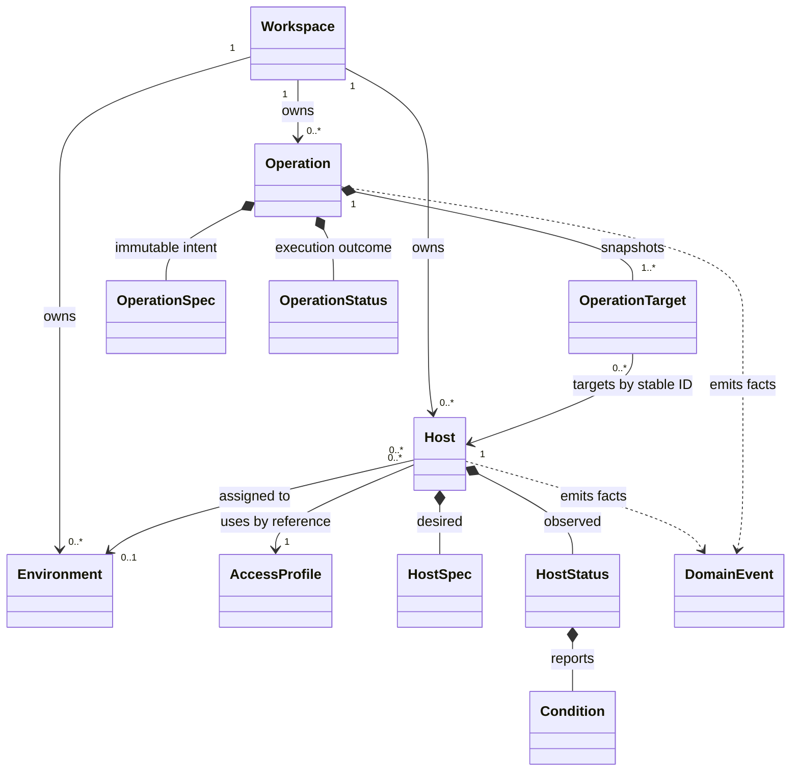
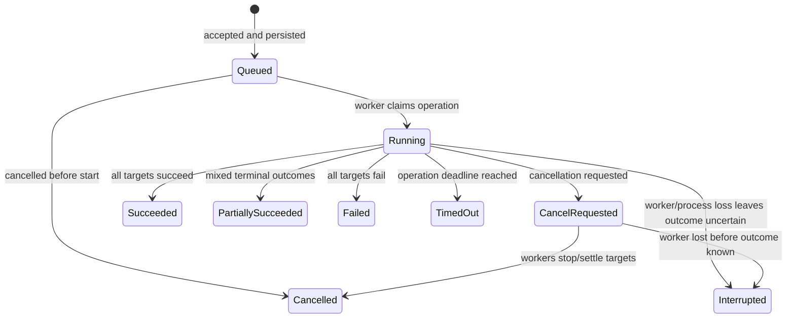

# Phase 2 — Domain Model and Resource Lifecycle

**Status: Approved to proceed to Phase 3 on the recommended baseline.** The working model uses opaque Machinarchy Host IDs, asynchronous initial observation, immediate deletion when no cleanup is required, typed Operations with Run as the initial kind, and workspace-scoped reusable AccessProfiles. These are domain concepts and Go-oriented sketches, not repository code or a database/API schema.

## Objective and design rules

Model a Host as a durable managed resource with identity, desired configuration, and observed facts. Model each imperative request as a separate Operation with its own immutable intent, lifecycle, targets, and outcome. Controllers reconcile resources; operation workers execute individual requests. Neither an event nor an operation result becomes the Host's source of truth.

Key boundaries:

- Host records what Machinarchy manages and wants, not how a particular adapter implements SSH.
- A connector is selected through a stable profile reference. Connector-specific settings, credential material, and wire details belong to the connector/access subsystem.
- Host desired state and observed state are distinct. Reachability is a condition, not the Host lifecycle.
- Operation history never accumulates on Host. Operations refer to target Host IDs and retain the target snapshot needed to explain what was attempted.
- Domain methods enforce local invariants. Cross-resource authorization, uniqueness, reference validation, transaction boundaries, and scheduling belong to application services and persistence contracts.

## Domain model diagram



`Workspace` and `Environment` are ownership and grouping concepts. `AccessProfile` is an abstract reference to connection configuration; this proposal does not define SSH fields or the profile's storage. Operation targets are immutable snapshots, not mutable child entities on Host.

## Host identity and value objects

Host identity is an opaque, stable `ResourceID` assigned by Machinarchy. Name, DNS name, network address, connector identity, labels, and environment are attributes or references; they are not the primary identity. A name is unique within its workspace by policy and may be changed without changing Host ID. Address reuse must not make a new machine the old Host.

The owner is the workspace/tenant boundary, not the creating user. `CreatedBy` is audit attribution. A Host may reference at most one Environment in the same workspace; environment deletion must reject or explicitly reassign dependent Hosts rather than silently cascading. A Host references one AccessProfile; profile ownership and sharing rules need a product decision. Host names are unique within a workspace by policy; cross-Host uniqueness is coordinated by application and persistence, not a single Host value object.

```go
type ResourceID string
type WorkspaceID string

type Host struct {
    Metadata ResourceMetadata
    Spec     HostSpec
    Status   HostStatus
}

type ResourceMetadata struct {
    ID        ResourceID
    Workspace WorkspaceID
    Name      string
    Labels    map[string]string
    EnvironmentID *ResourceID
    Generation uint64
    Revision   uint64
    DeletionTimestamp *time.Time
    CreatedAt time.Time
    UpdatedAt time.Time
}

type HostSpec struct {
    Access         ConnectorBinding
    Presence       DesiredPresence
}

type ConnectorBinding struct {
    ProfileID ResourceID
}

type ConnectorKind string

type AccessProfile struct {
    ID             ResourceID
    Workspace      WorkspaceID
    Kind           ConnectorKind // e.g. "ssh" or "agent"; no wire details here
    Revision       uint64
    CredentialRef  SecretRef
    TrustPolicyRef string
}

type SecretRef string

type DesiredPresence string

const (
    PresenceManaged DesiredPresence = "Managed"
    PresenceAbsent  DesiredPresence = "Absent"
)
```

`ConnectorBinding` intentionally contains no SSH username, port, key, command, or fingerprint fields. An access profile resolves through an application port to a connector-specific configuration. This keeps Host meaningful if the connector later changes to an Agent. The current implementation's `Host.SSH` and `ConnectionMethod` fields are adapter-shaped and should not be copied as the target Host aggregate.

## Desired and observed state

Desired state is administrator intent, changed through validated commands. For the first Host resource, `Presence=Managed` means Machinarchy should retain and reconcile the Host; `Presence=Absent` requests removal. Connector profile binding is part of `HostSpec`. Environment, labels, and display name are metadata used for organization and target selection, not host-side reconciliation, unless an approved product rule later makes them desired configuration.

Observed state records what the control plane last established: the generation it processed, lifecycle phase, conditions, and time of observation. It does not copy an SSH session, secret, or operation result into Host.

```go
type HostPhase string

const (
    HostPending  HostPhase = "Pending"  // created; initial reconciliation not yet recorded
    HostActive   HostPhase = "Active"   // currently managed; may be unhealthy/degraded
    HostDeleting HostPhase = "Deleting" // deletion requested; cleanup may remain
)

type HostStatus struct {
    ObservedGeneration uint64
    Phase              HostPhase
    Conditions         []Condition
    LastObservedAt     *time.Time
}
```

`Active` means the resource is under management, not that the remote host is reachable. A failed connection keeps the Host managed and sets `Ready=False` (and `Reachable=False`); it does not move the Host to an unrelated lifecycle state. A Host with `Presence=Absent` is excluded from newly resolved Operation targets as soon as deletion is accepted.

## Generation, resource revision, and concurrency

Use two distinct concepts:

- **Generation** increments only when desired `HostSpec` changes. It identifies a desired configuration version.
- **Revision** is a monotonic resource freshness token advanced for every accepted persisted mutation, including metadata and observed status. It supports consistent reads, audit ordering, and stale response detection; it is not itself the universal compare-and-swap token.

Application write commands carry an expected Generation for spec changes. A mismatch returns a conflict with the current generation. Metadata patches must be atomic; if full-object metadata replacement is offered, it carries an expected metadata revision/token to prevent lost updates. Controller status writes include the generation they observed and are rejected if the Host's current generation has advanced. Thus an older reconciliation cannot overwrite status for newer intent. The storage mechanism implementing these guards is intentionally unspecified here.

`ObservedGeneration` means the controller has examined and recorded an outcome for that generation, whether reconciliation succeeded or failed. Success is expressed by Conditions. A stale worker must not mark a newer generation observed. Status updates do not increment Generation. Avoid introducing `ObservedGeneration` if a future resource has no asynchronous observer/controller; for Host it is useful because access checks and desired configuration can converge asynchronously.

The domain may expose `Revision uint64` for ordering, but clients should use typed preconditions (`ExpectedGeneration`, metadata token) rather than depend on a database sequence or assume every status update is a user-write conflict.

## Condition model

Conditions are a bounded set keyed by unique type. They express facts that can change independently, with a small stable reason and sanitized diagnostic message. A condition message must not contain credentials, command output, private key material, or unbounded remote text.

```go
type ConditionStatus string

const (
    ConditionTrue    ConditionStatus = "True"
    ConditionFalse   ConditionStatus = "False"
    ConditionUnknown ConditionStatus = "Unknown"
)

type Condition struct {
    Type               string
    Status             ConditionStatus
    Reason             string
    Message            string
    ObservedGeneration uint64
    LastTransitionTime time.Time
}
```

Initial Host condition types:

- `Ready`: summary of whether Machinarchy can currently perform the resource's declared management role.
- `Reachable`: last connector check succeeded, failed, or has not been attempted.
- `Configured`: the current desired generation is accepted and its connector profile reference resolves.
- `Deleting`: cleanup is in progress or blocked, only when asynchronous deletion is needed.

Do not add `Healthy`, `Online`, `Connected`, and `Available` as overlapping booleans. A type's definition and reasons must specify what evidence makes it True/False/Unknown. Updating a condition's message without changing its status/reason should not reset `LastTransitionTime`.

## Host lifecycle state machine

```mermaid
stateDiagram-v2
    [*] --> Pending: Create accepted
    Pending --> Active: initial generation examined
    Active --> Active: spec/metadata update; new generation if spec changed
    Pending --> Deleting: Delete accepted
    Active --> Deleting: Delete accepted
    Deleting --> Deleting: required cleanup/finalizer remains
    Deleting --> [*]: cleanup complete; resource removed
```



Reachability and configuration failures are condition changes while `Pending` or `Active`; they do not imply lifecycle transitions. Registration validates shape and authorization in the application layer. Recommended target behavior persists a valid Host first, then lets a controller observe the connector and report conditions. This changes today's synchronous SSH verification-before-persistence behavior and needs owner approval.

### Deletion and finalizers

For SSH-only Hosts, Machinarchy does not own a remote installation to uninstall. Recommended default: deletion is a logical inventory removal with audit, prevents new Operations from targeting the Host immediately, and preserves independent Operation records and snapshots. Do not create a generic finalizer framework before a real cleanup obligation exists.

If a future Agent connector creates a remote registration or credential that must be revoked, deletion may enter `Deleting` and remain until that named cleanup completes. Finalizers must be bounded, observable, retryable, idempotent, and removable only by the responsible subsystem or an explicit privileged recovery action. The deleted Host is eventually removed; a deletion event/audit record is retained separately. Deleting a Host does not erase completed Operation history.

## Operation as a separate domain resource

An Operation is an immutable request to perform one imperative task against a fixed target set. The initial concrete kind is the existing command Run. Future diagnostics, inventory collection, or credential validation may use the same lifecycle where semantics fit, but they should have typed request/result data rather than a universal `map[string]any` payload.

```go
type OperationKind string
type OperationState string

const (
    OperationQueued               OperationState = "Queued"
    OperationRunning              OperationState = "Running"
    OperationCancelRequested      OperationState = "CancelRequested"
    OperationSucceeded            OperationState = "Succeeded"
    OperationPartiallySucceeded   OperationState = "PartiallySucceeded"
    OperationFailed               OperationState = "Failed"
    OperationCancelled            OperationState = "Cancelled"
    OperationTimedOut             OperationState = "TimedOut"
    OperationInterrupted          OperationState = "Interrupted"
)

type Operation struct {
    ID          ResourceID
    Workspace   WorkspaceID
    Kind        OperationKind
    CreatedBy   ActorRef
    CreatedAt   time.Time
    StartedAt   *time.Time
    FinishedAt  *time.Time
    Spec        OperationSpec // immutable after acceptance
    Status      OperationStatus
}

type OperationSpec struct {
    Targets  []OperationTargetSpec // immutable IDs plus safe identifying snapshots
    Deadline time.Time
    Run      *RunSpec           // typed payload for the initial command kind
}

type RunSpec struct {
    Argv []string // structured arguments; no generic shell command string
}

type ActorRef struct {
    UserID    string
    APITokenID string
}

type OperationTargetSpec struct {
    HostID             ResourceID
    HostGeneration     uint64
    DisplayName        string
    ConnectorProfileID ResourceID
    ConnectorProfileRevision uint64
}

type OperationTargetState string

const (
    TargetPending     OperationTargetState = "Pending"
    TargetRunning     OperationTargetState = "Running"
    TargetSucceeded   OperationTargetState = "Succeeded"
    TargetFailed      OperationTargetState = "Failed"
    TargetTimedOut    OperationTargetState = "TimedOut"
    TargetCancelled   OperationTargetState = "Cancelled"
    TargetInterrupted OperationTargetState = "Interrupted"
)

type OperationTargetStatus struct {
    HostID ResourceID
    State  OperationTargetState
    Result *OperationTargetResult
}

type OperationTargetResult struct {
    ExitCode   *int
    Output     string // bounded and sanitized by application/adapter policy
    ErrorClass string // stable classification, not raw connector error text
}

type OperationStatus struct {
    State       OperationState
    CancelAsked bool
    Conditions  []Condition
    Targets     []OperationTargetStatus
}
```

`OperationSpec` is immutable after acceptance; target progress and results live in `OperationStatus`. `RunSpec` contains validated argv and command policy references; secrets should be referenced, not placed in arguments. Target snapshots contain no credentials. `OperationTargetResult` holds per-target outcome and bounded/sanitized result data outside Host. Completed operations remain queryable after target deletion, subject to an explicit retention policy.

### Operation state machine



The operation terminal state is derived from target outcomes and operation-level cancellation/deadline/interruption. A target has its own pending/running/succeeded/failed/timed-out/cancelled/interrupted state. Do not blindly retry imperative commands after uncertain transport loss; a command may already have executed. Retry policy belongs to each operation kind and defaults to no automatic retry for command runs.

## Resource ownership and relationships

- Workspace owns Host, Environment, AccessProfile, and Operation records.
- Host may reference an Environment and one AccessProfile within the same workspace. Cross-workspace references are invalid.
- AccessProfile sharing, secret ownership, and whether profiles can be referenced by several Hosts are product decisions.
- Operation records its creator/actor and immutable target IDs/snapshots. Host does not own or embed Operations.
- Audit records refer to resource IDs and actor identity, but audit history is not a mutable field on Host or Operation.
- Environment is organizational metadata, not an independent authorization boundary under the currently approved single-team installation assumption.

## Domain invariants

1. Host ID is immutable and never derived from address, name, or current connector identity.
2. Host name is non-empty and unique within its owning workspace under the agreed normalization rules; rename never changes identity.
3. Desired presence is `Managed` or `Absent`; deleting resources cannot receive new target assignments.
4. Host workspace, Environment, and AccessProfile references must be consistent.
5. Connector details and credentials do not appear in Host's transport-neutral domain fields, condition messages, or domain events.
6. Generation increases exactly when desired spec changes; status and metadata changes do not increase Generation.
7. Status for generation N cannot overwrite or claim observation of generation N+1.
8. Condition types are unique per Host; status values and transition times are valid; diagnostic text is bounded and sanitized.
9. Operation intent and target set are immutable after acceptance; cancellation is a command/status transition, not an edit to intent.
10. Each Operation target belongs to its workspace at acceptance and is pinned by stable Host ID; target snapshots contain no secrets.
11. Operation outcomes never mutate Host's lifecycle or store command history on Host.
12. Operation kind and typed payload must agree; accepted intent and target set are immutable while target outcomes are append/update-only through legal transitions.
13. Domain constructors/methods enforce single-aggregate invariants. Workspace membership, uniqueness races, transactional audit/outbox writes, scheduling, and access policy enforcement require application/persistence coordination.

## Domain events

Domain events are immutable facts, not commands and not the current state snapshot. They carry stable resource IDs, workspace, occurred time, and relevant generation/revision. They must not contain secret values, full command arguments, or unbounded remote output. Event publication mechanics and versioned integration envelopes are designed in the event-processing phase.

| Fact | When emitted | Consumer use |
|---|---|---|
| `HostCreated` | New Host accepted | Schedule initial reconciliation |
| `HostSpecChanged` | Desired spec changes and generation advances | Schedule reconciliation for Host ID |
| `HostMetadataChanged` | Name/labels/environment metadata changes | Inventory/index/target cache refresh where needed |
| `HostDeletionRequested` | Desired presence becomes Absent | Stop new targeting; begin required cleanup |
| `HostDeleted` | Host removed after applicable cleanup | Refresh dependent projections; retain audit history |
| `HostObserved` / `HostConditionChanged` | New observation or meaningful condition transition | Operations UI, alerting, projection updates |
| `OperationAccepted` | Immutable operation intent is persisted | Wake operation workers |
| `OperationStarted` | Worker successfully claims it | Progress/audit projection |
| `OperationCancelRequested` | Authorized cancellation accepted | Notify active workers |
| `OperationCompleted` | Terminal outcome recorded | History and notification projection |

Events are emitted only after domain facts occur. The application transaction coordinates resource updates with any required outbox record. Ordinary health samples need not each become domain events; sampling/metrics are separate telemetry concerns.

## Domain versus application responsibilities

**Domain:** Host and Operation concepts, typed values, legal state transitions, local validation, generation rules, condition semantics, target immutability, and event facts.

**Application:** authenticate/authorize actor; validate workspace references; resolve selector to a fixed target set; apply optimistic concurrency preconditions; coordinate Host, profile, audit, and outbox changes; schedule reconciliation/operation execution; enforce deadlines and cancellation; translate connector failures into bounded domain conditions/results.

**Infrastructure:** store state and transactionally append audit/outbox records; deliver notifications; implement connector access; encrypt secrets; provide clocks/IDs where injected. These details are not domain types.

**Transport:** encode API request/response forms, ETags/status codes, and CLI presentation. API serialization is not the Go domain model.

## Decisions requiring owner input

1. **Identity and naming:** Should IDs be generated opaque IDs with workspace-unique mutable names, or should an externally supplied machine identity be authoritative? **Recommendation:** opaque Machinarchy ID; name is mutable and unique per workspace. This avoids address/hostname reuse changing identity, at the cost of requiring operators to retain/use a generated ID for exact references.
2. **Registration semantics:** Should Host creation remain synchronously SSH-verified before persistence, or persist a valid Host as Pending and report connector verification asynchronously through conditions? **Recommendation:** persist then reconcile asynchronously. This aligns resource lifecycle with recovery and avoids keeping an HTTP request open for network access, but changes the current API's success meaning and requires clear pending/failed UI behavior.
3. **Deletion semantics:** Should SSH-only Host deletion be immediate logical removal, with finalizers introduced only for connectors that own remote cleanup, or should all deletions be asynchronous? **Recommendation:** immediate removal when there is no cleanup obligation; explicit Deleting/finalizers only when needed. This keeps SSH inventory simple while allowing Agent revocation later.
4. **Operation model:** Should current Run become the first typed Operation kind sharing a common lifecycle, or remain a standalone Run aggregate with a later Operation abstraction? **Recommendation:** define the common lifecycle concepts now and keep the request/result payload strongly typed; avoid a generic dynamic operation framework. This clarifies histories and worker ownership but can require a migration from current Run shape.
5. **Access profile scope:** Can one workspace-scoped AccessProfile be shared by multiple Hosts, or is connector/credential configuration owned by each Host? **Recommendation:** allow reusable profile references with separate secret references and explicit workspace authorization. This reduces repeated configuration, but increases the impact of profile changes and requires profile revision pinning/rotation semantics.

## Phase 2 acceptance criteria

- Owner confirms or amends Host identity, registration, deletion, and access-profile ownership defaults.
- Owner confirms whether Operation is the common aggregate and Run its typed initial kind.
- Generation, revision, condition, and stale-reconciliation semantics are approved.
- Domain events are approved as facts and stable-ID notifications, not authoritative payloads.
- Draft ADRs below are accepted/amended before Phase 3. No implementation is authorized by this design document.
