# Phase 4 — Event-Driven Architecture and Reliable Messaging

**Status: Approved on recommended defaults when Phase 5 was authorized.** The initial design uses the existing SQLite/PostgreSQL state, a transactional outbox, local dispatch, and the resource-key workqueue. It does not introduce NATS or Kafka now. The approved broker timing amends the NATS adoption direction in ADR 007: NATS becomes a candidate only after stated deployment or measured-load triggers are met.

## Design principles

- Commands ask for work; events record facts; notifications only wake a component to inspect current state.
- A database transaction commits a business state change and its outbox event together.
- The outbox is not event sourcing or the authoritative current state. Host, Operation, and runtime configuration state remain authoritative.
- Delivery is at least once wherever durable delivery is required. Consumers are duplicate-safe; no exactly-once claim is made.
- Resource-change and configuration notifications carry identifiers/revisions, not resource snapshots or secret values.
- Event delivery, reconciliation completion, and Operation completion are three different lifecycles.

## Event taxonomy

| Concept | Meaning | Example | Delivery/use |
|---|---|---|---|
| Command | Intent/request to perform work; may be rejected and is not a fact | `RegisterHost`, `RequestOperationCancellation`, `PublishRuntimeConfiguration` | Application use case/API command; validated and authorized synchronously or persisted as an Operation. Do not publish commands as domain events. |
| Domain event | Internal immutable fact raised after a domain transition | `HostSpecChanged`, `OperationAccepted` | Produced by domain behavior/application transaction; no broker or transport types. |
| Integration event | Versioned fact crossing a process/component boundary | `machinarchy.host.spec-changed` | Written to outbox in the state transaction; delivered to named consumers. |
| Reconciliation notification | Coalescible hint that a resource may need another pass | `{kind: host, workspace, id, generation}` | Enqueues a stable key; controller reads current database state. No requirement to preserve every intermediate notification. |
| Agent protocol message | Authenticated control/telemetry message with its own protocol contract | Agent heartbeat or Operation result | Future protocol design. An assignment is a command/Operation delivery, not a domain event. |

An event is emitted only after its named fact occurs. A `HostSpecChanged` event does not mean reconciliation succeeded. `OperationAccepted` does not mean execution started or completed. `OperationCompleted` is a terminal outcome and does not imply a Host changed state.

### Naming conventions

- Event type names are lowercase, dot-separated, namespaced facts: `machinarchy.host.created`, `machinarchy.host.spec-changed`, `machinarchy.host.deletion-requested`, `machinarchy.runtime-config.published`, `machinarchy.operation.accepted`, `machinarchy.operation.completed`.
- Use past-tense fact names (`created`, `changed`, `completed`), not imperative verbs (`create`, `run`, `delete`).
- Keep schema version in the envelope, not the routing name, for compatible evolution. A new major type/route is permitted only when consumers must route incompatible contracts separately.
- Agent facts may use `machinarchy.agent.registered`, `machinarchy.agent.heartbeat-observed`, `machinarchy.agent.capabilities-changed`, and `machinarchy.agent.disconnected`. High-frequency heartbeats are coalesced status/telemetry, not one permanent event per interval.

## Integration event envelope

```go
type EventEnvelope struct {
    ID             EventID
    Type           string // e.g. machinarchy.host.spec-changed
    SchemaVersion  uint16
    OccurredAt     time.Time
    Producer       string
    WorkspaceID    WorkspaceID
    Subject        ResourceSubject
    AggregateSeq   uint64 // optional per-aggregate event sequence
    CorrelationID  string
    CausationID    string
    Actor           *ActorRef // optional, non-secret attribution
    Data            json.RawMessage // typed payload for Type + SchemaVersion
}

type ResourceSubject struct {
    Kind       ResourceKind
    ID         ID
    Generation uint64
    Revision   uint64
}
```

These are discussion types; imports, constructors, encoding, and database representation are intentionally omitted. Trace context is propagated in transport metadata/headers, not used as event identity. `CorrelationID` groups a workflow/request; `CausationID` names the event or command that directly caused this fact. For an API command, causation may be the command/request ID; for a controller fact, it can be the triggering event ID. IDs must be opaque and validated.

`ID` is a unique UUID/ULID generated before transaction commit and reused for every retry/redelivery. `(WorkspaceID, Subject.Kind, Subject.ID, AggregateSeq)` can be unique when per-aggregate ordering is required. Do not use event ID as resource ID. Do not include credentials, JWTs, private keys, full command arguments, raw remote output, database rows, or secret values in `Data`.

### Payloads for resource notifications

Resource notifications carry `Subject` and a small fact-specific `Data`, such as changed field categories or deletion intent. They do not carry a full Host snapshot. Reconciliation handlers discard payload details other than key and optional generation hint, then load the latest committed resource. This prevents stale and out-of-order payloads from driving state.

## Versioning and compatibility

- Schema version is scoped to event type, starts at 1, and is immutable on a stored event.
- Compatible changes: add optional fields with safe defaults; consumers ignore unknown fields; do not change existing field meaning, units, null behavior, or enum values in place.
- Breaking changes: publish a new schema version and support old/new versions during a stated compatibility window. Consumers validate `(type, schema_version)` and quarantine unsupported versions rather than retrying forever.
- Outbox records are immutable. Do not rewrite old payloads during migrations. If replay needs a new shape, use an explicit upcaster/adapter or versioned new event.
- Cross-language/agent contracts need a published schema and compatibility tests before the Agent sends or receives the event.
- Keep schema payloads small and bounded (recommended 64 KiB maximum by default); large artifacts/results belong in separately authorized storage with references.

## Event flow and outbox

```mermaid
flowchart LR
    CMD[Application command] --> USECASE[Use case + domain transition]
    USECASE --> TX[Single database transaction]
    TX --> STATE[(Authoritative resource / operation / config state)]
    TX --> OUTBOX[(Immutable outbox event)]
    OUTBOX --> RELAY[Bounded outbox relay]
    RELAY --> LOCAL[In-process event dispatcher]
    LOCAL --> INGRESS[Consumer ingress]
    INGRESS --> QUEUE[Resource-key queue]
    QUEUE --> CTRL[Controller loads latest state]
    CTRL --> STATE
    STATE --> STATUS[Conditional observed-state update]
```



The application/domain layer returns facts from a transition; it does not publish to a broker. The persistence transaction writes the authoritative change and each required outbox envelope atomically. A failed transaction writes neither; a failed relay leaves the event pending.

The application boundary must make this transaction explicit without exposing `*sql.Tx` to domain or use-case code. Prefer a persistence unit-of-work port or aggregate-specific store operation that commits the resource/Operation/configuration update and outbox append together. Do not call `SaveResource` and then `AppendEvent` as two independently committed methods.

Use two tables/concepts: immutable `outbox_events` and per-logical-consumer `outbox_deliveries`. The event row stores event ID, type, schema version, workspace/subject, per-aggregate sequence where needed, occurred/created timestamps, correlation/causation IDs, and payload. Delivery rows store consumer group, attempt count, next attempt, lease owner/expiry, delivered time, and sanitized last failure class. Keep event payloads free of secrets so outbox and dead-letter access can be more narrowly controlled than credential storage.

An application-owned event routing registry maps each event type to its required logical consumer groups. The same transaction that appends the event creates its required delivery rows. A consumer group is a logical role (for example `control-manager`), not a process replica: competing Control Manager instances claim the same group delivery, so the event is fanned out once per group. Adding a new consumer group requires an explicit replay/backfill decision; it must not silently reinterpret old outbox rows.

In the first SQLite profile, the local relay claims delivery rows and hands them to the in-process consumer. In a PostgreSQL deployment without NATS, independent consumers poll and claim their group rows from the shared database; PostgreSQL notification may wake pollers. This provides durable cross-process handoff without making NATS an initial dependency. Queue-backed consumers acknowledge only after key admission and rely on level-triggered recovery if process memory is lost afterward.

### Publishing and dispatch guarantees

1. **State and event recording:** atomic in one DB transaction; no event is published before commit.
2. **Relay:** at least once. It claims pending rows in a short transaction, publishes outside the transaction, and marks delivered only after the local dispatcher or future durable broker confirms acceptance. A crash after publish but before marking delivered causes a duplicate.
3. **Resource-key queue:** admission is at least once; duplicates and repeated changes coalesce by key. If admitted work is lost on process crash, startup/periodic resync recovers from state. It is valid to mark a resource wake-up delivered after queue admission because the level-triggered scan is the recovery guarantee.
4. **Durable business consumer:** use a per-consumer Inbox keyed by `(consumer_id, event_id)`. Commit inbox insertion and the consumer's database side effect/outgoing event in one transaction. Duplicate event IDs become no-ops. External side effects require their own idempotency/Operation protocol; an Inbox cannot make an SSH action atomic with SQL.
5. **No exactly-once delivery:** transport may redeliver; acknowledgements may be lost; external effects may have uncertain outcomes. “Effectively once” applies only to a deduplicated transactional database effect per consumer.

For initial resource notifications, a generic Inbox is unnecessary: the coalescing resource queue plus source-of-truth scan is simpler and repairs a lost in-memory handoff. Add Inbox only for a consumer whose distinct event has a durable business effect that cannot be reconstructed by reading current state.

### Relay retry and dead-letter behavior

- Retry transient DB, local consumer, or broker failures with exponential backoff, jitter, and a global token bucket; initial bounds: 1 second to 5 minutes. Do not hot-loop on database outage.
- Keep pending rows until delivered or explicitly quarantined; never silently expire them. After repeated failures, slow retries continue and an alert fires.
- Invalid JSON, unsupported schema, or permanent contract rejection goes to a dead-letter/quarantine record with original event ID, consumer, schema, failure class, attempt timestamps, and operator action. Do not log sensitive payloads.
- Resource wake-up poison input does not block reconciliation forever; quarantine it and rely on resync. A durable business consumer's poison event remains visible until corrected or explicitly discarded.
- Operator replay retains the original event ID for uncompleted delivery. Intentional replay of an already completed consumer effect creates a new replay identity linked with `replay_of`; consumers still need idempotent effects.
- A consumer acknowledges only after durable handoff/effect. For NATS, acknowledge after Inbox/effect commit or queue admission as appropriate; a NAK or ack timeout can redeliver.

## Consumer architecture

```mermaid
sequenceDiagram
    participant DB as Database
    participant Relay as Outbox relay
    participant Sink as Local dispatcher / future broker
    participant Ingress as Consumer ingress
    participant Q as Resource-key queue
    participant C as Controller

    DB->>Relay: Claim pending event with lease
    Relay->>Sink: Publish envelope (at least once)
    Sink->>Ingress: Deliver; duplicate possible
    Ingress->>Q: Add(key); coalesce duplicates
    Q-->>Ingress: Accepted/coalesced
    Ingress-->>Sink: Ack after durable handoff
    Sink-->>Relay: Publish accepted
    Relay->>DB: Mark delivery complete
    Q->>C: Reconcile key
    C->>DB: Read latest state (not event snapshot)
```

If the relay crashes between dispatcher acceptance and `MarkDelivered`, it publishes again. The queue suppresses duplicate keys. If the process crashes after marking delivered and loses the volatile queue, level resync repairs it. A generic durable consumer uses Inbox plus DB transaction instead of a volatile queue as its handoff.

## Resource, configuration, and Agent notifications

### Resource changes and reconciliation

Integration events include `machinarchy.host.created`, `machinarchy.host.spec-changed`, `machinarchy.host.deletion-requested`, and `machinarchy.host.deleted`, with stable resource subject and generation/revision. Every notification enters the Phase 3 queue as `(kind, workspace, ID)`. Out-of-order or duplicate generations do not matter; controllers reload current state. Status-only events such as `machinarchy.host.condition-changed` should not enqueue the same Host reconciler unless a defined rule needs it, avoiding self-trigger loops.

### Runtime configuration

On a committed runtime configuration head/revision change, write `machinarchy.runtime-config.published` in the same transaction. The event contains scope, revision, and schema version, not the configuration document or secret values. A process treats it as a wake-up: load the newest immutable revision, validate, prepare changes, and atomically publish its snapshot. Periodic revision checks repair missed events. Track applied revision and reload failure per process. Do not confuse configuration delivery with successful configuration application.

### Future Agent communication

Agent registration, capability changes, heartbeat observations, and disconnects are facts, but heartbeat updates should be coalesced/sequence-checked rather than retained without bound. Include authenticated agent ID, installation/workspace, agent incarnation ID, protocol version, and monotonic sequence/time; reject stale incarnation/sequence. Use mTLS or an equivalent authenticated enrollment protocol (designed in the security phase).

Work assigned to an Agent is an Operation command with stable operation/target ID, lease/deadline, and explicit acknowledgement/result message. `agent.operation_started` and `agent.operation_completed` are facts. Agent replies are untrusted; validate size/schema and never treat an Agent-reported result as Host desired state. Do not send secrets in generic event payloads; use a separately authorized secret retrieval flow.

## SQLite and PostgreSQL behavior

| Database | Outbox/relay behavior | Wake-up option | Recovery and limit |
|---|---|---|---|
| SQLite | Outbox inserts share the application transaction. One relay/manager polls pending rows with short transactions; one local queue coalesces keys. | Polling only; no database notification facility is required. | Startup and periodic scans recover queue loss. One-node/one-manager profile; avoid a multi-process dispatcher due to write serialization and lock contention. |
| PostgreSQL | Same transaction and outbox contract. Relay claims rows with short conditional updates/row locks, using `SKIP LOCKED` for competing claimers where appropriate. | Optional `LISTEN/NOTIFY` wakes pollers after commit, with outbox polling as mandatory fallback. | `NOTIFY` is not the event log: listeners can disconnect, payload is small, duplicates can coalesce, and clients still inspect outbox rows. Postgres supports independent consumers via separate consumer state/inboxes. |

PostgreSQL documents `NOTIFY` as interprocess signaling, transaction-delayed delivery, and notification de-duplication within a transaction; the listener setup also has a startup race that requires inspecting state after `LISTEN` before relying on later notifications. Therefore, use it only as a wake-up and always poll the durable outbox/cursor. [PostgreSQL NOTIFY](https://www.postgresql.org/docs/current/sql-notify.htm) · [PostgreSQL LISTEN](https://www.postgresql.org/docs/18/sql-listen.html).

## Delivery guarantee matrix

| Boundary | Guarantee | Duplicate/loss handling |
|---|---|---|
| State mutation → outbox insert | Atomic | Transaction commits both or neither. |
| Outbox relay → named consumer group | At least once | Per-group delivery lease and retry; duplicate after publish/ack crash window. |
| Local dispatcher → resource queue | At least once admission; coalesced by stable key | Queue dedupe plus startup/periodic state scan. Intermediate revisions may be collapsed intentionally. |
| Outbox → durable DB consumer | At least once with transactional Inbox | `(consumer,event ID)` dedupe in same transaction as DB effect. |
| Outbox → PostgreSQL NOTIFY | Best-effort wake-up | Durable outbox poll is required; never count notifications as consumed events. |
| Outbox → future JetStream | At least once, if publisher confirms and consumer ACKs | Redelivery/duplicates expected; consumer Inbox or queue dedupe. JetStream is bounded by configured retention, so DB outbox/resync remains recovery source. |
| API accepted Operation → Operation worker | Durable Operation state, independent lifecycle | Worker startup scan/claims recover; event only wakes workers. |
| Agent work/result transport | Future contract, not defined as available | Operation ID, target ID, lease/incarnation, ack/result dedupe; security phase must define authentication. |

Event delivery success says only that the consumer received/admitted the event. It does not say Host reconciliation succeeded. A controller's successful reconcile says nothing about a separate Operation's outcome. Operation status is authoritative for imperative execution.

## Ordering, retention, and replay

- No global ordering guarantee. Events from different aggregates may be processed concurrently.
- Resource notifications are order-independent and coalescible. The controller reloads the latest state.
- Where a durable consumer needs per-aggregate order, assign `AggregateSeq` transactionally and deliver/validate sequence per subject. Detect gaps and reload state or request replay; never block unrelated aggregates behind one poison event.
- Operation target outcomes are ordered by their Operation state machine and conditional transitions, not by event arrival order.
- Runtime configuration applies monotonically by revision; a process ignores older revisions.
- Initial retention proposal: keep successfully delivered outbox events for 7 days for diagnosis/short replay; keep quarantined events for 30 days or until operator disposition. Pending deliveries never expire automatically. These are operational defaults, not audit retention. Audit records remain governed by the audit policy.
- Deletion/replay policy must account for sensitive data. Event payloads are intentionally small and secret-free. Retention may be reduced after size/cardinality measurements.

## Broker abstraction and future adoption

Do not add a broad domain `Broker` interface. The application boundary needs only consumer-owned ports such as `OutboxStore` (append/claim/ack/retry) and a narrow `WakeupNotifier` (publish/subscribe resource keys or “outbox has work”). Domain types do not import NATS/PostgreSQL notification packages. Keep transport acknowledgement semantics in the adapter.

Initial implementation target: SQLite/PostgreSQL outbox, one local dispatcher, in-process resource workqueue, periodic polling, and recovery scans. PostgreSQL `LISTEN/NOTIFY` may be added as a wake-up when using PostgreSQL; it does not replace polling.

Evaluate **NATS JetStream** only when at least one is demonstrated: independently deployed components need persistent cross-process fan-out/replay; PostgreSQL polling causes measured load/latency problems; Agents need authenticated asynchronous delivery; or operational recovery requires durable consumer cursors beyond the outbox. Its stream and consumer retention/ack settings must be bounded, and consumers still handle at-least-once redelivery. The official JetStream docs describe persistence and at-least-once delivery through acknowledgements/redelivery. [NATS JetStream concepts](https://docs.nats.io/concepts/jetstream).

Evaluate **Kafka** only if measured sustained event throughput, long retention/replay, stream processing, or many independent consumer groups exceed what PostgreSQL outbox plus JetStream can support, and the team accepts operating a streaming platform. There is no present evidence for that dependency.

This recommendation proposes an explicit amendment to the broker timing in [ADR 007](/Users/mleus/Documents/Projects/machinarchy/docs/architecture/decisions/ADR-007-persistence-and-event-notification.md): defer NATS until criteria above are met, with PostgreSQL NOTIFY/poll and local queues as the first distributed notification path. The amendment is in draft ADR 018 and is not accepted until Phase 4 approval.

## Proposed ADRs

- ADR 016 — Versioned event envelopes and taxonomy.
- ADR 017 — Transactional outbox and at-least-once consumer processing.
- ADR 018 — Defer broker adoption; define PostgreSQL and future NATS roles (amends ADR 007's timing).

## Decisions requiring owner input

1. **Delivered-event retention:** keep delivered outbox events for 7 days and quarantined events for 30 days, or choose different windows? **Recommendation:** 7/30 days as initial bounded defaults, then tune from event volume, replay needs, and privacy review. Longer windows improve support/replay but increase storage and retention exposure; shorter windows reduce cost but narrow recovery.
2. **Cross-process distribution before NATS:** use shared PostgreSQL outbox delivery rows with consumer-group leases and polling, optionally woken by `LISTEN/NOTIFY`, or require JetStream as soon as API and Control Manager are split? **Recommendation:** shared outbox polling plus optional NOTIFY. It avoids a new service and preserves durable recovery, but adds polling load and DB coordination that must be measured.
3. **General integration-event consumers:** should the initial event contract support arbitrary future subscribers, or remain limited to the current control-plane consumers until a real integration exists? **Recommendation:** define a versioned envelope and per-consumer delivery model now, but only register concrete consumers when they exist. This keeps the boundary evolvable without committing to unused event types or fan-out infrastructure.

## Phase 4 acceptance criteria

- Owner approves taxonomy, envelope identity/correlation, version compatibility, and secret-exclusion rules.
- Owner approves transactional outbox and distinguishes coalescible resource wake-ups from durable business consumers.
- Owner approves retry, dead-letter, ordering, and retention defaults.
- Owner approves SQLite polling, PostgreSQL NOTIFY as wake-up only, and the criteria to adopt NATS later.
- ADRs are accepted/amended before Phase 5. No implementation is authorized by this proposal.
