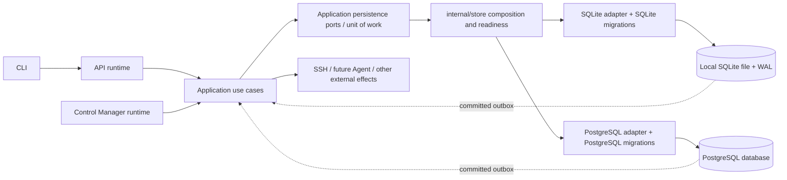
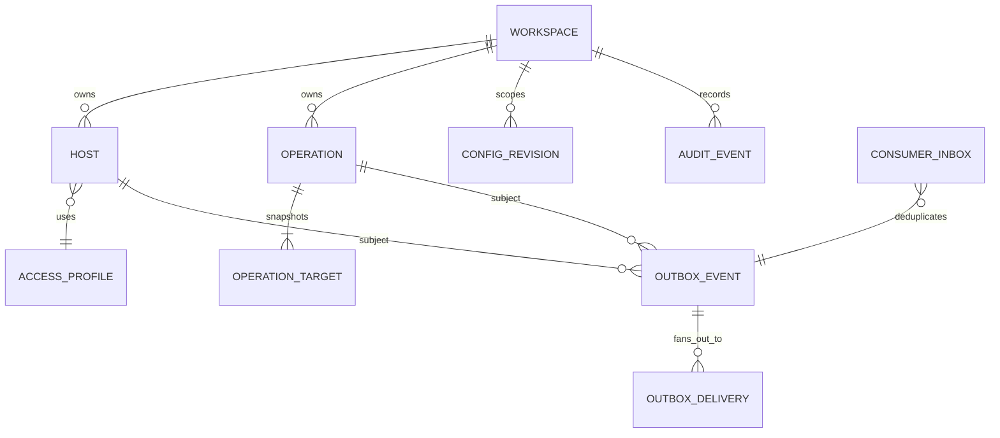
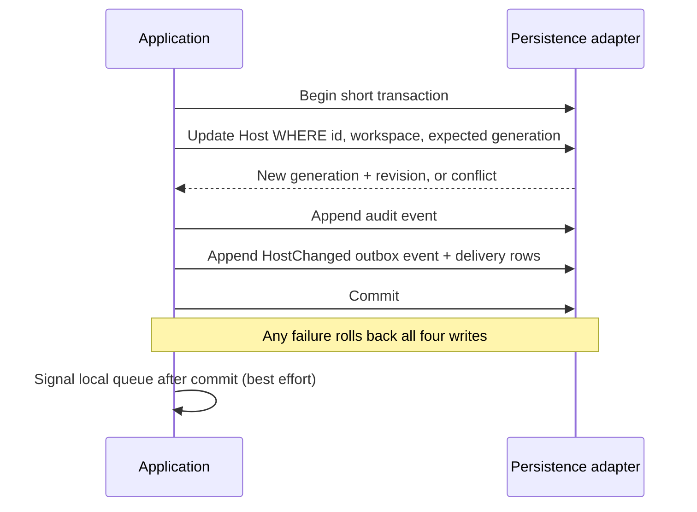
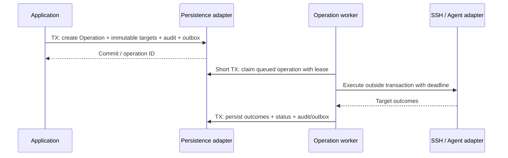
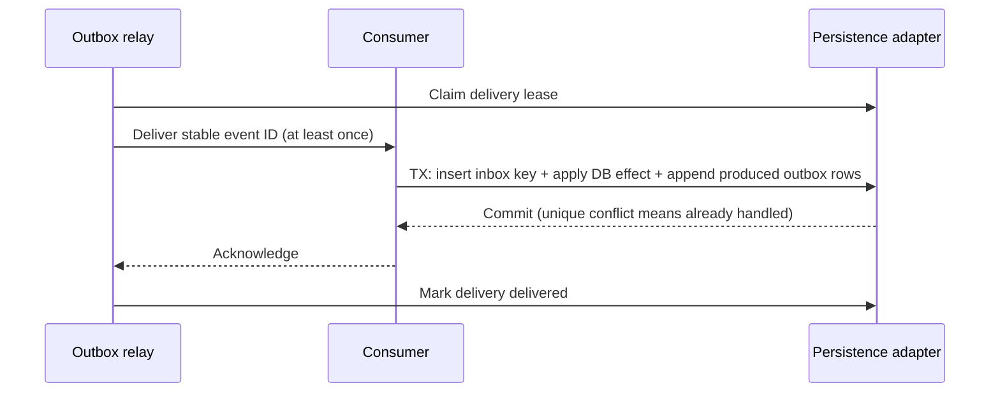

# Phase 5 — Persistence and Data Architecture

**Status:** Approved on the recommended defaults when Phase 6 was authorized  
**Scope:** Persistence boundaries, logical schema, transaction semantics, concurrency, migrations, recovery, and database-specific behavior. This document does not implement migrations or repositories.

## 1. Design summary

Machinarchy keeps one logical persistence contract and two database adapters. The application owns persistence ports and transaction use cases; `internal/store` composes the configured engine; `internal/store/sqlite` and `internal/store/postgres` own SQL, encoding, locking, and engine-specific migrations. Application services do not receive `*sql.DB` or dialect-specific transaction objects.

Each database transaction is short and contains only database work. State changes, audit entries, domain/integration outbox records, and their initial delivery rows commit atomically. Network calls (SSH now, Agent later), waits, and operation execution never occur inside a database transaction. Reconciliation remains level-triggered from the latest Host state; outbox delivery is an independent notification lifecycle.

SQLite is supported for a single-node installation with a local filesystem and one active application composition. PostgreSQL is the deployment path for multiple API/Control Manager processes. Both implement the same correctness contract using atomic conditional writes; PostgreSQL can additionally distribute queue claims with row locks and `SKIP LOCKED`.

## 2. Persistence architecture

The database owns durable desired state, observed state, revisions, operation status/results, configuration history, audit history, and event delivery state. The in-memory Controller Manager workqueue is a disposable acceleration structure: it can be rebuilt from current resource rows and does not own truth. A future external broker is downstream of the outbox and is not authoritative for Host or Operation state.

## 3. Repository and transaction responsibilities

| Boundary | Owns | Must not own |
|---|---|---|
| Domain | Entities, value objects, invariants, lifecycle transitions, event facts | SQL, database handles, broker delivery |
| Application | Use cases, persistence port definitions, transaction boundary requests, authorization/policy orchestration, external-effect orchestration | SQL dialect, transaction implementation |
| `internal/store` | Engine selection, pool setup, migration entry point, adapter composition, ping/readiness/stats | Business decisions or direct SQL from handlers |
| `internal/store/sqlite` | SQLite queries, serialization, atomic writes, busy handling, local migration set | PostgreSQL semantics |
| `internal/store/postgres` | PostgreSQL queries, JSONB/index use, row locking, claims, PG migration set | Business decisions |
| Outbox relay / event consumer | Claim/publish/ack delivery, bounded retries, inbox dedupe | Resource reconciliation logic |
| Controller Manager | Queue and reconcile latest Host state | Durable event history or SQL access |
| Operation worker | Claim operation, perform external action, record bounded outcome | Host reconciliation queue |

Keep one application contract per meaningful capability (Hosts, Operations, Configuration, Audit, Outbox, Inbox, etc.) where a consumer needs it. Avoid creating parallel `SQLiteHostRepository` and `PostgresHostRepository` application contracts. The existing `domain.*Store` interfaces should be reviewed for eventual relocation beside application consumers; Phase 5 does not require splitting them into one interface per method. A transaction-capable persistence boundary should expose intent-bearing methods/use cases or a narrow unit-of-work callback, never `*sql.Tx`.

The current `Stores` container implements many contracts with one concrete engine store and exposes `DB *sql.DB`. Target composition keeps the useful single adapter instance but hides the raw handle from application/runtime consumers. Health and pool statistics can be exposed through narrow store lifecycle methods. Existing `internal/store` is a reasonable adapter root, but “store” should not become a business service package.

### Responsibility matrix

| Data set / contract | Main reads and writes | Atomic companions | Ownership |
|---|---|---|---|
| Hosts | Host query/update and optimistic write | Audit + outbox; conditions/status write | Inventory application + Host adapter |
| Operations and targets | Submit, claim, heartbeat, cancel, finish, inspect snapshots | Audit + outbox; claim lease | Operation application + Operations adapter |
| Runtime configuration | Read active revision, validate/activate candidate | Revision head + audit + outbox; secret refs | Configuration application + Config adapter |
| Audit events | Append, filtered page, verify chain | Same transaction as audited state change | Audit contract; immutable storage |
| Outbox and deliveries | Create, claim, acknowledge, retry, quarantine, prune | Same transaction as originating state change | Messaging application + Outbox adapter |
| Inbox | Insert unique `(consumer_id,event_id)` and record durable effect | Same transaction as consumer DB effect | Consumer application + Inbox adapter |
| Metrics/history | Append and bounded time-range queries | Usually independent batches | Observability application + Metrics adapter |
| Workspace, membership, tokens, access profiles | CRUD and authorization lookups | Membership uniqueness / owner invariants | Identity/access application + adapters |

## 4. Transaction diagrams and rules

### Desired-state update

### Operation submission and work

### Durable consumer

No database transaction spans a call to SSH, an Agent, a broker, or a user-controlled process. If an external effect must be retried safely, represent it as an Operation with an idempotency policy; database inbox deduplication alone cannot make a remote side effect exactly once.

## 5. Logical schema proposal

Logical names and columns below are a cross-engine design, not a migration script. Use opaque IDs consistently across engines (application-generated UUIDs stored as canonical text for SQLite/PostgreSQL parity unless native UUID handling is selected later). Use explicit foreign keys and workspace scoping on all workspace-owned records, with intentional retention behavior rather than broad cascade deletion.

| Table | Important fields and rules |
|---|---|
| `workspaces`, `workspace_memberships`, `users`, `api_tokens` | Preserve current identity and tenancy concepts. Unique membership `(workspace_id,user_id)`. Store token hashes only. Make workspace ownership explicit in all access predicates. |
| `environments` | Workspace-owned named environment; unique `(workspace_id, normalized_name)`. Do not retain parallel global and scoped environment tables. |
| `access_profiles` | Reusable workspace-scoped connector configuration. `kind`, non-secret parameters, `secret_ref`, revision, created/updated. Host refers to profile; Host does not persist SSH-specific fields in its domain identity. |
| `secrets` or external secret refs | Prefer external secret manager in distributed deployments. If local secret storage is required, store authenticated ciphertext, nonce, key version, and metadata; never plaintext credentials. Database backup and encryption-key backup are separate responsibilities. |
| `hosts` | `id`, `workspace_id`, `environment_id`, `name`, `labels`, `access_profile_id`, `desired_spec`/typed desired columns, `generation`, `revision`, `observed_generation`, `lifecycle`, `conditions`, `deletion_timestamp`, timestamps. Keep connection credentials out of Host and version any persisted spec encoding. |
| `operations` | `id`, `workspace_id`, `kind`, `status`, `payload_version`, protected payload/ref, `idempotency_key`, requester attribution, created/started/finished, lease owner/expiry/fence, cancellation, result summary. Unique `(workspace_id, requester_scope, idempotency_key)` when key is supplied. |
| `operation_targets` | Immutable target ID and Host identity/address/access snapshot, target status, bounded sanitized result/output reference, exit/error summary, timestamps. FK to Operation; Host deletion must not erase historical operation snapshot. |
| `runtime_config_revisions` | Immutable revision ID, scope, monotonically increasing revision, schema version, canonical config document/checksum, actor, timestamp, validation result. Secret values are references, not embedded plaintext. |
| `runtime_config_heads` | Current active revision per scope. Update via compare-and-swap on expected revision; activation and `ConfigurationChanged` outbox event are atomic. |
| `audit_events` | Existing append-only/hash-chain semantics remain separate from outbox retention. Add explicit verification/export/retention policy before pruning. |
| `outbox_events` | Stable event ID, event type, schema version, occurred/recorded time, subject kind/id, generation/revision, aggregate sequence where ordering is required, correlation/causation IDs, safe payload. Immutable after commit. |
| `outbox_deliveries` | `(event_id, consumer_id)` primary key; state, attempts, next attempt, lease owner/expiry/fence, delivered time, sanitized last error. Initial consumer rows created atomically with event. |
| `consumer_inbox` | `(consumer_id,event_id)` unique key, processed time and optional result reference. Insert and consumer database effect in the same transaction. Only durable consumers needing replay safety require it. |
| `metrics_history` | Workspace/resource/time, metric key/value or compact payload. Partition/retention strategy only when measured volume needs it. |

Do not use an unversioned catch-all JSON document as the only schema for core identity, tenancy, lifecycle, revision, uniqueness, or query predicates. JSON is appropriate for bounded typed extension payloads, Host conditions, versioned operation payloads, and event payloads where a schema version exists. SQLite stores JSON text or JSONB depending on the bundled SQLite version; keep the logical API independent of storage encoding.

### Index proposal

Start with indexes that match actual list, claim, cleanup, and authorization queries; validate query plans and production cardinalities before adding more. Candidate indexes:

- Hosts: unique `(workspace_id, normalized_name)`, unique `(workspace_id, normalized_address, port)`, and `(workspace_id,lifecycle,updated_at,id)` for resync pages. Add a labels index only for demonstrated selector predicates; PostgreSQL GIN and SQLite JSON expression indexes are not equivalent.
- Operations: `(workspace_id,created_at DESC,id DESC)`, `(status,created_at,id)` for queued work, `(status,lease_expires_at)` for recovery, unique idempotency scope.
- Operation targets: PK `(operation_id,target_id)`, optionally `(host_id,created_at)` only if history queries need it.
- Outbox delivery: partial/filtered due-work index on `(consumer_id,next_attempt_at,event_id)` for pending/retry and `(lease_expires_at)` for stale leases. PostgreSQL can use partial indexes; SQLite needs a compatible predicate/index layout.
- Outbox event: `(subject_kind,subject_id,aggregate_sequence)` if per-subject ordering is required; `(recorded_at,id)` for retention scans.
- Inbox: PK/unique `(consumer_id,event_id)`.
- Config head/revisions: unique `(scope,revision)` and one head row per scope.
- Audit: existing workspace ordered page and `(workspace_id,action,id)` access paths.
- Metrics: `(workspace_id,resource_id,recorded_at)` and time-based cleanup index.

Avoid speculative duplicate indexes. Every secondary index increases write and storage cost; confirm with query plans on both engines.

## 6. Optimistic concurrency, locking, and transaction isolation

### Shared correctness contract

- `generation` increases only when Host desired state changes. Controllers compare current generation with observed generation.
- `revision` increases for every persisted Host mutation, including metadata, conditions, and observed status. It is a resource version for optimistic writes, not a domain generation.
- Mutations accept an expected revision/generation and use a conditional `UPDATE ... WHERE id=? AND workspace_id=? AND revision=?` (and expected generation where applicable). Zero affected rows maps to not-found or conflict after a scoped read; never silently overwrite concurrent changes.
- State-machine transitions use conditional writes (`WHERE status IN (...)`) and explicit allowed transitions. Operation claims set a lease and increment a fencing token; heartbeat/finish must match the current token so an expired worker cannot overwrite its successor.
- Use unique constraints for invariants vulnerable to races: host uniqueness, idempotency keys, inbox keys, consumer delivery identity, one active configuration head, and membership keys.
- Persist and publish after commit. Notifications are hints; every worker re-reads current durable state before acting.

### PostgreSQL

Use `READ COMMITTED` for ordinary short application transactions with atomic compare-and-swap. Use `SELECT ... FOR UPDATE` when a multi-row decision must be serialized (for example current audit-chain head or an Operation state transition that cannot be expressed as one guarded update). Use `FOR UPDATE SKIP LOCKED` for independent queue/outbox claim rows; PostgreSQL documents this specifically as useful for queue-like consumers, while warning it produces an inconsistent view and is unsuitable for general reads. Claim in one short transaction, set a lease/fence, commit, then perform work outside the transaction. A partial index on due rows avoids scanning delivered history.

Use `SERIALIZABLE` only for invariants that cannot be expressed with uniqueness, row locks, or conditional writes; the application must retry the complete transaction on serialization failure. Do not treat an automatic retry as safe if the transaction has emitted an external effect.

### SQLite

Use WAL for concurrent readers and a single writer at a time. SQLite’s `database/sql` pool is currently configured with one connection; retain a bounded write path and short transactions. Treat `SQLITE_BUSY`/locked outcomes as bounded transient failures with jitter, then surface overload rather than queue unbounded requests. SQLite has no PostgreSQL-style row-level `SKIP LOCKED`; the initial single-node Controller Manager and outbox relay use the one database connection and in-process bounded workers. If separate local processes are ever supported, prove the locking and migration model first.

WAL relies on same-host shared-memory/filesystem coordination and is not a multi-host shared-volume coordination mechanism. Do not place a WAL database on NFS or a general network filesystem. Long readers can prevent checkpoint progress and WAL reset; keep reads bounded and monitor database/WAL size. SQLite backup must include a consistent database state through SQLite’s backup mechanism or a quiesced/checkpointed close procedure; copying only the main `.db` while WAL is active can omit committed data.

### Isolation summary

Default transactions are short, atomic, and rely on constraints/CAS rather than broad serializable isolation. PostgreSQL `READ COMMITTED` plus row locks and uniqueness is sufficient for designed flows. SQLite serializes writes; retries are bounded. No transaction may be held across SSH, broker publication, or long polling. Applications must distinguish conflict (`409`/domain conflict) from transient database unavailability and retry only when the operation is safe.

## 7. Migrations and startup

The repository currently embeds numbered, engine-specific `*.up.sql` files; `Migrator.Up` discovers pending versions and runs each migration and schema-version insert in a transaction. SQLite and PostgreSQL migration sequences must remain semantically equivalent even where DDL differs. Existing preflight checks (such as Host uniqueness before migration 4) demonstrate the right approach for nontrivial data transitions.

Target policy:

1. Treat released migrations as immutable; add a higher numbered forward migration for every change.
2. Keep SQLite and PostgreSQL schemas logically aligned, with explicit documented exceptions; add migration parity review for columns, keys, constraints, indexes, and default behavior.
3. Preflight conflicting/invalid data and fail with actionable remediation; do not silently drop or rewrite records.
4. Use expand/backfill/contract for rolling PostgreSQL deployments; SQLite may need table rebuilds and a single controlled maintenance step.
5. Serialize migration execution. PostgreSQL should acquire a migration advisory lock or run a single deploy-time migrator. The current migrator has no explicit cross-process migration lock, so concurrent first starts are a risk to resolve before multi-replica production.
6. Prefer a controlled migration step in production; local/dev can run migrations at startup. Application readiness should fail if schema is behind/incompatible. Do not let every API and Control Manager replica independently race migrations.
7. Migration failure must prevent serving traffic; preserve backup/restore as the rollback route for destructive or hard-to-reverse changes. Keep the existing absence of a general down path explicit.

Startup order: parse and validate config; open DB with bounded connection settings; verify connectivity and encryption-key availability/version; run or verify migrations according to deployment mode; assemble ports; recover expired Operation leases and outbox deliveries; start relay and Controller Manager; perform full Host resync; mark runtime ready only after required components report healthy. A failure in required persistence leaves the process unready and should stop startup or trigger supervised shutdown.

## 8. SQLite and PostgreSQL comparison

| Concern | SQLite (initial single node) | PostgreSQL (distributed path) |
|---|---|---|
| Deployment | One host, local durable filesystem, one active application composition | Multiple API/Control Manager processes and shared durable DB |
| Reads/writes | WAL allows reader/writer overlap; one writer at a time | MVCC readers plus concurrent row-level writers |
| Queue claims | One in-process relay/manager; atomic conditional updates | Multiple claimers with `FOR UPDATE SKIP LOCKED` and leases |
| Locking | File/database-level writer contention; busy timeout/retry | Row locks, advisory locks where justified, `SKIP LOCKED` |
| JSON/indexing | Bundled version and JSON/JSONB functions determine capabilities; expression indexes vary | JSONB operators and GIN available; keep core predicates relational |
| Schema changes | DDL/table rebuild constraints; single writer | Transactional DDL for many operations, but long locks/compatibility still matter |
| Failure scale | Local disk loss affects whole deployment; backup and restore central | HA, replicas, PITR options depend on operator/deployment; application still handles outages |
| Filesystem constraints | WAL requires same host and reliable local locking; no network shared DB file | Database server owns storage; clients connect over network |
| Operational fit | Simple install, low write concurrency, bounded local workloads | Horizontal API/CM, higher write throughput, durable centralized coordination |

The same repository method must have the same logical result, uniqueness, optimistic concurrency, audit/outbox atomicity, and lifecycle semantics on both engines. Database-specific syntax and queue-claim strategy can differ behind adapters. SQLite is not a substitute for PostgreSQL distributed coordination by placing its file on shared storage.

## 9. Deletion, retention, recovery, and backup

- Host deletion is a tombstone only while a finalizer/cleanup obligation exists. Once external cleanup is complete (or no cleanup is required), delete the Host row; keep audit facts and Operation snapshots independent of that row.
- Operations and targets are operational history, not Host state. Never cascade-delete target snapshots when deleting a Host. Retain detailed output for a bounded period and retain a compact audit summary separately.
- Outbox delivery defaults inherited from Phase 4: delivered rows/events retained 7 days; quarantined records 30 days; pending/retry rows never pruned automatically. Retention pruning uses bounded batches and preserves replay/debug metadata for the configured window.
- Inbox retention must cover the maximum supported replay horizon. If old events can be replayed after inbox pruning, also retain a consumer checkpoint/epoch or accept and document duplicate application risk.
- Audit is append-only/hash-chained and is not subject to outbox retention. Define archival/export and legal retention separately before implementing automatic audit deletion.
- Metrics history is time-series-like and needs a configurable retention horizon before high-volume deployment; no current policy was verified.
- Startup recovery reclaims only expired leases, marks abandoned imperative work according to Operation policy, resumes outbox deliveries with the same event ID, and rebuilds resource work from current state. Retries are at least once and handlers remain idempotent.
- SQLite backups use SQLite’s online backup API or a documented quiesce/checkpoint/close workflow. Preserve `.db`, `-wal`, and `-shm` as a consistent set if copying an active database is unavoidable. Test restore, not just backup creation.
- PostgreSQL backups use the selected operator’s logical or physical backup and WAL/PITR policy. Test restoration into an isolated environment.
- Back up encryption keys separately under restricted access. A database backup without the matching key may preserve rows but make encrypted credentials or Operation payloads unusable; a key backup without database access must not reveal secrets.
- A restore must bring the database and key version set into a compatible state, then run integrity checks (schema version, audit-chain verification, queue recovery) before serving.

## 10. Current architecture observations and debt

Verified in the repository as of this proposal:

- `internal/store/store.go` selects SQLite/PostgreSQL, owns connection setup, migrations, store composition, readiness, and exposes `Stores.DB *sql.DB`.
- `internal/store/migrator.go` embeds engine-specific numbered SQL and applies each pending migration plus version record in one transaction. It has no explicit cross-process migration lock.
- `internal/store/migrations/sqlite` and `internal/store/migrations/postgres` contain six migration pairs. Both create Hosts, workspace/access data, uniqueness indexes, append-only audit events, and `runs`/`run_hosts`.
- SQLite startup config sets WAL and uses a one-connection pool; PostgreSQL uses a configurable connection pool. Both adapters share current `domain.*Store` contracts and often one concrete store type implements many capabilities.
- PostgreSQL Run recovery uses row locking; ordinary run starts use a guarded status update. This is a useful foundation, but future outbox claims need a separate lease/claim contract and `SKIP LOCKED` only on PostgreSQL.
- Current schema has no outbox, inbox, Host generation/revision/observed generation, configuration revision/head, or access-profile tables.
- Schema parity is not exact: SQLite stores labels as SQLite JSONB BLOB (requiring SQLite 3.45+), while PostgreSQL uses JSONB; SQLite has no equivalent GIN index. Several migrations define no foreign-key constraints between related workspace resources, so referential integrity is partly application-owned. Existing `runs` uses integer IDs while Hosts use text IDs; this is an implementation choice that the target model should normalize.
- `runs.argv_encrypted` is encrypted at rest, while `run_hosts.output` and `error` are plain text. Their sanitization/bounds reduce exposure but do not make them encrypted. Operation payload/result retention and access control remain sensitive design decisions.
- Audit events are protected from update/delete by triggers and hash-chain logic, with PostgreSQL advisory locking for append serialization; they have no documented retention/archive policy.

These are current-state observations, not proposed implementation changes.

## 11. Draft ADRs

See ADR-019 through ADR-022 for decision records on shared persistence contracts, schema/migration evolution, transaction/concurrency rules, and retention/backup. Their status remains proposed until owner approval.

## 12. Questions requiring owner input

1. **Production migration mode:** Should production deploys use a single explicit migration step, or may one designated runtime execute migrations on startup? Recommended: explicit migration step for multi-replica PostgreSQL, automatic on startup for local/dev; require schema readiness checks before traffic. This prevents startup races and makes upgrade order reviewable.
2. **Operation result retention:** How long should per-target output and detailed errors remain available? Recommended default: 30 days of bounded, sanitized detailed output; retain compact Operation status and audit summary for 1 year (subject to deployment policy). This limits sensitive-data exposure and storage while keeping recent operational diagnosis. Output encryption is also a decision; recommendation is encrypt if outputs can contain secrets, otherwise retain strict access control and bounds.
3. **Audit retention/export:** Should audit events be retained indefinitely in the primary DB, or archived after a defined horizon? Recommended: no automatic deletion in Phase 5; add verified export/archival before long-term storage policy. The existing hash chain detects tampering but does not itself provide external durability.
4. **Metrics retention:** Recommended default 30 days, configurable and pruned in bounded batches. This is suitable for an initial operational history but should be adjusted to volume and product requirements.
5. **ID representation:** Recommended application-generated UUIDs stored as canonical text in both engines for consistent opaque identity. PostgreSQL native UUID is more compact/strongly typed but creates adapter differences. Existing Host IDs are text and Run IDs are integers; normalizing them requires an explicit migration plan.

Phase 5 proposes these defaults for discussion. Approval to proceed to Phase 6 should confirm or amend them.
