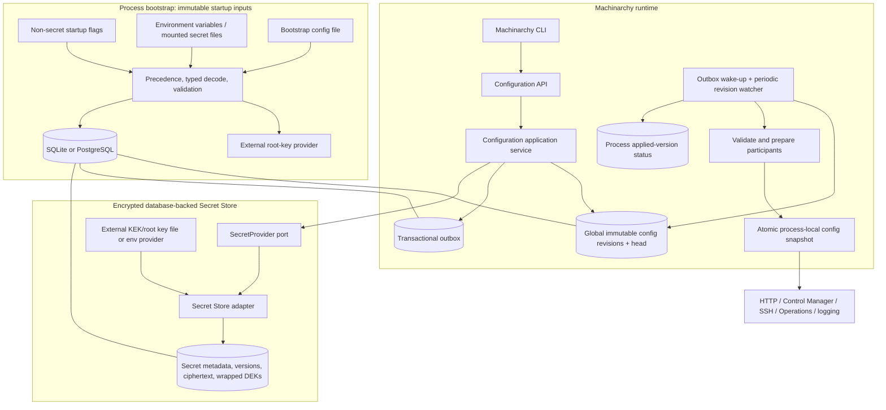
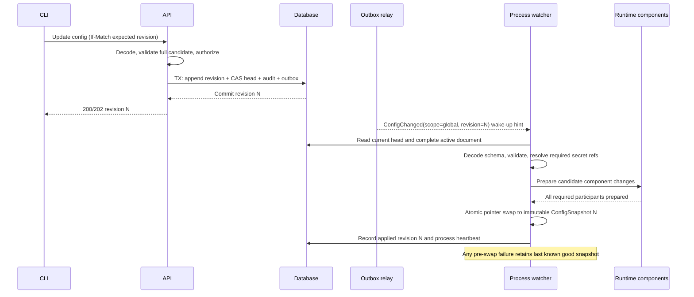

# Phase 6 — Configuration and Secrets Management

**Status:** Approved on the confirmed constraints and recommended defaults when Phase 7 was authorized
**Approved constraints:** one global runtime scope; same SQLite/PostgreSQL database; encrypted database-backed secrets initially; API and CLI management; event notification plus periodic version checking; safe settings hot reload without process environment mutation.
**Scope:** architecture and contracts only. No subsystem implementation or schema migration is included.

## 1. Architecture



The diagram shows logical components; configuration, outbox, and secrets share the selected Machinarchy database. The encryption root key does not. Process-local snapshots contain non-secret configuration and secret references/version identifiers, not plaintext secret values.

## 2. Bootstrap configuration model

### 2.1 Loading and precedence

Introduce a typed bootstrap document read before database or Secret Store initialization. Recommended precedence, highest first:

1. Explicit non-secret startup flags (including `--config` to select a file).
2. Environment variables.
3. Bootstrap configuration file.
4. Compiled defaults.

Decode and validate once into an immutable `BootstrapConfig`. Do not watch the file, mutate `os.Environ`, or update process environment variables to make runtime changes. Runtime updates use the persisted configuration API, not a changed file or environment.

Do not accept root keys, database passwords, operator credentials, or bootstrap administrator passwords as command-line flag values: process arguments can be exposed through process inspection, shell history, or service diagnostics. Load secret material from a mounted file or deployment secret environment injection and keep it out of the non-secret config struct. A file may name a credential file, but should not contain its secret value unless the operator explicitly accepts that deployment risk.

### 2.2 Settings needed before database initialization

| Startup-only setting | Why needed early | Current source / target source |
|---|---|---|
| Database engine, SQLite path, PostgreSQL URL and pool/connect settings | Open and configure storage | Current `internal/config.Config`; env-only today; target env/file/flags except passwords via secret references |
| Encryption root key provider and key IDs | Decrypt existing credentials and initialize Secret Store | Current `MACHINARCHY_ENCRYPTION_SECRET`; target external key provider/file/env, never database |
| Process role and health/listen address | Choose runtime and bind sockets | Current entry points use `MACHINARCHY_LISTEN_ADDR`; address is startup-only |
| Bootstrap operator/JWT signing secret | Initialize authentication | `MACHINARCHY_OPERATOR_TOKEN`; startup-only |
| Bootstrap administrator credentials | Optional one-time owner creation | `MACHINARCHY_BOOTSTRAP_ADMIN_*`; startup-only, then remove from deployment config |
| CLI API/user tokens | CLI authentication only, not server configuration | Current `MACHINARCHY_API_TOKEN`/`MACHINARCHY_USER_TOKEN`; rotate through auth/token workflows, never runtime config |
| TLS listener/certificate and telemetry exporter bootstrap | Establish transport/export before serving | TLS currently deployment/termination dependent; OTEL values are env-based |
| Database migration policy | Decide migrate versus verify-only | Target explicit production mode, local/dev may migrate automatically |
| Broker/outbox relay connection, if retained during transition | Initialize existing broker/runtime | Current broker URL is env-based; target remains restart-required until adapter supports live replacement |

Bootstrap config should distinguish a *credential source* from a credential value, support explicit file permissions, reject malformed values, redact on error, and avoid returning the resolved config in logs. Fail before serving if required settings are missing or key material cannot be loaded. Production must never fall back from the encryption root key to the operator token.

### 2.4 Classification of the current server settings

| Current setting (`internal/config.Config`) | Target classification |
|---|---|
| `ListenAddr` | Restart-required |
| `Environment` | Restart-required deployment identity; controls safe defaults and must not be toggled as a runtime flag |
| `SignupEnabled` | Hot-reloadable, security-sensitive; new requests observe the published snapshot |
| `OperatorToken` | Startup-only credential; rotation is an auth/key workflow, not runtime config |
| `EncryptionSecret` | Restart-required external key provider; key rotation is staged separately |
| `LogLevel` | Hot-reloadable |
| `Database.Engine`, `Path`, `URL`, pool settings, connect timeout | Restart-required |
| `EventBroker.URL` | Restart-required initially |
| `BootstrapAdmin` | One-time startup bootstrap only |
| `SSHTargetPolicy` | Hot-reloadable for new dials; security-sensitive |
| `Execution` policy | Hot-reloadable for new submissions and queued-work revalidation; security-sensitive |

### 2.3 Startup-only versus persisted runtime settings

Database connection identity, database path, encryption root key provider, listener binding/TLS identity, process role, migration mode, and telemetry exporter wiring remain startup-only. They cannot safely be changed by a database revision because the process needs them to reach the database or decrypt it. On restart, these still come from bootstrap inputs.

Runtime-compatible settings from the bootstrap file/environment are defaults for first initialization only. Once a global runtime revision exists, that persisted revision is authoritative for managed runtime settings. Do not silently overlay environment variables on a later runtime revision; doing so would make the reported revision differ from actual behavior. Operator overrides that are necessary for break-glass recovery should be explicit, logged without values, and reported as an unapplied/overridden process state.

## 3. Runtime configuration model

Configuration is a strongly typed, global `RuntimeConfig` made of versioned categories. API patch requests are typed patches against a current revision, never arbitrary unvalidated map edits. Defaults are materialized when a new revision is created so that a given revision has deterministic meaning.

Suggested Go-oriented model:

```go
type RuntimeConfig struct {
    SchemaVersion  int                         `json:"schemaVersion"`
    ControlManager ControlManagerConfig        `json:"controlManager"`
    WorkQueue      WorkQueueConfig             `json:"workQueue"`
    Reconciliation ReconciliationConfig        `json:"reconciliation"`
    SSH            SSHRuntimeConfig            `json:"ssh"`
    Operations     OperationRuntimeConfig      `json:"operations"`
    Logging        LoggingConfig               `json:"logging"`
    Features       FeatureConfig               `json:"features"`
}

type RuntimeRevision struct {
    ID          string
    Revision    uint64
    Schema      int
    Config      RuntimeConfig // secret-free, validated snapshot
    Checksum    string
    CreatedAt   time.Time
    CreatedBy   Actor
    ChangeNote  string
}

type ConfigSnapshot struct {
    Revision RuntimeRevision
    AppliedAt time.Time
}
```

Every category needs explicit bounds and cross-field validation. Reject unknown fields and unknown enum values; do not silently ignore misspellings. Secret fields are typed `SecretRef` values (`secretID`, `version`) and do not accept raw values in configuration revisions.

### 3.1 Revision history, rollback, and optimistic concurrency

- `runtime_config_revisions` is append-only: one immutable, fully materialized document per accepted change, with schema version, monotonically increasing global revision, digest, actor, timestamp, and non-secret change summary.
- `runtime_config_head` contains the active revision ID/number. Update via compare-and-swap on `expectedRevision`; a stale writer receives a conflict and must read/rebase.
- Validate the complete candidate and check all secret references/versions before the transaction. Persist revision, advance head, append audit event, and append `ConfigurationChanged` outbox event in one DB transaction.
- Rollback creates a new revision by copying an earlier revision’s effective configuration into a fresh revision number. It never moves the head backward or edits history. Rollback still runs current-schema migration and validation; revoked/missing secret versions block activation.
- Keep history separate from current process application state. Configuration history remains indefinitely by default because revisions are compact and are the audit/recovery record; archive policy can be added without changing the API contract.
- First startup seeds revision 1 from compiled defaults plus explicitly supplied runtime defaults, only if the global head is absent. Subsequent restarts read the active persisted revision.

## 4. Configuration propagation and atomic snapshot lifecycle

Each API and Control Manager process independently tracks its applied version. The database head is the persisted desired version; `appliedRevision` is process-local progress and may lag.



Implementation rules:

1. Event payload contains global revision number and IDs only, never configuration contents or secrets.
2. Notifications are hints. On notification, the process queries the latest head and loads the complete document; skipped revisions are acceptable because revisions are snapshots. Periodically query the head even if no event arrives; initial proposal is a jittered 30-second check, separate from the Host resynchronization interval.
3. Prepare immutable participant-specific state (new policy objects, ticker schedule, worker limits, logger level) without mutating live state. Validate resource acquisition and compatibility during prepare.
4. Assemble all prepared participant state into one immutable runtime bundle and atomically swap one pointer only after every required participant is prepared. Components read settings from that bundle. Readers capture one snapshot per request/reconcile/operation so one unit of work does not mix versions.
5. If any participant cannot prepare, keep the prior bundle, record attempted revision/error category, and retry with backoff. Do not advance `appliedRevision` prematurely. After publication, component work such as enqueueing affected Hosts is idempotent and recoverable from periodic resource resync.
6. For a multi-participant change that cannot be made atomic (for example changing a live listener), classify it restart-required instead of faking a two-phase update. A participant failure after snapshot publication must have a rollback callback or cause the snapshot to remain unpublished.
7. On startup, load and validate the current persisted revision before marking readiness. If valid but a managed setting cannot be applied, either remain unready or use the prior good snapshot only when the process has a durable prior snapshot and operator-visible degraded state; default: remain unready on a fresh process.

Use per-process status keyed by an ephemeral process-instance ID, with role, build/schema compatibility, applied revision, attempted revision, last success/error category, and heartbeat/expiry. Do not store raw error text that could contain secret values. The API presents a process list as potentially stale after its heartbeat expiry.

### SQLite and PostgreSQL notification behavior

- **SQLite:** no cross-process durable notification service is assumed. The outbox relay polls the database and signals local watchers; each process also polls the head on a bounded interval. For Phase 6 SQLite’s single-node topology, a local in-process signal accelerates updates, while periodic checks recover missed signals.
- **PostgreSQL:** `LISTEN/NOTIFY` may wake relays/watchers after commit, but is not the delivery log. The outbox and head table remain durable; connect, `LISTEN`, commit the listener setup, then inspect current state to close the startup race. Poll even while listening.
- In both modes, lost, repeated, and out-of-order notifications are harmless because the process compares monotonic revision numbers and reloads the latest complete state.

## 5. Hot-reload classification matrix

The classifications below are the target policy for the initial runtime schema. “Hot-reloadable” means new work observes the new snapshot after publication; it does not rewrite already-running calls. “Reconciliation-triggered” means applying the change enqueues affected Hosts/resources, while credentials and external side effects remain managed through their own lifecycles. “Restart-required” means a new revision is persisted but processes report it unapplied until restart; prefer rejecting activation unless a staged rollout contract exists.

| Category / setting | Classification | Apply semantics and limits |
|---|---|---|
| Control Manager resync interval and jitter | Hot-reloadable | Replace ticker/schedule at safe loop boundary; existing reconciliation finishes under captured snapshot. |
| Control Manager worker count | Hot-reloadable | Resize bounded worker pool; drain excess workers safely, never spawn one goroutine per item. |
| Workqueue retry base/max delay, rate limit, max queue depth | Hot-reloadable | Affect future enqueue/retry decisions; do not rewrite current in-flight backoff timer. Reject bounds that can starve recovery. |
| Reconciliation worker concurrency | Hot-reloadable | Resize bounded pool; per-Host serialization remains invariant. |
| Reconciliation periodic full-resync interval | Hot-reloadable | Replace timer; persisted state still recovers missed events. |
| Reconciliation policy that changes Host desired-state interpretation/defaults | Reconciliation-triggered | New config revision enqueues all Hosts; controller reads current config and latest Host state. Avoid broad resync for unrelated config. |
| SSH target allow/deny CIDRs and private/loopback policy | Hot-reloadable, security-sensitive | Applies to new dials immediately. Existing sessions are not forcibly terminated. Tightening blocks future dials; audit actor and changed ranges without secret data. |
| SSH connect/handshake timeout and safe connection limits | Hot-reloadable | Applies to future sessions; active sessions retain existing deadline/capacity reservation. |
| SSH host credential references | Reconciliation-triggered | Updating access profile/secret version enqueues affected Hosts; existing connections are not retroactively re-authenticated. |
| Operation allowlist and enabled state | Hot-reloadable, security-sensitive | Validate at submission and again before execution. Tightening blocks queued work that is no longer permitted; in-flight operation follows explicit cancellation policy and is not silently killed. |
| Operation worker count and default timeout/target cap | Hot-reloadable | Applies to newly claimed/submitted work according to captured revision; existing Operations retain their recorded submission policy where required. |
| Logging level and log sampling | Hot-reloadable | Swap logger options; never add secret fields. |
| Feature flags that only affect request admission/UI/API behavior | Hot-reloadable | Apply to new requests; authorization checks remain authoritative and independently enforced. |
| Public signup enabled/disabled | Hot-reloadable, security-sensitive | Applies to new signup requests; retain the production-disabled default and audit changes. |
| Feature flags that alter Host reconciliation behavior | Reconciliation-triggered | Enqueue affected Hosts and record applied revision. |
| API listen address/port, TLS certificate/key source, bound protocol | Restart-required | Socket/certificate lifecycle is not safely atomic in current server construction. |
| Database engine, path/URL, credentials, pool topology, migration mode | Restart-required | Required to access the configuration database itself. |
| Encryption root/KEK provider or keyring | Restart-required | Load before Secret Store and DB-backed decryption; staged key rotation is separate and must retain old key availability. |
| Broker transport endpoint/credentials | Restart-required initially | Replace only after a future broker adapter has prepare/swap/drain semantics; current bootstrap connects once. |
| Process role, health listener, telemetry exporter identity | Restart-required | Infrastructure/client setup occurs before application readiness. |
| Bootstrap admin username/password and operator bootstrap token | Restart-required / one-time bootstrap only | Never store these in runtime revision. Rotations use dedicated API/auth/key workflows. |

Do not let one config revision combine an unstageable restart-only setting with hot-reload settings and imply that every process applied it. API validation should reject restart-required fields in runtime updates, or expose explicit staged restart configuration only after rollout status semantics exist.

## 6. Secret Store design

### 6.1 Provider boundary and initial adapter

```go
type SecretRef struct {
    ID      string `json:"id"`
    Version uint64 `json:"version"`
}

type SecretMetadata struct {
    ID, Name, Description string
    CurrentVersion        uint64
    CreatedAt, UpdatedAt  time.Time
}

type SecretProvider interface {
    Resolve(ctx context.Context, ref SecretRef, purpose SecretPurpose) ([]byte, error)
}

type SecretManagement interface {
    Create(ctx context.Context, in SecretInput, actor Actor) (SecretMetadata, error)
    Update(ctx context.Context, id string, expected uint64, in SecretInput, actor Actor) (SecretMetadata, error)
    Rotate(ctx context.Context, id string, expected uint64, in SecretInput, actor Actor) (SecretMetadata, error)
    Describe(ctx context.Context, id string) (SecretMetadata, error)
    Delete(ctx context.Context, id string, expected uint64, actor Actor) error
}
```

The `[]byte` plaintext exists only inside the authorized process boundary for the shortest practical period. Resolver callers are infrastructure components (for example SSH adapter), not general API handlers or loggers. A `SecretPurpose` binds access to a consumer/use case. Minimize copies and lifetime, clear owned buffers on a best-effort basis, and do not claim guaranteed zeroization of Go-managed memory. The initial `DatabaseSecretProvider` uses the same selected SQLite/PostgreSQL database. Keep the provider port small so an external KMS/Vault-backed adapter can be added later without requiring it now.

### 6.2 Envelope encryption

Use a random per-secret-version 256-bit DEK. Encrypt secret bytes with AES-256-GCM under the DEK using a fresh nonce. Wrap the DEK with a KEK held outside the database; initial KEK provider reads a high-entropy root key/keyring from a mounted secret file or environment injection before database initialization. Use a distinct wrapping purpose and authenticated encryption. Store `kek_id`, key version, algorithm, nonce, ciphertext, wrapped DEK, and wrapping nonce. Include AAD binding ciphertext to `secret_id`, `secret_version`, purpose, algorithm, and schema version so records cannot be swapped undetected. Never reuse a GCM nonce with the same key; use the standard Go AEAD implementation and random nonce generation with documented per-key usage limits. AES-GCM provides confidentiality and authentication; NIST’s GCM guidance emphasizes IV uniqueness and authenticated encryption. [NIST SP 800-38D](https://csrc.nist.gov/pubs/sp/800/38/d/final) [Go `crypto/cipher`](https://pkg.go.dev/crypto/cipher)

The database contains ciphertext and wrapped DEKs only. It does not contain the KEK or root key. Root provisioning must use an independent, protected channel; generate high-entropy key material, do not derive it from `MACHINARCHY_OPERATOR_TOKEN`, and do not log it. A mounted key file should have restrictive ownership/permissions and must not be committed to source control. Existing production `MACHINARCHY_ENCRYPTION_SECRET` can be a compatibility key source only during a documented transition; the target provider uses key IDs and an explicit keyring. New value ciphertext uses stable AAD that does not include the KEK ID, so KEK rewrapping does not require decrypting secret values. A persisted AAD version preserves the legacy key-ID-bound format for existing rows.

### 6.3 Key rotation versus secret rotation

- **KEK/root rotation:** add a new key ID to the external keyring and configure new writes to use it. Rewrap each stored DEK in bounded batches (decrypt DEK with old KEK, encrypt/wrap with new KEK); secret ciphertext need not be decrypted or rewritten. Track migration progress outside secret values. Retain old KEK until all active versions, backups, replicas, and restore points that need it have expired or been rewrapped. If a key may be compromised, assess forced secret replacement; rewrapping alone does not erase ciphertext already exposed with its DEK.
- **Secret rotation:** create a new immutable secret version with a new DEK; atomically advance the secret current-version pointer under expected-version CAS. Emit secret metadata event and audit record in that transaction. Configuration revisions pin explicit secret versions; when an active config needs the new version, create a new runtime revision referencing it. Access-profile secret changes produce resource events/reconciliation requests.
- **Retirement:** prevent new references to retired versions; retain ciphertext while referenced by active config, Host/access profiles, Operations, or backup recovery horizon. After all references and required retention expire, delete wrapped DEK and ciphertext in a bounded transaction. Physical overwriting is not guaranteed in WAL databases, MVCC storage, filesystem snapshots, or backups; cryptographic erasure of DEK plus backup lifecycle is the practical target. Document backup expiry and restore implications.
- **Recovery:** database restore without the corresponding KEK keyring makes encrypted material unavailable. Key backup is separate, encrypted, access-controlled, and tested with restore. Losing all copies of a KEK is an unrecoverable data-loss event for values wrapped by it.

### 6.4 Authorization, audit, and non-disclosure

- Only owners may create/update/rotate/delete secrets initially; metadata listing can be a distinct permission. Do not allow API tokens to read plaintext. Secret resolution is service-to-service within a process and is authorized by purpose/caller identity.
- API responses expose IDs, names, current version, timestamps, and reference status only. There is no plaintext read endpoint. Create/update accepts plaintext over TLS but returns metadata only. CLI reads secret value from stdin or a protected file, not positional arguments or prompts that echo.
- Audit creation, rotation, version activation, deletion, and denied access with actor, secret ID, version, purpose, request ID, and outcome—never the plaintext, ciphertext, key, or value-derived digest.
- Secret events carry reference IDs and versions only. Runtime configuration revisions store secret references only. Error values, logs, metrics, traces, and panic messages must be scrubbed of secret bytes. Disable body logging for secret endpoints and cap request sizes.
- Existing `pkg/crypto` derives purpose-specific AES-256 keys via HKDF and uses AES-GCM with a random nonce for current encrypted Host fields. It currently has no per-secret DEK wrapping, KEK key IDs/rotation, or generic Secret Store. The target envelope model is a new capability and requires careful compatibility for existing encrypted Host credentials.

## 7. Logical database schema

Tables below share the selected database with Host/Operation/audit/outbox data. They are a proposal, not migration SQL.

| Table | Fields and constraints |
|---|---|
| `runtime_config_head` | Singleton global scope row (`scope='global'`), `active_revision_id`, `revision`, updated timestamp; revision CAS. No other scope values are permitted. |
| `runtime_config_revisions` | `id`, global `scope`, monotonic `revision`, `schema_version`, canonical secret-free JSON/config payload, checksum, actor, change note, created timestamp. Unique `(scope,revision)`; immutable. |
| `configuration_processes` | Ephemeral `process_id`, role, build/schema compatibility, started/heartbeat/expiry. No credentials. |
| `configuration_process_status` | Process ID, applied revision, attempted revision, state (`current`, `preparing`, `failed`, `restart_required`), last success, safe error code, update time. Unique `(process_id)`. |
| `secrets` | Opaque ID, global namespace, normalized unique name, description, current version, creator/timestamps, deletion/tombstone state. No secret value. |
| `secret_versions` | `(secret_id,version)` PK, algorithm/schema/purpose, data nonce and ciphertext, wrapped DEK and wrap nonce, KEK ID/version, created actor/time, retirement time. Immutable except lifecycle metadata; FKs restrict deletion while referenced. |
| `secret_references` (optional if FK-like references are queryable) | Owner type/ID/field, secret ID/version; enables safe deletion checks and rotation impact reports. If all references live in typed rows, derive this index transactionally rather than treating it as source of truth. |
| `audit_events` | Append-only action record for config and secret operations; no values. Same transaction as mutations. |
| `outbox_events`, `outbox_deliveries` | `ConfigurationChanged`, `SecretVersionChanged`, and `SecretDeleted` notifications; created atomically with revision/head or secret pointer update. Payloads contain IDs/revisions only. |

Use restrictive foreign keys and expected-version updates. Index global head by scope, revisions by `(scope,revision DESC)`, process status by `(state,heartbeat_expires_at)`, secrets by unique normalized name, and secret versions by `(secret_id,version DESC)` plus references by `(secret_id,version)`. Add no index on ciphertext.

## 8. API and CLI architecture

### API

Configuration and Secret Management are separate application capabilities/routes and permission sets. Example versioned endpoints:

| Capability | API shape (proposal) |
|---|---|
| Read effective config | `GET /api/v1/configuration` (secret refs redacted to IDs/versions, ETag = revision) |
| Validate candidate | `POST /api/v1/configuration:validate` (no mutation; returns field errors and restart-required fields) |
| Update | `PUT /api/v1/configuration` with `If-Match` revision; full typed document or merge-patch with strict schema |
| History | `GET /api/v1/configuration/revisions?limit=&before=` |
| Revision detail | `GET /api/v1/configuration/revisions/{revision}` |
| Rollback | `POST /api/v1/configuration/revisions/{revision}:rollback` with expected current revision and change note |
| Apply status | `GET /api/v1/configuration/status` (per-process revision/state/heartbeat/error code) |
| Secret metadata/list | `GET /api/v1/secrets`, `GET /api/v1/secrets/{id}` |
| Create/update/rotate | `POST /api/v1/secrets`, `PUT /api/v1/secrets/{id}`, `POST /api/v1/secrets/{id}:rotate`; values accepted in request body, never echoed |
| Delete | `DELETE /api/v1/secrets/{id}`; conflict if referenced unless caller first updates/removes references |
| KEK rewrap | `POST /api/v1/secrets/rewrap` with `oldKeyId` and bounded `batchSize`; repeat until `remaining` is zero |

Suggested permissions: `configuration:read`, `configuration:write`, `configuration:history`, `secrets:metadata`, and owner-only `secrets:write`. Start with owner-only config writes and all secret management until workspace/role semantics are explicitly changed. Mutations require human-session authentication/step-up policy where available; every update uses optimistic concurrency. Validate authz both in HTTP adapter and application service.

Validation is layered: transport decoding/size limits; application authorization and complete typed validation; domain invariants and cross-field checks; infrastructure preparation for current external capabilities; DB constraints in transaction. Candidate validation must be side-effect-free apart from safe metadata checks. “Valid” means structurally and semantically valid; it does not promise every remote Host can reconcile successfully.

### CLI

All runtime configuration and secret management commands call the API through the existing CLI client. They never open SQLite/PostgreSQL directly. Suggested conventions:

```text
machinarchy config runtime get [--output yaml|json]
machinarchy config runtime validate -f runtime.yaml
machinarchy config runtime apply -f runtime.yaml --expected-revision N --change-note ...
machinarchy config runtime history [--limit N]
machinarchy config runtime rollback REVISION --expected-revision N
machinarchy config runtime status
machinarchy secret list|describe NAME
machinarchy secret create NAME --value-stdin
machinarchy secret update NAME --value-stdin --expected-version N
machinarchy secret rotate NAME --value-stdin --expected-version N
machinarchy secret rewrap --old-key-id OLD_ID [--batch-size 100]
machinarchy secret delete NAME --expected-version N
```

For KEK rotation, install the new key as the current external key and retain the old key in the protected keyring. Restart server processes so new writes use the new key, then run `machinarchy secret rewrap --old-key-id OLD_ID` repeatedly until the response reports `remaining: 0`. Keep both keys available through the database backup recovery horizon; remove the old key only after retained database backups that require it have expired. Each batch is bounded and safe to repeat after interruption. Rewrapping changes only the wrapped DEK and its key ID; it does not decrypt or rewrite secret values.

`config` commands must be named to distinguish local CLI context configuration from remote runtime configuration (current `machinarchy config` manages API contexts and tokens). Secret commands support stdin/protected file input and refuse secret values in normal output. Redact references where the caller lacks metadata permission. Print revision/version IDs and process application status, not secret contents.

## 9. Failure and security scenarios

| Failure / threat | Required behavior |
|---|---|
| Invalid candidate, unknown field, or invalid cross-field combination | Reject before transaction; active head and process snapshots unchanged; return field-scoped errors without echoing secret values. |
| Concurrent writers | CAS mismatch returns conflict with current revision; no lost update. Client reads and rebases. |
| DB commits but event is missed | Process version polling sees newer head and loads full snapshot. |
| Duplicate/out-of-order notifications | Ignore stale revision; read latest head; do not roll back snapshot. |
| Component prepare fails | Preserve last known good snapshot, record safe failure code, retry; keep process unready/degraded according to startup policy. |
| Process restart during apply | New process loads active persisted revision before readiness; process status heartbeat expires. |
| Secret key unavailable/wrong key | Secret resolution fails closed; do not substitute empty/default credentials; fail startup if required current secret cannot be loaded; do not overwrite stored ciphertext. |
| DB backup restored without root/KEK | Report unrecoverable key-version availability as readiness failure; restore keyring before starting service. |
| KEK rotation partially completed | Both old/new KEKs remain available; new writes use new KEK, rewrap resumes idempotently; status lists key IDs/counts only. |
| Secret deleted while referenced | Reject with safe reference list (IDs/purpose only), or stage tombstone until references/retention clear. |
| Unauthorized config/secret write | Deny before persistence, audit denial metadata as policy permits; no value in response/log. |
| Secret endpoint request/trace body logging | Explicitly disable/redact body capture; test observability middleware policy during implementation. |
| Configuration allows execution or broad SSH destinations | Treat as security-sensitive change with owner authorization, audit, immediate new-work enforcement and per-process applied status. |
| Old binary cannot understand new schema | `min_reader_schema`/compatibility check blocks unsafe apply or marks process incompatible; expand/contract rollout. Do not silently drop unknown fields. |

## 10. Go package boundaries

Proposed boundaries, consistent with the modular-monolith target:

- `internal/config/bootstrap`: file/env/flag source loading, typed startup settings, precedence, redaction, validation; distinct from runtime configuration domain.
- `internal/configuration/domain`: `RuntimeConfig`, revisions, setting classifications, validation errors, immutable snapshot and global-scope invariants.
- `internal/configuration/app`: read, validate, apply, history, rollback, process status, application ports and transaction requests.
- `internal/configuration/runtime`: process watcher, periodic version check, participant prepare/apply lifecycle, atomic snapshot publisher and applied-status reporter.
- `internal/secrets/domain`: `SecretRef`, metadata/version lifecycle, purpose model and invariants.
- `internal/secrets/app`: authorization-facing use cases, audit/outbox coordination, provider ports.
- `internal/secrets/crypto`: envelope encryption, AAD construction, keyring interfaces and zeroization best-effort boundaries; wrap an established crypto library rather than expose raw key bytes broadly.
- `internal/secrets/provider/database`: encrypted SQLite/PostgreSQL adapter behind one shared persistence port, using selected store transaction boundary.
- `internal/store/sqlite`, `internal/store/postgres`: schema/query implementation for config revisions, process status, secret metadata and ciphertext; share behavioral contracts, permit dialect-specific SQL.
- `internal/transport/http/v1`: separate Configuration and Secret HTTP handlers/middleware, request limits, body-redaction hooks.
- `internal/cli/commands`: remote runtime configuration and secret command groups; use API client only.
- `internal/bootstrap`: load immutable bootstrap config, initialize logging/telemetry, open DB and key provider, run/verify migrations, load initial runtime snapshot, then construct runtime participants and servers.

Avoid a generic dynamic settings framework or a reflection-driven map of arbitrary knobs. Typed structs and a small participant interface make classification and safe reload behavior reviewable.

## 11. Current implementation facts and transition risks

Verified in the repository:

- `internal/config.Load` currently reads server settings from environment variables only. It does not load a server bootstrap file or accept startup flags. The CLI separately has a YAML context file and Cobra flags; that is client config, not server runtime config.
- `cmd/api`, `cmd/controlmanager`, and `cmd/monolit` load config before telemetry/runtime setup. `internal/bootstrap.Open` initializes Store and the NATS broker; API/runtime construction consumes the loaded `config.Config` value.
- Current server `Config` includes listener address, environment, signup, operator token, encryption secret, log level, database, broker, bootstrap admin, SSH target policy, and execution policy. Consumers receive ordinary copied structs; no update watcher or atomic configuration snapshot exists.
- Several settings are static at process construction: logging level is installed through `slog.SetDefault`; execution policy and SSH target policy are passed into services; listener address is used when starting the HTTP server. Treat these as requiring implementation work before the matrix’s hot reload classifications can be achieved.
- Production requires a separate `MACHINARCHY_ENCRYPTION_SECRET`, but development falls back to the operator token. Store adapters derive purpose-specific AES-256 keys with HKDF and encrypt current Host credential fields using AES-GCM with random nonce. No generic secret metadata/version store or KEK/DEK envelope exists.
- Existing CLI configuration already avoids printing tokens in errors and writes its file atomically with restrictive permissions. Preserve those behaviors for local CLI credentials; runtime configuration still goes through the API.
- `cmd/agent` is a placeholder and remains outside this phase’s initial secret consumer contract.

Transition risks: existing host ciphertext is encrypted with an installation-derived key, so changing derivation/key IDs cannot strand deployed credentials. A compatibility reader and explicit re-encryption migration are required before retiring legacy key handling. Do not silently seed an already-initialized database from a changed environment value. Do not activate runtime configuration before every process can safely report its applied revision.

## 12. ADRs

See ADR-023 through ADR-027 for bootstrap precedence, immutable global revisions, process snapshot propagation, envelope-encrypted secret storage, and management/API boundaries. They remain proposed pending Phase 6 approval.

## 13. Phase 6 decision log

The following are fixed by the owner and are not open questions: same database; encrypted database-backed initial secret storage; global-only runtime scope; event plus periodic version-check propagation; API and CLI management; hot reload only where explicitly safe. Phase 6 recommends: flags > environment > file > compiled defaults for bootstrap; runtime DB revision authoritative after first seed; owner-only secret writes; no plaintext secret read API; 30-day default retention for unreferenced retired secret versions after all reference and backup horizons clear; restart-required for DB/key/listener/broker bootstrap changes.

Genuine product/security questions to resolve before implementation:

1. **Who may update runtime configuration?** Recommended: owners only initially; separate `configuration:read/write` permissions can be refined later. This controls authority over SSH egress and command execution policy.
2. **May authorized operators retrieve secret plaintext via API?** Recommended: no read-back endpoint. Creation/update accepts a value once and returns metadata; services resolve by purpose. This reduces accidental disclosure and exfiltration through API clients.
3. **Root key provisioning interface:** Recommended initial provider supports a mounted key file plus environment-provided key material/key ID, with no raw key flag and no database storage. Should the product support only file-based provisioning at first? This affects deployment docs and key rotation operations.
4. **Retired secret retention:** Recommended keep old versions while referenced and through the configured backup recovery horizon, then cryptographically erase wrapped DEKs in bounded cleanup. Please specify a maximum backup/recovery horizon or approve an operator-configured one.
5. **Runtime config history:** Recommended retain immutable revisions indefinitely (small, secret-free documents) and provide rollback as a new revision. Confirm whether any expiry/export policy is required.

The confirmed decisions above remain fixed. Please approve or amend these defaults before Phase 7.
