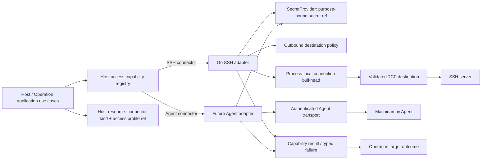

# Phase 7 — Host Access and Execution Architecture

**Status:** Approved on the recommended defaults when Phase 8 was authorized
**Scope:** Connector boundaries, Go SSH behavior, command execution, network controls, Secret Store integration, and future Agent compatibility. No code changes.

## 1. Host-access architecture



The Host domain records a connector kind and opaque access-profile reference, plus ordinary resource identity and desired/observed state. It does not contain `ssh.Client`, SSH auth methods, key bytes, protocol-specific options, or a session lifecycle. Connector selection and capability support belong to application/infrastructure composition.

### Responsibilities

| Component | Responsibility |
|---|---|
| Host domain | Identity, desired access intent, profile reference, lifecycle and conditions; no transport details |
| Host access application port | Request a named capability for a Host and return a typed result; enforce capability checks and operation policy |
| Connector registry | Map stable connector kind to adapter and declared capabilities; reject missing/unsupported capabilities early |
| SSH adapter | Resolve SSH-specific access settings and secrets, enforce pinning, network policy, limits, dial/handshake, execute bounded capabilities, close resources |
| Secret Store | Resolve a version-pinned secret for an authorized purpose; never serialize or publish plaintext |
| Network policy | Resolve once, evaluate every DNS result, and dial only a validated address |
| Operation application | Authorize, pin targets, schedule bounded work, apply deadlines/cancellation, persist status/results/audit |
| Agent adapter (future) | Authenticate Agent identity, negotiate declared capabilities, submit/observe Agent tasks, translate protocol results to application results |

## 2. Capability-oriented connector contracts

Do not define a universal `Connect()` or session interface that every connector must emulate. SSH is an outbound interactive protocol; an Agent may be an asynchronous task protocol with no caller-owned socket/session. Define the smallest stable capability ports used by application consumers:

```go
type ConnectorKind string
type Capability string

const (
    CapabilityReachability Capability = "reachability"
    CapabilityObserve     Capability = "observe"
    CapabilityExecute     Capability = "execute"
)

type AccessTarget struct {
    HostID      string
    ProfileID   string
    ProfileRev  uint64
    EndpointID  string // opaque adapter-owned target identity
}

type Connector interface {
    Kind() ConnectorKind
    Capabilities() []Capability
}

type ReachabilityTester interface {
    TestReachability(ctx context.Context, target AccessTarget) error
}

type CommandExecutor interface {
    Execute(ctx context.Context, target AccessTarget, request CommandRequest) (CommandResult, error)
}

type HostObserver interface {
    Observe(ctx context.Context, target AccessTarget) (ObservedHostState, error)
}

type CommandRequest struct {
    Argv       []string
    Timeout    time.Duration
    OutputLimit int
}

type CommandResult struct {
    Stdout []byte
    Stderr []byte
    ExitCode *int
    Truncated bool
    StartedAt, FinishedAt time.Time
}
```

The registry resolves a connector by the Host’s connector kind, then the use case requires a specific capability interface. A connector may implement only `ReachabilityTester` and `HostObserver` without command execution. Registration verifies declarations against implemented ports at process startup. Avoid passing domain `Host` or database entities into adapters; translate to a minimal `AccessTarget`/request at the boundary. In production, `EndpointID` resolves from a trusted profile store, not arbitrary request input.

`CommandRequest` accepts argv, never an arbitrary shell string. It belongs to the Operations capability and is unavailable to generic Host reconciliation. Capability names are a small registry contract, not a speculative plugin framework.

## 3. SSH adapter and connection lifecycle

### Initial SSH connector

Use the existing Go-native implementation based on `golang.org/x/crypto/ssh`; do not launch `/usr/bin/ssh`. The adapter translates an access profile and secret references into a temporary auth method, validates the target, connects with a context-aware TCP dialer, verifies the server key, opens one SSH session for the requested action, drains bounded output, and closes the SSH client and TCP connection on every path.

Do not pool SSH connections initially. Each verification or command gets a fresh connection. Pooling would extend credential and host-key trust lifetimes, complicate cancellation and identity changes, and risk sending work over stale sessions. The SSH protocol/client can multiplex, but no current requirement justifies that operational complexity. Revisit only with measured handshake cost and an explicit pool invalidation model keyed by Host revision, access-profile version, host-key pin version, and policy version.

```mermaid
sequenceDiagram
  participant U as Use case / Operation worker
  participant R as Connector registry
  participant S as SecretProvider
  participant N as Network policy
  participant H as SSH adapter
  participant TCP as Remote SSH endpoint
  U->>R: Request reachability or execute capability
  R->>H: Resolve SSH connector + capability
  H->>S: Resolve profile secretRef/version for SSH auth purpose
  S-->>H: Plaintext bytes in bounded process scope
  H->>N: Resolve target hostname
  N->>N: Check every address and deny unsafe ranges
  N->>TCP: Dial one validated IP:port
  TCP-->>H: SSH host key during handshake
  H->>H: Compare SHA-256 fingerprint to configured pin
  H->>TCP: Authenticate only after host-key callback accepts
  H->>TCP: Open exec channel if requested
  TCP-->>H: stdout, stderr, exit status
  H->>H: Drain within cap, sanitize and classify result
  H->>TCP: Close session/client/socket; release bulkhead slot
  H-->>U: Typed capability result/error
```

### Host-key verification

- Require an explicit expected SHA-256 fingerprint for every SSH Host; an absent pin is an error. Unknown or changed fingerprints fail closed and return the observed fingerprint through a dedicated trust-confirmation response only.
- Never auto-accept a first key or offer a global “skip verification” mode. A user explicitly confirms trust through an authorized Host/access-profile update, producing an audit record and new desired revision.
- Rotation can support a time-bounded set of accepted fingerprints during a planned overlap. The set is limited and scoped to one Host/profile; expiration removes the old pin. Revocation of the old key must be explicit and auditable.
- SSH host-key verification occurs during protocol handshake before credentials are sent. Server-auth failure is not retried with weaker algorithms or trust rules.

The current `hostKeyCallback` compares a configured fingerprint to `ssh.FingerprintSHA256` and fails on absent or mismatched pin. Preserve this behavior. Improve the domain boundary by representing pins as connector-neutral access-profile trust metadata rather than `SSHAuthType` fields on Host.

### SSH credential resolution and rotation

Host/access profile stores a version-pinned `SecretRef` for password, private key, or passphrase material; it does not store plaintext in Host API output or event payload. After host-key validation, SSH adapter materializes the auth method and uses it only for that connection. Secret values are not placed in `DialParams` structs that cross broad application boundaries; use a private adapter-only request type.

Rotation creates a new secret version and updates the access-profile binding. The profile update is audited and triggers reconciliation for affected Hosts; subsequent dials use the new version. Existing sessions remain open until their action ends, unless an explicit emergency revocation policy closes tracked sessions. The default is no cross-action connection pool, so rotation affects all new dials promptly.

## 4. Connection bounds, timeout, and cancellation

- Retain a single process-local SSH bulkhead shared by registration checks, metrics probes, and Operation execution. The current default is 32 concurrent outbound SSH actions; queueing is bounded or rejected explicitly. Operation worker count and SSH capacity are separate controls.
- Host registration currently waits for a slot with a 7-second context. Run execution currently waits for SSH capacity within the per-target timeout, polling at 50 ms. Target design should replace the polling loop with a bounded, cancellation-aware semaphore/wait queue if fairness is needed; do not spawn a goroutine per waiter.
- Every action has one context deadline that bounds capacity wait, DNS lookup, TCP dial, SSH handshake, channel setup, and remote command. Use phase budgets only if they sum within the operation deadline. Handshake has a finite default; clear handshake socket deadlines after successful negotiation.
- Context cancellation closes the connection and session. Release bulkhead capacity exactly once using `defer`. Process shutdown stops new work, cancels in-flight local work, waits for bounded drain, and records Operation interruption.
- Closing the local SSH channel cannot guarantee that a remote command stopped. On timeout/cancel after sending exec, report outcome as uncertain (`may still be running`) unless the remote protocol provides a verified cancellation mechanism. Do not automatically retry an ambiguous command.
- No unbounded goroutine or connection per event. Bound run-level parallelism, per-run target concurrency, and process-level SSH connections; enforce host and request caps before work starts.

## 5. Remote command and Operation execution

Keep reconciliation and imperative operations separate. A Host controller uses `Observe`/reachability capabilities to converge desired state and does not execute arbitrary user command payloads. A user command creates an Operation; an Operation worker claims it, loads the latest Host and access profile, checks the capability and current execution policy, then calls `CommandExecutor`.

### Submission and target pinning

1. Authenticate and authorize `runs:execute` (future `operations:execute`).
2. Validate argv shape/size, execution allowlist, timeout, target rule, max hosts, per-run concurrency, and idempotency key.
3. Resolve target rule once and snapshot Host ID, endpoint identity/address/port, connector kind, Host/access-profile revision, and credential reference version. The current implementation pins Host ID/address/port and a target hash; target design also pins connector/profile/trust versions.
4. Persist Operation, target snapshots, encrypted argv, audit fact, and outbox notification atomically; never store an unparsed shell string.
5. Worker re-checks current authorization/policy before execution. If endpoint/trust/profile changed, fail that target and require resubmission or an explicit approved policy.
6. Persist per-target status, exit code, bounded result, error class, timestamps, and final Operation aggregate status. Command execution is not automatically retried because an SSH failure can occur after the remote side effects begin.

### Shell safety

SSH `exec` commonly invokes a remote command interpreter. The safe boundary is to accept structured argv, reject control characters/invalid program syntax, and quote each argument using a well-defined POSIX quoting function. Never concatenate untrusted selector/name/metadata into the command. Do not expose raw-shell mode. The allowlist constrains executable names but cannot make an allowed interpreter or multi-purpose program safe; production should permit narrow, single-purpose programs and document argument risk.

The current `domain.ValidateArgv` restricts program names and arguments, `domain.QuoteArgv` quotes values, and the Run service caps host targets at 200. Keep those protections and ensure quoted command construction remains connector-local or a shared tested protocol utility.

### stdout/stderr and output limits

- Capture stdout and stderr separately at the adapter boundary. Apply a combined raw-byte ceiling while continuing to drain both remote streams after the cap to prevent SSH channel backpressure/deadlock; discard excess bytes and set `Truncated`.
- Sanitize terminal escape/control sequences and invalid UTF-8 before persistence or display. Use a separate bounded per-target result cap (the current domain cap is 64 KiB) and cap error text.
- Never log stdout/stderr, argv, passwords, private keys, passphrases, or untrusted full remote errors. Tracing records operation ID, Host ID, connector kind, duration, byte counts, truncation flag, and stable error class only.
- Generic output redaction cannot reliably identify secrets echoed by a remote program. Recommend encrypted-at-rest output plus restrictive read permission and bounded retention; inform users that command output may contain sensitive data. Do not promise that regex masking prevents disclosure.
- Current `sshclient.ExecuteRemoteCommand` merges stdout/stderr into a 1 MiB bounded buffer; Run service sanitizes and truncates stored output to 64 KiB. `run_hosts.output` and `error` are stored as plaintext in the database; this is a known sensitive-data limitation.

### Error taxonomy

Map adapter errors to stable categories without exposing raw credentials or stack details:

| Category | Retry / Operation behavior |
|---|---|
| Invalid access profile / unsupported capability | Permanent configuration failure; no dial |
| Secret reference unavailable or decryption failed | Fail closed; no fallback credential; operator action |
| Target denied by policy | Permanent security denial; audit and no retry until policy/target changes |
| DNS failure / no permitted answers | Transient or policy-classified; bounded backoff for reachability, no automatic command replay |
| TCP refused / unreachable / timeout before SSH exec | Connection failure; action known not started when provable; explicit retry policy only for idempotent capability |
| Host-key unknown/mismatch | Security failure; no retry/bypass; requires trust workflow |
| Authentication denied | Credential failure; no brute-force retry; secret/profile rotation needed |
| SSH protocol/session setup failure | Transient or permanent by structured cause; preserve uncertainty if exec may have been sent |
| Command non-zero exit | Completed command failure, not transport failure; record exit code |
| Deadline/cancel before exec | Cancelled/timed out and known not sent |
| Deadline/cancel after exec request | Outcome uncertain; never auto-retry unless Operation declares idempotency and policy allows |
| Capacity exhausted | Backpressure/queue outcome; retry at scheduler, not via spawned goroutine |
| Output truncated | Successful/failed execution with `truncated=true`; never hide truncation |

## 6. Host network restrictions and SSRF defense

All connector outbound dials pass through a central destination policy. The policy is connector adapter infrastructure, but application/runtime owns its immutable versioned configuration. Enforce it at dial time even if registration validated the Host earlier, because DNS answers and policy can change.

- Parse IP literals and deny forbidden categories before acquiring scarce SSH capacity where possible.
- Resolve hostnames once per dial; validate every answer; dial the exact validated IP rather than resolving again. Reject mixed-safe/unsafe DNS answer sets rather than selecting only a safe result.
- Always deny unspecified, multicast, broadcast/this-network, zoned addresses, and cloud metadata endpoints; apply explicit deny ranges before allow rules. Keep loopback and link-local denied by default. Private-range defaults must be owner-configurable and documented.
- Re-check any redirect/proxy/tunnel target if future connectors introduce them. Do not add port forwarding, proxy jump, or arbitrary URL fetch capability as an incidental feature.
- Pair application policy with deployment egress firewall/security groups. An in-process policy is not a network boundary against a compromised process.
- DNS rebinding is mitigated by dialing the validated resolved address directly. DNS itself remains untrusted; impose resolver timeout and bound result count.

The current `pkg/netpolicy` resolves hostnames once, validates every returned address, and dials a validated IP. It denies metadata and unsafe address classes and supports explicit allow/deny CIDRs. It currently permits public destinations and, by default, private destinations; egress firewall controls remain recommended.

## 7. Future Agent connector boundary

Keep `Host` identity and desired state independent of SSH. `connectorKind=agent` plus an opaque enrollment/profile reference selects an Agent adapter. The Agent adapter can implement `HostObserver` and asynchronous `CommandExecutor` with the same application result contract; it does not need to pretend to be an SSH session.

Agent-specific concerns stay outside Host domain: enrollment token exchange, certificate identity, mTLS, heartbeat lease, protocol version, capability negotiation, Agent software version, and offline queue semantics. Host observed state records the Agent-reported facts and freshness. Agent identity is bound to Host ID by a secure enrollment workflow; an Agent cannot choose an arbitrary Host ID.

Capability differences are explicit:

| Capability | SSH connector | Future Agent connector |
|---|---|---|
| Reachability | Outbound TCP/SSH handshake + host-key pin + auth | Agent heartbeat/transport health; may be inbound/push or polling |
| Observe | SSH-based probe/command or host facts | Structured Agent report with timestamps and protocol version |
| Execute argv | SSH exec channel; remote shell quoting and uncertain cancel | Agent task protocol; explicit argv if Agent supports it, task ID and acknowledgement |
| Cancellation | Close local session; remote process may continue | Best-effort cancel by task ID; outcome follows Agent acknowledgement/lease |
| Credentials/trust | SecretStore ref + SSH host-key fingerprint | Agent certificate/enrollment identity; no SSH secret required |
| Offline behavior | Dial fails; retry policy at controller/operation layer | Durable task acceptance/expiry depends on protocol; must be negotiated, not assumed |

Do not claim an Agent capability based only on connector kind. Store or negotiate the supported set and reject unsupported Operation kinds before enqueue. Agent delivery remains at least once and idempotency keys/task IDs are required for replay safety.

## 8. Go package boundaries

- `internal/hostaccess`: application-facing capability interfaces, registry, connector selection and typed results. No SSH library imports in `domain`.
- `internal/hostaccess/ssh`: Go SSH implementation, host-key pin verification, command quoting integration, network policy adapter, auth parsing, output drain/cap, typed error mapping.
- `pkg/netpolicy`: retain reusable IP/address policy and safe dial behavior; keep connector-specific policy wiring in runtime composition.
- `internal/secrets`: Phase 6 provider/SecretRef contract and database-backed implementation; only SSH adapter receives purpose-authorized plaintext.
- `internal/operations`: Operation application service/worker, authorization, target snapshots, concurrency, cancellation, persistence and audit. It depends on `CommandExecutor`, never `sshclient`.
- `internal/hostaccess/agent` (future): Agent protocol/client adapter and capability mapping; introduced only with an actual Agent protocol.
- `internal/bootstrap`: register adapters, inject SecretProvider, policy snapshot, capacity limiter and operation workers; no business rules.
- `internal/domain`: generic Host connector/profile identity, capabilities or lifecycle events only; remove SSH auth structs/types from target Host model during implementation migration.

Current `pkg/sshclient` is an infrastructure package but imports `internal/domain` error/auth types and `pkg/netpolicy`, and `internal/service` passes `sshclient.DialParams` directly. Target ownership moves SSH-specific parameters/errors wholly under the SSH adapter and keeps application ports connector-neutral. This can be staged without changing the external CLI/API contract all at once.

## 9. Failure and recovery matrix

| Scenario | Expected behavior |
|---|---|
| Duplicate reconcile or Operation event | Connector call follows idempotency policy; resource reconcile reloads current state; imperative command is not repeated by default |
| Host/access-profile deleted before worker begins | Load latest state, mark target failed/skipped; no stale credentials or address are used |
| Host address, pin, connector kind, or access profile changes after submit | Snapshot comparison fails safely; require resubmission or explicit use-current policy |
| DNS answer changes between check and dial | Dial pinned validated address; next attempt resolves again and revalidates |
| Credential rotates during an active session | New dials use new pinned version; active action completes/cancels under existing session policy |
| Host key changes unexpectedly | Fail closed, return trust-change condition; no credential sent on rejected handshake |
| Slow/hung TCP/SSH/remote command | Context deadline closes local connection; classify stage and certainty; persist bounded result |
| Cancellation races with remote command start | Record cancellation and uncertain outcome if exec may have reached target; do not claim remote termination |
| Flood of checks/runs | Shared bulkhead plus bounded operation workers cap connections; reject/backpressure excess work |
| Remote command emits unbounded output | Drain while discarding above cap, mark truncation, sanitize and bound persistence |
| Secret decryption/key unavailable | Fail closed before connection; report safe key/secret error class; no plaintext log |
| API/process crashes after command was sent | Operation recovery marks interrupted/uncertain; no automatic re-execution |
| Agent lacks requested capability or protocol version | Reject before dispatch or mark explicit unsupported capability; do not fall back to SSH silently |

## 10. Current implementation baseline

Verified current behavior:

- `pkg/sshclient` uses `golang.org/x/crypto/ssh` and TCP; enforces an expected SHA-256 host-key fingerprint; authenticates with password or private key; context cancellation closes the socket; handshake has a 10-second default; remote stdout/stderr currently share a mutex-protected 1 MiB cap.
- `internal/service/host_service.go` validates and actively tests SSH registration before persisting a Host, applies `netpolicy`, waits for a shared SSH slot, and currently passes plaintext credential fields into `sshclient.DialParams`.
- `internal/service/ssh_capacity.go` provides a process-local 32-slot non-waiting bulkhead; Run execution polls for capacity while respecting the per-host deadline.
- `internal/service/run_service.go` pins selected targets at submission, uses `domain.QuoteArgv`, per-host timeouts, cancellation/heartbeats/recovery, and does not automatically retry commands. On cancellation/timeout, it records that the command may still be running remotely.
- `internal/domain/run.go` validates argv, provides an allowlist, caps target count at 200, and sanitizes terminal sequences/control bytes before truncating output to 64 KiB.
- `pkg/netpolicy` validates every DNS result and dials the validated IP; current defaults allow private/public addresses and deny loopback/link-local/metadata and unsafe special addresses.
- Host domain currently contains `SSHAccess` and `SSHAuthType` structures and `ConnectionMethod` includes SSH and Agent Pull/Push values, but `SSHValidate` only supports SSH. `cmd/agent` remains a placeholder.
- Run argv is encrypted at rest; target output/error are stored in plaintext. Logs intentionally use stable messages in most Operation paths but some lower-level SSH errors include endpoint/error text.

These observations identify migration tasks, not permission to implement them in Phase 7.

## 11. ADRs

See ADR-028 through ADR-031 for connector capabilities and Host independence, SSH trust/network controls, bounded Operation execution, and the future Agent boundary. They remain proposed pending Phase 7 approval.

## 12. Decisions and approval gate

Phase 7 proposes these initial defaults: capability-oriented ports; Go `x/crypto/ssh`; no connection pool; pinned host keys; Secret Store references; one shared process SSH bulkhead (current default 32); structured argv only; bounded and sanitized output; no automatic retry for ambiguous imperative commands; egress controls outside the process; Agent capabilities introduced only when an actual protocol is defined.

No new product decision is required to complete this architecture proposal. Output encryption/retention and allowed-program policy remain security policy choices carried from earlier phases; this design recommends encrypted-at-rest bounded output and narrow allowlists. Please approve or amend the defaults before Phase 8.
