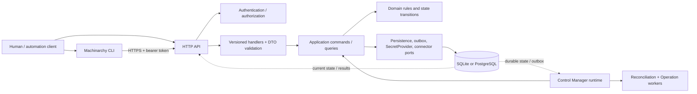
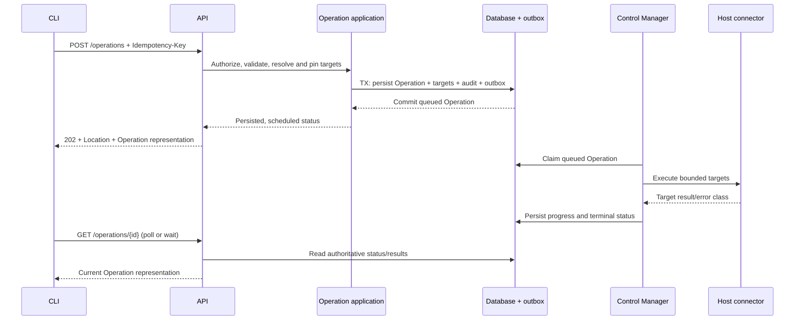
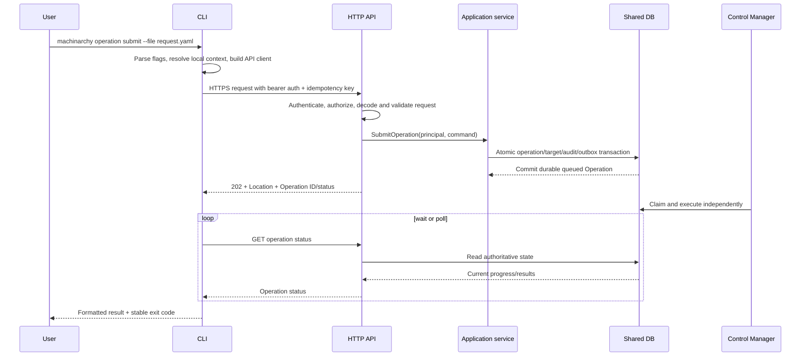

# Phase 8 — API, CLI and Application Interaction

**Status:** Accepted as the working design baseline when Phase 9 was authorized
**Scope:** External API contracts, application command/query boundaries, async resource and Operation semantics, authorization, and CLI behavior. No HTTP handlers or CLI commands are implemented here.

## 1. API architecture and runtime boundary



API and Control Manager are separate runtime responsibilities. The API authenticates requests, validates transport input, invokes application use cases, commits durable state, and returns resource/Operation representations. The Control Manager independently runs reconciliation and scheduled Operation workers, using the shared application/domain logic and database. The API does not require a Control Manager process to serve reads or persist desired state, but an accepted asynchronous workload may remain queued until a worker is available. Health/readiness must distinguish API readiness (database/auth dependencies) from controller/worker readiness.

The CLI is an API client. It parses arguments, resolves local CLI context, calls API endpoints, formats responses, and maps failures to exit codes. It must not open the database, resolve target rules independently, implement authorization, contain domain transitions, or contact Hosts directly.

### Current-state gap

Current routes are registered beneath `/api/v1`. `internal/transport/http/v1` contains endpoint handlers and passes several domain stores directly into transport constructors. The CLI has an immutable HTTP client and currently lists Hosts and Environments, but no mutating resource/Operation commands. Existing Run requests return `202` and execute in a `RunService` constructed from the API runtime; the separate Control Manager is a separate executable but is not currently the durable Run worker. The target design moves durable Operation execution to the Control Manager while preserving the API’s independent request/read responsibility.

## 2. Application command/query boundary

Transport DTOs are not domain entities. Each HTTP handler performs only authentication context extraction, request decoding, field validation, application invocation, response status/header selection, and safe error mapping.

| Application request | Examples | Durable side effect? |
|---|---|---|
| Command | `CreateHost`, `UpdateHostDesiredState`, `DeleteHost`, `SubmitOperation`, `CancelOperation`, `ApplyRuntimeConfiguration`, `CreateSecretVersion` | Yes; state/audit/outbox in transaction as applicable |
| Query | `GetHost`, `ListHosts`, `GetOperation`, `ListOperations`, `GetConfigurationStatus`, `ListSecretMetadata` | No |
| Validation/preview query | `ValidateConfiguration`, `PreviewOperationTargets` | No persistent mutation; may read current state |
| Worker command | `ReconcileHost`, `ExecuteOperationTarget`, `ApplyConfigurationSnapshot` | Yes; worker-owned state transitions/results |

Application services own authorization-independent business rules and transaction coordination. Transport authorization middleware is an early guard; application services also enforce caller permissions so internal callers cannot bypass policy. Application handlers never receive Echo context, raw HTTP request/response objects, or CLI command objects.

For mutating requests with an expected resource revision, use `If-Match` or an explicit expected revision field. Return a conflict rather than silently overwrite a concurrent update. Use `Idempotency-Key` for Operation submission and any non-idempotent creation where a client retry could duplicate work.

## 3. API versioning and representation conventions

- Preserve the current major path prefix `/api/v1`. Additive optional response fields/endpoints remain in v1. Breaking field semantics, lifecycle changes, or incompatible request schemas require `/api/v2` with a transition period.
- Publish OpenAPI for the same versioned routes and generate CLI client types/contract references from the API schema where practical. The schema is the transport contract; domain structs should not be serialized directly as the long-term public API.
- Use stable opaque resource IDs and explicit `kind`/`apiVersion` only where versioned polymorphic payloads need them (not on every ordinary response by default).
- Timestamps are UTC RFC 3339. Status and condition enums are documented; clients should tolerate unknown response fields and fail safely on unknown state that affects an action.
- Resource `metadata.revision` is an optimistic concurrency token; Host `generation` tracks desired-state changes; `status.observedGeneration` tracks reconciliation progress. An HTTP ETag may carry the opaque resource revision.
- Never serialize credentials, secret bytes, encryption metadata, raw database errors, or internal workspace identifiers unless a caller-facing contract explicitly needs them.

## 4. Resource API conventions and endpoints

Proposed endpoint inventory (the current API has only the endpoints noted in the right column):

| Method and path | Purpose / response semantics | Current status |
|---|---|---|
| `GET /api/v1/me` | Current authenticated principal and effective permissions | Exists |
| `GET /api/v1/environments` | Cursor-paged environment list | Exists; currently unpaged |
| `POST /api/v1/environments` | Persist environment; `201 Created` + `Location` | Exists |
| `GET /api/v1/environments/{id}` | Read one environment | Proposed (currently no item GET) |
| `PUT /api/v1/environments/{id}` | Replace desired environment fields with ETag precondition | Exists; no consistent revision header yet |
| `DELETE /api/v1/environments/{id}` | Delete when no dependent resource blocks it; `204` or structured conflict | Exists |
| `GET /api/v1/hosts` | Cursor-paged Host list; selector filters | Exists; currently returns full array and filters in handler |
| `POST /api/v1/hosts` | Persist Host desired resource; `201` + `Location`, pending reconciliation state | Exists, but currently performs synchronous SSH verification before persistence |
| `GET /api/v1/hosts/{id}` | Read Host desired state and current status | Proposed |
| `PUT /api/v1/hosts/{id}` | Replace desired fields with `If-Match`; increment generation/revision | Exists; add consistent precondition |
| `PATCH /api/v1/hosts/{id}/labels` | Atomic metadata patch; resource revision precondition | Exists |
| `GET /api/v1/hosts/{id}/status` | Conditions, observed generation, latest transition and reason | Proposed (status currently embedded in Host/SSH representation) |
| `DELETE /api/v1/hosts/{id}` | Persist deletion intent; `202` while finalization is pending, `204` if immediately deleted | Exists but currently synchronous delete |
| `POST /api/v1/hosts/bulk` | Bulk desired resource submission with per-item persisted/rejected result | Exists; currently probes SSH before persistence |
| `POST /api/v1/fleet/targets/preview` | Read-only target resolution and binding hash | Exists |
| `GET /api/v1/hosts/{id}/jobs` | Cursor-paged legacy job history | Exists; currently offset paging |
| `GET /api/v1/audit/events`, `/audit/verify` | Append-only audit read and integrity verification | Exists; owner/human only |
| `GET /api/v1/healthz/live`, `/ready` | Process liveness/readiness, separate worker readiness | Exists outside API version prefix |

Host create/update persists desired state; successful HTTP response does not claim the Host is connected or converged. A `201` means the resource row was committed and returns its generation/revision/status. Reconciliation begins independently. If a caller needs an immediate connectivity test, expose an explicit validation/Operation flow instead of blocking the resource write on a network call.

### Resource list contract

Use a consistent envelope:

```json
{
  "items": [{"id": "host_…", "metadata": {"revision": 12}, "status": {"observedGeneration": 4}}],
  "nextCursor": "opaque-token-or-null"
}
```

Use `limit` with a server default and maximum, plus an opaque stable `cursor`. Bind cursors to the normalized filter/sort and tenant; reject malformed or mismatched cursors. Use deterministic ordering with a stable tie-breaker. Prefer keyset pagination; retain `before_id`/`offset` only for compatibility while old clients migrate. Do not return unbounded collections.

## 5. Operation API lifecycle

Use a first-class `/operations` resource as the public abstraction. A command execution is one Operation kind; more kinds may be added only when their lifecycle fits the Operation model. Keep current `/runs` endpoints as a compatibility surface during migration, with documented deprecation before removal.

| Method and path | Semantics |
|---|---|
| `POST /api/v1/operations` | Validate and persist Operation + immutable targets + audit + outbox; return `202 Accepted`, `Location: /api/v1/operations/{id}`, and status `queued` only after transaction commit |
| `GET /api/v1/operations` | Cursor-paged list by kind/status/created time; excludes sensitive argv and per-target output by default |
| `GET /api/v1/operations/{id}` | Status, progress, cancellation flag, timestamps, safe error classes and authorized result fields |
| `GET /api/v1/operations/{id}/targets` | Cursor-paged target-level state and bounded results, subject to output-read permission |
| `POST /api/v1/operations/{id}/cancel` | Persist cancel request and wake worker; return `202` with `cancelRequested=true`; final status is later observed |
| `POST /api/v1/operations:preview` | Optional read-only target/policy preview, returns target hash and plan; no Operation is created |

Submission flow:



### Distinguish request, persistence, scheduling, and execution

| State the caller cares about | Meaning | Observable signal |
|---|---|---|
| Request rejected | Authentication, validation, authorization, conflict, or storage failure prevented durable acceptance | Non-2xx problem response; no Operation ID is promised |
| Request accepted | API has accepted an asynchronous workflow | `202`; response must include status monitor/`Location` |
| Resource persisted | Database transaction committed the Operation/resource and its audit/outbox records | Operation ID, `createdAt`, `persisted=true` or successful resource response |
| Operation scheduled | Durable Operation is `queued` and recoverable by Control Manager; not merely a volatile in-memory enqueue | `status=queued`, `scheduledAt`/creation time, durable ID |
| Operation running | Worker has claimed it and began processing | `status=running`, `startedAt`, optional bounded progress |
| Operation completed | Terminal aggregate state and target outcomes are committed | terminal status, `finishedAt`, counts and result links |

HTTP `202` means processing is not complete; the response must point to a status resource. The Machinarchy contract strengthens this: for Operation submission, return `202` only after durable persistence and scheduling eligibility are committed. A queue signal itself is not completion. [RFC 9110 §15.3.3](https://www.rfc-editor.org/rfc/rfc9110.html)

Operation states: `queued`, `running`, `cancel_requested`, `succeeded`, `partially_succeeded`, `failed`, `cancelled`, `timed_out`, `interrupted`. `cancel_requested` is nonterminal; per-target states remain distinct. Cancellation is a request, not an immediate terminal result; an already-sent SSH command can have an uncertain outcome. This follows the approved Phase 2 Operation state machine.

Use `Idempotency-Key` for POST submission. The server stores key scope, request digest and Operation ID atomically. A retry with the same key and same semantic request returns the existing Operation; reuse with a different request returns `409`. Do not deduplicate solely by argv/target content.

## 6. Configuration API

Carry forward Phase 6’s global, revisioned configuration and process application status. Configuration endpoints are distinct from local CLI context configuration:

| Method and path | Contract |
|---|---|
| `GET /api/v1/configuration` | Current effective persisted global revision; ETag/revision; contains secret references only |
| `POST /api/v1/configuration:validate` | Validate full candidate without persistence; return field errors and restart-required fields |
| `PUT /api/v1/configuration` | Apply candidate with `If-Match`; validate, persist immutable revision + head + audit + outbox transactionally; return `200` with persisted revision, not claim all processes applied |
| `GET /api/v1/configuration/revisions` | Cursor-paged history |
| `GET /api/v1/configuration/revisions/{revision}` | Secret-free immutable revision details |
| `POST /api/v1/configuration/revisions/{revision}:rollback` | Validate old effective values against current schema, create a new revision using `If-Match` |
| `GET /api/v1/configuration/status` | Per-process attempted/applied revision, process role, state, heartbeat age, and safe error code |

Persisted revision and applied revision are separate. Return success after the revision transaction commits, but expose process lag and failures. Restart-required changes should be rejected from runtime updates until explicit staged-rollout semantics are designed. Configuration writes are commands; reads and validation are queries.

## 7. Secret API

Keep secret management separate from configuration. API and CLI exchange secret references and metadata; plaintext is write-only through management calls and is never returned by normal APIs.

| Method and path | Contract |
|---|---|
| `GET /api/v1/secrets` | Cursor-paged metadata visible to caller; never includes ciphertext/plaintext |
| `POST /api/v1/secrets` | Accept bounded secret bytes over TLS, create metadata/version, return `201` metadata only |
| `GET /api/v1/secrets/{id}` | Metadata and reference/rotation state only |
| `PUT /api/v1/secrets/{id}` | Create a new immutable version with expected current version; response metadata only |
| `POST /api/v1/secrets/{id}/rotate` | Create a rotated version and advance pointer; no plaintext read-back |
| `DELETE /api/v1/secrets/{id}` | Tombstone/delete only if unreferenced; return `409` with safe reference identities if still in use |

Do not expose secret resolution as an HTTP endpoint. Authorized runtime components resolve version-pinned refs through the internal SecretProvider. Secret API request bodies are never logged or included in traces; errors do not echo supplied values. Mutations return an audit event ID and secret version but no value-derived digest.

## 8. Request validation and API errors

Validation layers:

1. HTTP content type, request size, syntax, required fields, unknown fields, and path/query parsing.
2. DTO constraints and normalization (limits, enum values, field formats).
3. Application authorization and cross-field/business validation.
4. Domain invariants and optimistic revision checks.
5. Persistence constraints and transaction outcome.

Reject malformed/unknown values rather than silently interpreting them. Validate all list filters before database access. Bound request body sizes, target counts, selector complexity, argv/secret sizes, and pagination values. Use field paths in validation errors, without echoing sensitive input.

Standardize errors as `application/problem+json` based on RFC 9457, with stable extensions `code`, `requestId`, optional `fieldErrors`, and safe `currentRevision`/`targetsHash` where conflict resolution needs them. `detail` is user-safe; internal stack, SQL errors, secret data, network credentials, and raw connector messages stay in logs under redaction. [RFC 9457](https://www.rfc-editor.org/rfc/rfc9457.html)

| HTTP status | Use |
|---|---|
| `400` | Malformed request, invalid query/path, schema or business validation |
| `401` | Missing, invalid, expired, or revoked authentication |
| `403` | Authenticated principal lacks permission or required human session |
| `404` | Resource absent in caller’s authorized scope (avoid cross-scope existence leaks) |
| `409` | State conflict, idempotency-key mismatch, already-terminal cancellation, unique constraint |
| `412` | `If-Match`/expected revision no longer matches |
| `413` | Request or secret body exceeds supported size |
| `415` | Unsupported content type |
| `422` | Optional semantic validation response if kept distinct from malformed `400`; choose one consistent policy |
| `429` | Per-client/API rate limit; include `Retry-After` when known |
| `503` | Temporary capacity/dependency unavailability; include bounded `Retry-After` |
| `500` | Unexpected safe generic failure with request ID |

Pick one validation status (`400` or `422`) for v1 and apply it consistently; recommendation: `400` to align with current handlers and avoid unnecessary distinction. A successful cancellation request is `202`; a finished Operation cancellation attempt is `409`.

## 9. Authentication and authorization integration

Carry the authenticated principal from middleware into every application command/query. Current middleware accepts JWT bearer or auth cookie and hashed `mch_pat_` API tokens. JWT authorization reloads membership role on each request. CLI uses bearer token only. Retain issuer/algorithm/expiry validation and workspace scoping.

| Capability | Proposed permission | Initial role/use policy |
|---|---|---|
| Host/environment reads | `inventory:read` | Owner/operator/reader |
| Host/environment mutations | `inventory:write` | Owner/operator |
| Operation read/progress | `operations:read` | Owner/operator/reader; output may require stronger permission |
| Operation submit/cancel | `operations:execute` (compatibility with `runs:execute`) | Owner/operator; separate explicit authorization |
| Configuration read/status/history | `configuration:read` | Owner initially, optionally operator for non-sensitive effective config after review |
| Configuration validate/apply/rollback | `configuration:write` | Owner + human session initially |
| Secret metadata | `secrets:metadata` | Owner initially |
| Secret create/update/rotate/delete | `secrets:write` | Owner + human session; API tokens refused |
| Audit read/verify | `audit:read` | Owner + human session (current behavior) |
| Token/member administration | Existing `tokens:manage`, `members:manage` | Owner + human session |

Use least privilege and independently authorize reading sensitive Operation output/argv. Do not infer output access merely because a user can list status. API checks occur before application service use and are repeated in application services. Secret values are never authorized for generic API reads.

## 10. CLI command hierarchy, output, and exit codes

```text
machinarchy
├── get hosts|environments
├── host create|update|delete
├── operation submit|list|get|wait|cancel|preview
├── config
│   ├── context list|use-context|set-cluster|set-credentials|set-context
│   └── runtime get|validate|apply|history|rollback|status
├── secret list|describe|create|update|rotate|delete
└── auth login|logout|whoami (existing login/logout remain under API)
```

Use noun-oriented `host create`, `operation submit`, `config runtime ...`, and `secret ...` commands. Local `machinarchy config context ...` operations remain explicitly separate from remote `config runtime` API operations.

CLI command responsibilities: parse and validate syntax, read secret input from stdin/protected file, call the typed API client, display results, and map the outcome to an exit code. It must not perform duplicate business validation, target expansion, host connection checks, config mutation, secret decryption, or database access. Server validation remains authoritative.

Global output supports `table`, `json`, and `yaml`; tables are human-oriented and not a stable scripting contract. JSON/YAML preserve API field names and pagination metadata. Avoid emitting secret contents; allow `--quiet` for IDs and `--no-headers`/`--output json` for scripts. Long-running `operation wait` polls the API with backoff and prints state transitions; a local wait timeout stops polling without cancelling the remote Operation. `--cancel-on-interrupt` may explicitly request remote cancellation; Ctrl-C otherwise only interrupts the local client.

Proposed stable CLI exit codes:

| Code | Meaning |
|---:|---|
| `0` | Query/command succeeded; waited Operation reached successful terminal state |
| `1` | Operation completed but failed/partially failed, or generic unexpected CLI failure |
| `2` | CLI usage, local config, or input validation error |
| `3` | Authentication/authorization failure |
| `4` | API/network/dependency failure |
| `5` | Local wait deadline elapsed while Operation remains nonterminal |
| `130` | User interrupted local CLI process; remote cancel only if explicit option succeeded |

Do not overload a CLI exit code with the remote target exit status; print/preserve target exit codes in the Operation result and optionally expose a dedicated `--exit-code-from` policy later.

### CLI/API interaction



## 11. ADRs

See ADR-032 through ADR-035 for API/runtime boundaries and versioning, asynchronous Operation semantics, uniform errors/pagination, and CLI/API-only behavior. They remain proposed until Phase 8 is approved.

## 12. Current implementation observations

- `/api/v1` is the current prefix; HTTP uses Echo and middleware for JWT/API-token authentication, permissions, audit actor, CORS, rate limiting, request logging, tracing, and readiness.
- Host and environment routes cover reads/writes, but list pagination is inconsistent: Hosts return all records, Runs/Audit use `before_id` plus `limit`, while jobs use `limit` plus `offset`.
- Run submission returns `202` and `Location`; dry-run returns `200`. Cancel returns `202`, while terminal cancellation returns conflict. Operation status is polled through `GET /runs/{id}`. Only principals with `runs:execute` see argv and full per-host output; others see limited status/result details.
- Host create currently returns `201` only after synchronous SSH connectivity/authentication/host-key verification and persistence. The target desired-resource API should make persistence independent from reconciliation and remote verification.
- Error responses currently use inconsistent `{"error":"..."}` payloads. Some handlers return validation text directly; others map to generic messages. Existing Run tests ensure storage internals are not leaked and `Retry-After` is used for capacity.
- CLI root has `--config`, `--context`, `--env`, `--output table|json|yaml`, and `--verbose`; existing API client is read-only for Hosts/Environments. CLI process exits with code 1 for any returned error; no stable differentiated exit-code contract exists.
- Config and Secret APIs are not implemented. The Phase 6 API shapes in that proposal remain design, not current behavior.
- The Control Manager executable starts a separate health/operations server and event engine; `internal/bootstrap.NewAPIServer` currently constructs a RunManager in the API runtime. Target Operation execution should be owned by Control Manager.

## 13. Approval gate

Phase 8 recommends: preserve `/api/v1` with additive evolution; use DTOs and application command/query ports; make Host writes durable resource operations; make imperative work first-class Operations with `202` only after persisted/scheduled; unify cursor pagination; adopt safe machine-readable problem responses; keep CLI as an API-only client; and separate API readiness from worker readiness. No HTTP handlers, CLI commands, or API schema have been implemented.
