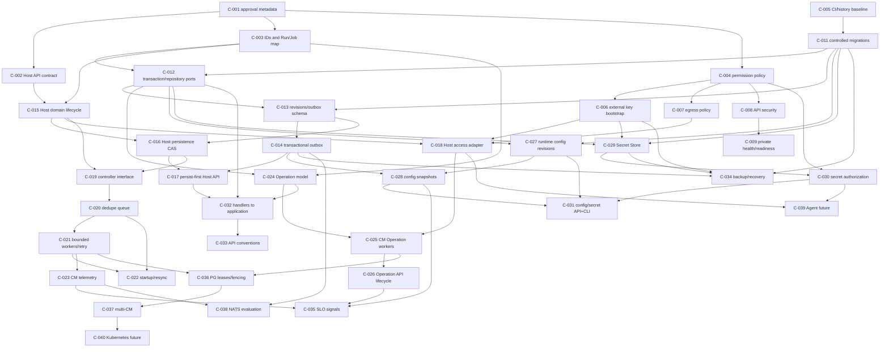

# Phase C — Engineering Roadmap and Backlog

**Status:** Proposed delivery plan; no implementation authorization.

**Architecture inputs:** [Implementation baseline](implementation-baseline.md) and [Phase B repository gap analysis](phase-b-repository-gap-analysis.md).

**Planning date:** 2026-11-11.

This roadmap turns the accepted modular-monolith architecture into reviewable milestones and GitHub-sized tasks. It preserves existing working code and tests unless a task has a specific migration reason. “P0” means a prerequisite to safely enabling the relevant capability; it does not mean all P0 tasks must ship in one release.

## 1. Roadmap at a glance

| Milestone | Outcome | Exit gate |
|---|---|---|
| M0 — Contract and baseline closure | API/data/security decisions that affect migrations are recorded; existing behavior has regression coverage. | No unresolved decision blocks the next vertical slice; current CI baseline is understood. |
| M1 — Security and deployment foundations | Safe key bootstrap, production egress policy, authorization/CSRF/rate limiting and private operational endpoints have defined behavior. | Production remote execution cannot run with unsafe defaults; security regression tests pass. |
| M2 — Persistence and reliable event foundation | Explicit migration lifecycle, resource revisions, transaction contracts and transactional outbox work on both DB engines. | State + audit + outbox atomicity and recovery are verified on SQLite and PostgreSQL. |
| M3 — Host resource vertical slice | Host is connector-neutral, persist-first, versioned, and reports asynchronous observed connectivity. | API can create/update/delete a Host; reconciliation is not yet implied until M4. |
| M4 — Reconciliation pipeline | Outbox and resync feed one deduplicating bounded worker pipeline with retries and recovery. | A missed/duplicate event and CM restart converge to current DB state. |
| M5 — Durable Operation execution | Operations are persisted and executed by CM workers with cancellation, restart recovery, bounded output and API status. | API restart does not lose accepted work; existing Run behavior has compatibility coverage. |
| M6 — Runtime configuration and Secret Store | Versioned global configuration applies atomically; encrypted secrets have external root keys and purpose authorization. | Last-known-good snapshots survive failed updates; secret security tests pass. |
| M7 — API/CLI completion and operational readiness | Application boundaries, async API/CLI workflows, health, metrics, backup/recovery and runbooks are complete. | All-in-one SQLite deployment and standalone API/CM PostgreSQL deployment have verified procedures. |
| M8 — PostgreSQL distributed workers (gated) | Leases, fencing, quotas and takeover support multiple CM replicas. | Concurrency, crash, partition and stale-worker tests pass before enabling replicas. |
| M9 — Future evolution (deferred) | Evidence-driven NATS, Agent, Kubernetes packaging or other growth capabilities. | Separate product/architecture approval and measurable need. |

M0 through M7 describe the initial implementation path. M8 is necessary only for multiple CM replicas. M9 is not part of the initial delivery commitment.

## 2. Engineering backlog

Dependencies refer to backlog IDs. A dependency is complete only when its acceptance criteria and required checks pass. Each item is independently reviewable and should be delivered in a separate issue/PR unless the owner approves a smaller cohesive batch.

### M0 — Contract and baseline closure

#### C-001 — Reconcile architecture approval metadata

- **Priority:** P0 · **Category:** Architecture/docs · **Dependencies:** None · **Effort:** Small
- **Affected packages/files:** `docs/architecture/implementation-baseline.md`, `docs/architecture/phase-12-final-architecture-blueprint.md`, `docs/architecture/decisions/ADR-053-integrated-architecture-review.md`
- **Description:** Align document status labels with the owner's instruction to use the baseline and Phase B analysis as approved inputs. Do not change architecture decisions in this task.
- **Acceptance criteria:** Baseline, Phase 12, and ADR-053 state consistent approval status; deferred and conditional decisions remain labeled; no decision is promoted beyond the user's approval.
- **Testing requirements:** Markdown link and consistency review; `git diff --check`.
- **Documentation requirements:** Update status and source-of-truth wording only; record rationale in the changelog.

#### C-002 — Decide Host create and connectivity API contract

- **Priority:** P0 · **Category:** Product/API contract · **Dependencies:** C-001 · **Effort:** Small
- **Affected packages/files:** `internal/transport/http/v1/host`, OpenAPI spec, CLI host workflows, `docs/architecture/phase-8-api-cli-interaction.md`
- **Description:** Record the transition from synchronous SSH-verified create to persisted Host plus asynchronous reachability. Recommended default: return `201 Created` once persisted, with Pending/Unknown observed connectivity and a status URL; use a separate Operation for an explicit verification request.
- **Acceptance criteria:** Status code, response body, idempotency/precondition behavior, retry UX, and compatibility/version policy are written and approved before endpoint behavior changes.
- **Testing requirements:** Contract tests planned for persisted-but-unreachable Host and repeated requests; no code test in this decision issue.
- **Documentation requirements:** Update API ADR/OpenAPI planning notes and migration/release note requirements.

#### C-003 — Decide identifier and Run/Job/history compatibility

- **Priority:** P0 · **Category:** Data/API compatibility · **Dependencies:** C-001 · **Effort:** Medium
- **Affected packages/files:** `internal/domain/{host,run,job}.go`, `internal/store/migrations`, `/api/v1/runs`, `/api/v1/jobs`, `/api/v1/history`
- **Description:** Map current stored and public identifiers to canonical UUID resource IDs; decide how Run becomes the initial Operation kind and how Job/history records and routes remain accessible. Recommended default: additive ID mapping and compatibility aliases through at least one deprecation window; retain history semantics until each reader is mapped.
- **Acceptance criteria:** A field-by-field/table-by-table mapping, rollback plan, duplicate/foreign-key handling, and compatibility policy are reviewed before migrations are authored.
- **Testing requirements:** Migration fixture tests and old/new API compatibility tests are specified.
- **Documentation requirements:** Data migration and API deprecation plan.

#### C-004 — Decide security grants and sensitive-action approval policy

- **Priority:** P0 · **Category:** Security/product policy · **Dependencies:** C-001 · **Effort:** Medium
- **Affected packages/files:** `internal/domain/authorization.go`, HTTP authorization middleware, future config/secret APIs
- **Description:** Define explicit permissions for inventory writes, remote execution, secret metadata/read-resolution, runtime config, and egress policy changes. Decide owner MFA/step-up and whether production egress widening needs a second approver. Recommended default: separate execution and secret resolution from inventory write; require step-up for key/security changes and two-person approval for production egress widening.
- **Acceptance criteria:** Permission matrix and migration defaults for existing owner/operator/reader roles are recorded; no role gains broader effective access silently.
- **Testing requirements:** Negative cross-workspace/object/property and privilege-escalation cases are listed for implementation.
- **Documentation requirements:** RBAC matrix and operator upgrade notice.

#### C-005 — Establish compatibility test baseline and repair history test debt

- **Priority:** P1 · **Category:** Testing · **Dependencies:** None · **Effort:** Medium
- **Affected packages/files:** `internal/transport/http/v1/history/history_test.go`, current tests, `.github/workflows/ci.yml`, `Makefile`
- **Description:** Record the current CI state and fix or isolate the known legacy history test that targets a removed package/handler API without removing history coverage.
- **Acceptance criteria:** Relevant test commands and current failures are recorded; history behavior has tests against current service/handler boundaries; existing contract/security tests remain enabled.
- **Testing requirements:** Run applicable package tests, full test suite, PostgreSQL workflow path, vet/lint/build according to repository workflow; report actual results.
- **Documentation requirements:** Update contributor instructions only if the test workflow changes; record known remaining failures.

### M1 — Security and deployment foundations

#### C-006 — Separate and validate bootstrap authentication/encryption keys

- **Priority:** P0 · **Category:** Security/configuration · **Dependencies:** C-004 · **Effort:** Medium
- **Affected packages/files:** `internal/config/config.go`, `pkg/crypto/crypto.go`, `internal/bootstrap`, Docker/compose examples
- **Description:** Remove production-inappropriate key fallback and establish explicit external provisioning for separate signing and encryption roots, key identifiers, startup validation, and development-only test keys.
- **Acceptance criteria:** Missing, weak, reused, or invalid production keys fail closed with safe errors; no operator-token fallback; existing ciphertext compatibility and key migration plan are documented.
- **Testing requirements:** Config validation, key separation, ciphertext compatibility, wrong-key failure and no plaintext/error leakage tests.
- **Documentation requirements:** Key generation, provisioning, rotation, backup, restore, and emergency replacement runbook; update sample deployment config.

#### C-007 — Enforce production SSH destination and port policy

- **Priority:** P0 · **Category:** Security/network · **Dependencies:** C-004 · **Effort:** Medium
- **Affected packages/files:** `internal/config/config.go`, `pkg/netpolicy/policy.go`, `internal/service/ssh_capacity.go`, deployment docs
- **Description:** Make production SSH egress deny-by-default with explicit CIDR and port allowlists, retaining DNS answer validation and dialing only validated IPs. State independent firewall requirements.
- **Acceptance criteria:** No configured grant means no production outbound SSH; loopback, metadata and prohibited ranges remain denied; DNS rebinding/mixed-answer protection remains effective; operators can identify which policy denied a target.
- **Testing requirements:** Unit/integration tests for allow/deny CIDRs and ports, mixed DNS answers, rebinding, and actual dial destination; no sensitive target leaked in telemetry.
- **Documentation requirements:** Migration guide from current permissive private-network default and firewall policy examples.

#### C-008 — Harden API mutation security and authorization boundaries

- **Priority:** P0 · **Category:** Security/API · **Dependencies:** C-004 · **Effort:** Large
- **Affected packages/files:** `internal/transport/http/middleware`, `internal/domain/authorization.go`, `internal/transport/http/v1/*`
- **Description:** Add explicit CSRF/Origin defense for cookie-authenticated mutation requests, permission-level checks for sensitive operations, and identity/cost-aware rate limits. Preserve workspace scoping and token hashing.
- **Acceptance criteria:** Every mutating route has an explicit authorization decision; cookie writes reject invalid/missing CSRF or Origin proof; limits do not silently multiply without documented per-replica behavior; secret reads and remote execution have distinct permissions.
- **Testing requirements:** Negative authorization matrix, CSRF, token revocation/scope, rate-limit boundary and multi-instance limitation tests.
- **Documentation requirements:** Auth modes, permissions, rate limit behavior, proxy/trusted-client configuration.

#### C-009 — Isolate management endpoints and define readiness

- **Priority:** P1 · **Category:** Security/operations · **Dependencies:** C-008 · **Effort:** Medium
- **Affected packages/files:** `internal/transport/http/server.go`, `internal/bootstrap/runtime.go`, `cmd/api`, `cmd/controlmanager`
- **Description:** Separate or protect health, readiness, metrics, docs, and profiling surfaces; readiness reflects required dependency and worker capability rather than mere process liveness.
- **Acceptance criteria:** Liveness remains available during recoverable DB/broker degradation as designed; readiness fails when required API/CM capability is unavailable; management endpoints are not exposed on an untrusted public interface by default.
- **Testing requirements:** Listener/auth integration tests for endpoint exposure and partial dependency health.
- **Documentation requirements:** Probe endpoints, network exposure, and reverse proxy/firewall requirements.

#### C-010 — Expand audit coverage and add external integrity anchoring

- **Priority:** P1 · **Category:** Security/audit · **Dependencies:** C-004 · **Effort:** Large
- **Affected packages/files:** `internal/domain/audit.go`, `internal/service/audit_service.go`, store audit adapters, HTTP middleware
- **Description:** Preserve current per-workspace chain and transactional mutation linkage; add security-relevant denials, config/secret access and policy changes, plus an external hash anchor and verification procedure.
- **Acceptance criteria:** Required action matrix is covered; audit rows commit atomically with associated state changes; anchor failure behavior and detection are explicit; no secret plaintext or unnecessary command output enters audit detail.
- **Testing requirements:** Chain tamper, transactional rollback, denied-action and anchor failure tests on both DB engines.
- **Documentation requirements:** Audit event catalog, retention, access, verification and incident procedure.

### M2 — Persistence and reliable event foundation

#### C-011 — Move production schema migration to a controlled lifecycle

- **Priority:** P1 · **Category:** Persistence/operations · **Dependencies:** C-005 · **Effort:** Medium
- **Affected packages/files:** `internal/store/store.go`, `internal/store/migrator.go`, `internal/bootstrap`, `cmd/*`, deployment workflow
- **Description:** Keep automatic migration convenience for local development if desired, but provide one controlled production migration command/step so API and CM replicas do not race migrations.
- **Acceptance criteria:** Migration owner, startup behavior, lock/serialization, failure and rollback policy are explicit; schema state is observable; API/CM can start against an already migrated DB.
- **Testing requirements:** SQLite/PostgreSQL migration tests, concurrent migration-owner test, failure/restart and partially applied migration tests.
- **Documentation requirements:** Upgrade and rollback procedure for single-node and PostgreSQL deployment.

#### C-012 — Define common transaction and repository ports for resource writes

- **Priority:** P1 · **Category:** Persistence/application boundaries · **Dependencies:** C-003, C-011 · **Effort:** Medium
- **Affected packages/files:** `internal/service`, `internal/store`, `internal/store/{sqlite,postgres}`, HTTP handlers
- **Description:** Establish narrow application-owned repository/transaction contracts for Host state, audit and event persistence; gradually remove direct SQL/repository use from HTTP handlers.
- **Acceptance criteria:** Application use case can atomically persist state + audit + outbox using either adapter; network calls are outside transactions; store contract behavior is engine-neutral except documented capabilities.
- **Testing requirements:** Contract tests for commit, rollback, optimistic conflict, audit/outbox atomicity on SQLite and PostgreSQL.
- **Documentation requirements:** Port ownership and transaction boundary notes; avoid duplicating contracts in both service and adapter packages.

#### C-013 — Add resource revision and event/outbox schema

- **Priority:** P0 · **Category:** Persistence/events · **Dependencies:** C-011, C-012 · **Effort:** Large
- **Affected packages/files:** `internal/store/migrations/{sqlite,postgres}`, `internal/domain/event.go`, Host stores
- **Description:** Add additive migrations for resource revision/generation/observed generation and transactional outbox fields (identity, type, schema version, aggregate/resource key, correlation/causation, payload, availability, attempts, delivery time). Include uniqueness/index strategy.
- **Acceptance criteria:** Both engines represent equivalent logical state; event payloads contain identifiers/revision hints but no authoritative secret values; migration is restartable and compatible with current records.
- **Testing requirements:** Migration fixtures, constraints/index checks, revision CAS tests, both-engine schema validation.
- **Documentation requirements:** Logical schema, indexes, retention, expand-contract migration sequence.

#### C-014 — Implement transactional outbox write and dispatch contracts

- **Priority:** P0 · **Category:** Events/persistence · **Dependencies:** C-013 · **Effort:** Large
- **Affected packages/files:** `internal/service`, `internal/store`, `internal/broker`, bootstrap
- **Description:** Persist event rows in the same transaction as resource/audit writes; dispatch with at-least-once semantics, bounded retries, duplicate-safe handlers and recoverable backlog. Use local wake/poll for SQLite and polling/optional PostgreSQL NOTIFY for PG initially; NATS remains optional/deferred.
- **Acceptance criteria:** DB state and outbox commit or roll back together; crash between commit and dispatch recovers; failed delivery retries; duplicate notification only schedules latest-state work; broker outage does not lose committed events.
- **Testing requirements:** Crash-point, duplicate, poison, retry/backoff, backlog and DB outage tests on both adapters; ensure no exactly-once claim.
- **Documentation requirements:** Delivery guarantees, operator backlog diagnosis, retry/dead-letter/retention policy.

### M3 — Host resource vertical slice

#### C-015 — Make Host connector-neutral with lifecycle values

- **Priority:** P0 · **Category:** Domain · **Dependencies:** C-002, C-003 · **Effort:** Large
- **Affected packages/files:** `internal/domain/host.go`, `internal/domain/event.go`, Host service and tests
- **Description:** Add Host desired/observed state, generation, storage revision, conditions and deletion semantics; move SSH credential/protocol details behind an access profile boundary while preserving existing identity and workflow through a migration adapter.
- **Acceptance criteria:** Domain does not import SSH types or hold plaintext credentials; desired-state changes increment generation while observed/status changes do not; invariants cover pending, ready, degraded and deleting states; no SSH-specific concept is required to represent a Host.
- **Testing requirements:** Domain transition/invariant tests, generation/revision conflict tests, compatibility mapping tests for old Host records.
- **Documentation requirements:** Domain lifecycle and legacy field mapping; document deletion behavior and why no finalizer is needed unless a real cleanup obligation exists.

#### C-016 — Extend Host persistence with optimistic concurrency

- **Priority:** P0 · **Category:** Persistence · **Dependencies:** C-013, C-015 · **Effort:** Large
- **Affected packages/files:** `internal/store/{sqlite,postgres}`, migrations, `internal/service/host_service.go`
- **Description:** Persist desired and observed state independently with revision CAS; define consistent conflict behavior for SQLite and PostgreSQL.
- **Acceptance criteria:** Concurrent stale update is rejected without overwriting latest state; status update does not change generation; delete prevents new Operations; audit and outbox state changes are atomic.
- **Testing requirements:** Both-engine concurrency, transaction rollback, delete/update race and audit/outbox tests.
- **Documentation requirements:** Revision/ETag semantics and database-specific transaction notes.

#### C-017 — Persist Host before reachability verification

- **Priority:** P0 · **Category:** Application/API vertical slice · **Dependencies:** C-002, C-012, C-014, C-016 · **Effort:** Large
- **Affected packages/files:** `internal/service/host_service.go`, `host_bulk.go`, HTTP Host handlers/routes/OpenAPI
- **Description:** Make validated Host persistence the request boundary; asynchronous reconciliation records connectivity as observed state. Preserve bulk preview and policy validation. Provide compatibility path for clients expecting immediate SSH validation.
- **Acceptance criteria:** A valid unreachable Host persists as Pending; request success unambiguously means persisted; duplicate submissions are safe according to approved idempotency contract; network I/O is never in DB transaction; failure to publish wakeup does not roll back or lose reconciliation.
- **Testing requirements:** API/service tests for persisted-but-unreachable, DB rollback, duplicate request, outbox failure and old API compatibility.
- **Documentation requirements:** API/CLI behavior, migration and upgrade notes, new onboarding guide.

#### C-018 — Define capability-oriented host access ports and isolate SSH adapter

- **Priority:** P1 · **Category:** Infrastructure/dependency direction · **Dependencies:** C-006, C-007, C-015 · **Effort:** Medium
- **Affected packages/files:** `pkg/sshclient`, `pkg/netpolicy`, `internal/domain`, new `internal/hostaccess` packages
- **Description:** Move or decouple project-private SSH/network dependencies from public-looking `pkg` packages; provide the narrow command/connectivity capability needed by application controllers and Operations.
- **Acceptance criteria:** Domain does not depend on connector implementation; SSH adapter still uses Go SSH and verifies pinned host key before credential use; no speculative universal connector API is introduced.
- **Testing requirements:** Preserve SSH integration/security tests and add adapter contract tests for cancellation, error classification, output bounds and host-key mismatch ordering.
- **Documentation requirements:** Host-access boundary and production egress configuration.

### M4 — Reconciliation pipeline

#### C-019 — Define controller registration and lifecycle interface

- **Priority:** P1 · **Category:** Control Manager · **Dependencies:** C-015, C-016 · **Effort:** Small
- **Affected packages/files:** `internal/controlmanager`, new controller package
- **Description:** Define a small controller interface, stable resource key, manager registration rules, start/stop lifecycle, and latest-state loading contract. Controllers receive context and a resource identity; events do not pass mutable Host snapshots.
- **Acceptance criteria:** Duplicate controller/resource registrations fail at startup with actionable diagnostics; lifecycle is deterministic; interface does not depend on NATS or SSH concrete types.
- **Testing requirements:** Registration validation and start/stop/cancel tests with fake controller/repository.
- **Documentation requirements:** Controller author guide and package ownership diagram.

#### C-020 — Implement deduplicating resource-key workqueue

- **Priority:** P1 · **Category:** Control Manager · **Dependencies:** C-019 · **Effort:** Medium
- **Affected packages/files:** new `internal/controlmanager/queue` package
- **Description:** Coalesce duplicate keys, track dirty/in-flight keys so updates during reconciliation enqueue one follow-up, and prevent unbounded per-event goroutines.
- **Acceptance criteria:** One key is processed by at most one local worker at a time; duplicate events coalesce; an update during processing results in another latest-state pass; queue supports shutdown and bounded memory policy.
- **Testing requirements:** Deterministic concurrency tests for duplicates, requeue-during-processing, shutdown and bounded admission.
- **Documentation requirements:** Queue semantics and what is intentionally not guaranteed (global exactly-once/order).

#### C-021 — Add bounded worker pool and retry/backoff scheduling

- **Priority:** P1 · **Category:** Control Manager/reliability · **Dependencies:** C-020 · **Effort:** Medium
- **Affected packages/files:** `internal/controlmanager`, queue package, runtime config defaults
- **Description:** Add fixed workers, per-key exclusion, bounded exponential retry with jitter, maximum-delay/rate limits, cancellation, and error classification. Keep worker count initially four and separate from SSH capacity.
- **Acceptance criteria:** Worker count never exceeds configured bound; transient failures retry; permanent errors do not hot-loop; context cancellation stops active reconciliation; retries re-load current state.
- **Testing requirements:** Fake-clock retry tests, concurrency cap, permanent/transient classification and cancellation tests.
- **Documentation requirements:** Retry defaults, tuning guidance, failure semantics, queue saturation response.

#### C-022 — Add startup resync and periodic level-triggered scan

- **Priority:** P1 · **Category:** Control Manager/recovery · **Dependencies:** C-020, C-021 · **Effort:** Medium
- **Affected packages/files:** `internal/controlmanager`, Host repositories, bootstrap
- **Description:** At startup enqueue eligible resources; perform jittered five-minute full resync initially; events and scans enter the exact same key queue. Controllers always load latest DB state and no-op on already-converged resources.
- **Acceptance criteria:** Missed events and CM restart recover; duplicate/out-of-order event payloads cannot overwrite DB state; stale generation work cannot commit; shutdown/restart does not lose pending resources.
- **Testing requirements:** Integration tests for missed/duplicate/out-of-order events, restart mid-reconcile, DB unavailable, deleted resource and stale generation.
- **Documentation requirements:** Recovery model, scan cost/tuning, readiness implications.

#### C-023 — Add Control Manager health and reconciliation telemetry

- **Priority:** P1 · **Category:** Observability · **Dependencies:** C-021, C-022 · **Effort:** Medium
- **Affected packages/files:** `internal/controlmanager`, `internal/telemetry`, health handlers
- **Description:** Report queue depth/oldest age, attempts/errors/duration, active workers, retry counts, last successful full resync and dependency readiness with bounded labels.
- **Acceptance criteria:** No Host address, secret, command, or unbounded identifier is used as a metric label; readiness differentiates alive from able to reconcile; metrics endpoint is private per C-009.
- **Testing requirements:** Metric registration/cardinality and readiness transition tests; telemetry redaction checks.
- **Documentation requirements:** Metric catalog, alert suggestions and degraded mode behavior.

### M5 — Durable Operation execution

#### C-024 — Persist Operation lifecycle and compatibility mapping

- **Priority:** P1 · **Category:** Domain/persistence/API · **Dependencies:** C-003, C-011, C-012 · **Effort:** Large
- **Affected packages/files:** `internal/domain/run.go`, `job.go`, Run stores/migrations, API Run/Job/history routes
- **Description:** Define Operation lifecycle and initial Run kind as a separate resource from Host reconciliation; add durable state, target/access revision pins, idempotency, timestamps, bounded result references and retention policy.
- **Acceptance criteria:** Accepted Operation exists durably before API acceptance; transitions are validated; cancel is distinct from terminal completion; existing Run/Job/history data and routes have documented compatibility mapping.
- **Testing requirements:** Domain state machine, migration fixtures, duplicate submission/idempotency, target pinning and retention tests on both DBs.
- **Documentation requirements:** Operation API/lifecycle, data mapping, output retention and upgrade guide.

#### C-025 — Add durable Operation claims and Control Manager workers

- **Priority:** P1 · **Category:** Control Manager/execution · **Dependencies:** C-018, C-024 · **Effort:** Large
- **Affected packages/files:** `internal/service/run_service.go`, `internal/controlmanager`, `internal/store/{sqlite,postgres}`, bootstrap
- **Description:** Move execution ownership from API process to CM worker lifecycle using durable claim/lease semantics for the supported single-CM profile; preserve SSH and per-run limits. Do not enable multiple CM replicas in this task.
- **Acceptance criteria:** API process restart does not lose accepted work; only one worker claims an Operation in the supported profile; uncertain remote dispatch is not blindly retried; stale state and result writes are rejected; API no longer owns new execution goroutines after cutover.
- **Testing requirements:** Worker crash/restart, duplicate claim, interrupted remote command, claim expiry, bounded SSH and regression of current Run service scenarios.
- **Documentation requirements:** Cutover/rollback plan, worker ownership, semantics for interrupted side effects.

#### C-026 — Complete Operation cancel, drain, result and API status flow

- **Priority:** P1 · **Category:** API/reliability · **Dependencies:** C-024, C-025 · **Effort:** Medium
- **Affected packages/files:** Run handlers/routes, `internal/transport/http/server.go`, CLI API client/output
- **Description:** Expose accepted/scheduled/running/succeeded/failed/cancelled/interrupted states, cancellation, bounded output/result retrieval, and graceful shutdown/drain through application use cases.
- **Acceptance criteria:** API distinguishes request accepted from completion; cancellation is idempotent and reports outcome; shutdown follows configured bound and leaves recoverable state; result responses redact sensitive output.
- **Testing requirements:** HTTP/CLI contract, cancel race, long-running shutdown, output limit/redaction and restart recovery tests.
- **Documentation requirements:** CLI/API usage, exit-code mapping, shutdown and operation retention.

### M6 — Runtime configuration and Secret Store

#### C-027 — Add global versioned runtime configuration model and storage

- **Priority:** P1 · **Category:** Configuration/persistence · **Dependencies:** C-011, C-012 · **Effort:** Large
- **Affected packages/files:** new `internal/configuration` application/domain packages, `internal/store`, both migration trees
- **Description:** Add strongly typed global configuration schema, immutable revisions, schema version, validation, optimistic update, history and rollback. Keep bootstrap-only settings outside DB.
- **Acceptance criteria:** Invalid updates do not persist; concurrent stale update conflicts; revision history is immutable; settings are classified hot-reloadable/reconcile-triggering/restart-required; secrets are represented only by references.
- **Testing requirements:** Schema validation, revision race, rollback, migration and no-secret-in-config tests on both DB engines.
- **Documentation requirements:** Setting catalog, classification, validation errors, history/rollback and schema evolution policy.

#### C-028 — Implement atomic per-process configuration snapshots

- **Priority:** P1 · **Category:** Configuration/runtime · **Dependencies:** C-014, C-027 · **Effort:** Large
- **Affected packages/files:** configuration application package, `internal/bootstrap`, Control Manager, API runtime
- **Description:** Watch outbox/event hints plus periodic version check; load full revision, validate, prepare components, atomically publish, and record persisted versus per-process applied version. Failed apply keeps last-known-good snapshot.
- **Acceptance criteria:** Updates do not mutate environment; event loss is recovered by version check; one process's apply status is independent; security-tightening config gates protected work if CM is stale; restart-required changes are not partially applied.
- **Testing requirements:** Atomic snapshot visibility, prepare/apply failure, missed event, multi-process apply status, stale security config and last-good tests.
- **Documentation requirements:** Runtime update lifecycle, per-setting reload classification, operator status/rollback guide.

#### C-029 — Implement envelope-encrypted database Secret Store

- **Priority:** P0 · **Category:** Security/secrets · **Dependencies:** C-006, C-011, C-012 · **Effort:** Large
- **Affected packages/files:** new Secret Store application/adapter packages, `pkg/crypto` or replacement internals, migrations, `internal/bootstrap`
- **Description:** Store versioned encrypted secret material with authenticated encryption, DEK/KEK envelope, external root key, AAD binding, metadata-only normal reads, rotation/retirement and recoverability.
- **Acceptance criteria:** Plaintext never persists; wrong/unavailable key fails closed; ciphertext binds secret identity/version/purpose; key and secret rotation are explicit; DB backup alone is insufficient to decrypt; restore procedure verifies matching external keys.
- **Testing requirements:** AEAD/AAD tamper, ciphertext-at-rest, key loss/rotation/restore, unauthorized access and plaintext-leak tests across API/events/logs/traces/errors.
- **Documentation requirements:** Key provisioning/recovery/rotation, secret lifecycle, backup pairing, retirement and incident response.

#### C-030 — Add purpose-bound secret authorization and audited resolution

- **Priority:** P0 · **Category:** Security/authorization · **Dependencies:** C-004, C-010, C-029 · **Effort:** Large
- **Affected packages/files:** auth/application ports, Secret Store, SSH access adapter, audit service
- **Description:** Separate metadata management, reference assignment, rotation and plaintext resolution permissions. Resolve only for an explicit purpose and principal/workload; audit all resolutions without recording values.
- **Acceptance criteria:** Normal API responses/events contain metadata/reference only; unauthorized purpose, revoked principal, stale version and unavailable key fail closed; remote connector receives plaintext only in a bounded call scope.
- **Testing requirements:** Authorization matrix, revocation, audit completeness, concurrency-safe rotation and secret redaction tests.
- **Documentation requirements:** Permission matrix, service-to-service identity, audit events and emergency revocation procedure.

#### C-031 — Add configuration and secret API/CLI workflows

- **Priority:** P1 · **Category:** API/CLI · **Dependencies:** C-027, C-028, C-030 · **Effort:** Large
- **Affected packages/files:** `internal/transport/http/v1`, `internal/cli`, OpenAPI
- **Description:** Add config read/update/validate/history/rollback/application-status and secret create/metadata/update/rotate/delete/reference operations. CLI uses HTTP API only; no secret plaintext read-back.
- **Acceptance criteria:** Authorization applies per operation; optimistic concurrency errors are actionable; CLI supports machine-readable output and stable exit codes; plaintext is accepted only on write and never returned by normal read; destructive retirement semantics are explicit.
- **Testing requirements:** OpenAPI validation, API auth/error/pagination tests, CLI client contract tests, no-plaintext response tests.
- **Documentation requirements:** API reference, CLI examples, secret stdin/file handling, redaction and recovery notes.

### M7 — API boundary and production operations

#### C-032 — Route HTTP workflows through application command/query boundaries

- **Priority:** P1 · **Category:** Architecture/API · **Dependencies:** C-012, C-017, C-024 · **Effort:** Large
- **Affected packages/files:** `internal/transport/http/v1/router.go`, endpoint handlers, `internal/service`
- **Description:** Remove direct repository orchestration from handlers incrementally; keep transport DTOs/validation in HTTP and authorization/transactions in application use cases. Do not force a wholesale `service` package rename.
- **Acceptance criteria:** Every write endpoint calls an application use case; handler cannot bypass workspace/object permissions or transactional audit/outbox; application package does not import Echo or transport DTOs.
- **Testing requirements:** Existing handler tests retained; application use-case tests cover authorization and transaction behavior; route tests prove scope enforcement.
- **Documentation requirements:** Updated package/dependency diagram and ownership notes.

#### C-033 — Complete API pagination, preconditions and stable problem errors

- **Priority:** P2 · **Category:** API contract · **Dependencies:** C-032 · **Effort:** Medium
- **Affected packages/files:** `internal/transport/http/v1`, OpenAPI, CLI API client
- **Description:** Apply consistent pagination, ETag/revision preconditions, safe error envelopes, idempotency where needed, and async status URLs across resource and Operation endpoints.
- **Acceptance criteria:** List endpoints have bounded pagination; stale revisions return documented conflict/precondition errors; internal details/secrets are not exposed; CLI maps failures consistently.
- **Testing requirements:** Contract/schema tests and boundary cases for page size, stale ETag, duplicate idempotency key and safe errors.
- **Documentation requirements:** API conventions and client migration notes.

#### C-034 — Add recovery, backup and upgrade runbooks

- **Priority:** P1 · **Category:** Operations/database · **Dependencies:** C-006, C-011, C-014, C-029 · **Effort:** Medium
- **Affected packages/files:** `docs`, deployment files, migration tooling
- **Description:** Document SQLite WAL-aware backup/restore, PostgreSQL backup/PITR expectations, external keyring pairing, outbox recovery, migration rollback boundaries and audit verification.
- **Acceptance criteria:** An operator can restore DB plus required key versions in a clean environment and verify Host, Operation, Secret and audit integrity without exposing plaintext.
- **Testing requirements:** Perform and record restore drills for SQLite and PostgreSQL; verify key loss and outbox pending recovery.
- **Documentation requirements:** Runbooks, retention defaults and recovery objectives; mark untested procedures honestly.

#### C-035 — Add target operational SLO signals and alert guidance

- **Priority:** P2 · **Category:** Observability/SRE · **Dependencies:** C-023, C-026, C-028 · **Effort:** Medium
- **Affected packages/files:** `internal/telemetry`, health endpoints, deployment docs
- **Description:** Define observable SLI/SLO proposals for API availability/latency, reconciliation convergence, Operation completion, outbox lag and config apply delay; add secret decryption failures and SSH concurrency without sensitive labels.
- **Acceptance criteria:** Metrics have bounded cardinality; no secret/command/IP/name labels; readiness and alert thresholds distinguish degraded dependency from process death; SLOs state assumptions and are not presented as measured guarantees.
- **Testing requirements:** Metric cardinality/redaction and readiness behavior tests; alert rule validation if rules are added.
- **Documentation requirements:** Metrics catalog, SLO assumptions, dashboards/alerts and tuning process.

### M8 — PostgreSQL distributed worker coordination (gated)

#### C-036 — Implement PostgreSQL worker leases, fencing and global admission

- **Priority:** P2 · **Category:** Scalability/reliability · **Dependencies:** C-011, C-016, C-021, C-025 · **Effort:** Large
- **Affected packages/files:** PostgreSQL store, Control Manager workers, migrations, config
- **Description:** Add short-transaction claim/renewal with expiry, monotonic fencing epochs, generation CAS and global operation/SSH admission. SQLite remains single-node and does not implement distributed claims.
- **Acceptance criteria:** Expired/partitioned worker cannot commit stale result; only one valid fence owns a claim; global limits hold across replicas; DB pool and lease load are bounded; multi-CM remains disabled until rollout gate passes.
- **Testing requirements:** PostgreSQL multi-process races, crash/partition/takeover, stale worker, lease renewal and global quota tests; load/chaos evidence before capacity claims.
- **Documentation requirements:** PostgreSQL deployment requirements, lease tuning, failure recovery and explicit SQLite limitation.

#### C-037 — Enable multi-replica Control Manager deployment after gate review

- **Priority:** P2 · **Category:** Deployment · **Dependencies:** C-036, C-034, C-035 · **Effort:** Medium
- **Affected packages/files:** `cmd/controlmanager`, deployment files, health/metrics docs
- **Description:** Add supported PG deployment topology and rollout controls only after lease/fencing tests and recovery docs are accepted.
- **Acceptance criteria:** Deployment refuses SQLite multi-replica mode; operators can observe lease ownership and takeover; rolling upgrade and version-skew policy are documented; no duplicate external effects in tested failure cases.
- **Testing requirements:** Multi-process deployment smoke test, rolling restart and worker takeover scenario.
- **Documentation requirements:** Topology, resource limits, migration sequencing and rollback guide.

### M9 — Deferred, evidence-driven evolution

#### C-038 — Evaluate NATS JetStream adoption against measured needs

- **Priority:** P3 · **Category:** Messaging/evolution · **Dependencies:** C-014, C-023 · **Effort:** Medium
- **Affected packages/files:** `internal/broker`, deployment configs, event architecture ADRs
- **Description:** Reassess NATS only if PG polling/outbox fan-out, Agent communication or wake-up latency is a measured constraint. Keep DB outbox authoritative.
- **Acceptance criteria:** Decision includes measured event volume/latency/backlog, failure model, auth/TLS/ACL requirements and operational cost; broker outage still recovers from DB.
- **Testing requirements:** Broker adapter contract, duplicate/outage/replay and compatibility tests if adoption is approved.
- **Documentation requirements:** ADR superseding/affirming ADR-018; deployment/operations guide.

#### C-039 — Design and implement Agent identity/protocol (future)

- **Priority:** P3 · **Category:** Agent/future · **Dependencies:** C-015, C-018, C-024, C-030; product protocol approval · **Effort:** Large
- **Affected packages/files:** `cmd/agent`, future `internal/agent`, host access, auth, event transport
- **Description:** Define outbound authenticated Agent connection, enrollment, heartbeat/lease and task capability contract without changing Host identity. No placeholder should be represented as functioning Agent support.
- **Acceptance criteria:** Threat model, identity lifecycle, revocation, lease expiry and replay defenses are approved before implementation; connector capability differences are explicit.
- **Testing requirements:** Protocol conformance, identity rotation/revocation, disconnect/reconnect, replay and resource ownership tests.
- **Documentation requirements:** Agent deployment, enrollment, trust, network and recovery guide.

#### C-040 — Add Kubernetes packaging only if deployment demand warrants it

- **Priority:** P3 · **Category:** Deployment/future · **Dependencies:** C-034, C-037 or approved single-replica deployment need · **Effort:** Medium
- **Affected packages/files:** deployment manifests/Helm, docs
- **Description:** Package supported container topology without making Kubernetes a runtime dependency or changing application ownership boundaries.
- **Acceptance criteria:** SQLite is not configured as shared multi-pod storage; secrets and DB connectivity use approved provisioning; probes, graceful termination, migration job and resource limits are documented and exercised.
- **Testing requirements:** Manifest validation and deployment smoke/restart test in supported cluster.
- **Documentation requirements:** Install, upgrade, backup and rollback guide.

## 3. Dependency graph

This graph shows technical ordering, not all process coordination. C-002 through C-004 are product/security decisions and should be closed before the migrations/API changes they govern.

## 4. Critical path

The minimum path to a working, recoverable Host reconciliation slice is:

**C-001 → C-002/C-003/C-004 → C-011 → C-012 → C-013 → C-014 → C-015 → C-016 → C-017 → C-019 → C-020 → C-021 → C-022 → C-023.**

Security prerequisites C-006 and C-007 must precede enabling production SSH access. C-018 is required for a clean connector boundary but should preserve the existing pinned-key and network tests. C-008 and C-009 are required before production API exposure.

For durable Operations, continue through **C-003 → C-024 → C-025 → C-026**. Do not remove current API Run execution until C-025 cutover and recovery tests pass.

For managed credentials and live runtime config, **C-006 → C-029 → C-030** and **C-011/C-012 → C-027 → C-028 → C-031** are separate paths that meet at C-031. Configuration can be built before Secret Store, but it must contain references only and cannot enable plaintext secret workflows.

## 5. Priority matrix

| Priority | Included work | Scheduling rule |
|---|---|---|
| **P0** | C-002, C-003, C-004, C-006, C-007, C-008, C-013–C-017, C-029, C-030 | Close required decisions first. P0 security tasks gate production remote execution/secrets; data/event/Host tasks gate reconciliation. |
| **P1** | C-005, C-009–C-012, C-018–C-028, C-031, C-032, C-034 | Deliver initial supported single-node and standalone API/CM product increment. |
| **P2** | C-033, C-035–C-037 | Improve contract consistency and enable PostgreSQL multi-replica only after evidence and gates. |
| **P3** | C-038–C-040 | Deferred; require measured need or explicit product approval. |

P0 is capability-relative. For example, Secret Store tasks are P0 before secret management, while Agent work is P3 and not a prerequisite for SSH-based Host management.

## 6. Deferred capabilities

- NATS JetStream as a required initial dependency; Kafka; microservices.
- Agent implementation and enrollment protocol; multi-tenant/customer isolation and multiple configuration scopes.
- Multiple Control Manager replicas until PostgreSQL leases, fencing, stale-worker rejection, and global quotas are tested.
- Kubernetes packaging unless supported deployment demand warrants it; Kubernetes is not a runtime requirement.
- SSH connection pooling until measurements demonstrate need; avoid speculative universal connector/event abstractions.
- External Vault/KMS provider; initial Secret Store uses encrypted DB records and an external root key.
- High availability, active-active multi-region, benchmark claims, and 10,000-host capacity targets until measured.

## 7. Definition of Done

An implementation issue is done only when all applicable items are true:

1. Scope, dependencies, non-goals, compatibility impact and rollback approach are explicit; no unrelated architecture or package rewrite is included.
2. Domain/application/persistence/transport responsibilities follow the approved dependency direction; new interfaces are narrow and justified by a real boundary.
3. SQLite and PostgreSQL behavior is equivalent where the common contract says it is; engine-specific behavior and migration changes are documented.
4. Migrations are additive/expand-contract, tested from supported prior schema, and safe under the documented migration owner model.
5. Failure paths are tested: duplicate/out-of-order/missed notification, retry, cancellation, crash/restart, stale write, unavailable DB/key, and any capability-specific threat cases.
6. Security checks cover authorization, secret non-disclosure, audit, network/SSH policy, and bounded output/concurrency as relevant. No plaintext secret appears in normal API, event, log, metric, trace, error, or test fixture output.
7. Existing relevant regression tests remain enabled; new tests are deterministic and do not rely on timing where a fake clock or controlled synchronization is practical.
8. API/OpenAPI/CLI, config samples, runbooks, ADRs and `ChangeLogAI.md` are updated for externally visible, operational, migration, or security changes.
9. `gofmt`/`make fmt`, relevant tests, applicable SQLite and PostgreSQL tests, `make vet`, lint, build, schema validation, and `git diff --check` are run as required by the repository workflow; the PR records actual results and limitations.
10. Readiness, metrics, logs, and rollback/recovery behavior are reviewable; no test, benchmark, security, or scale result is claimed without execution.
11. The milestone outcome and known limitations are documented. The next milestone does not start without owner review/approval as required by the implementation execution process.

## 8. Planning assumptions and open gates

- Existing public API and database records are treated as compatibility-sensitive; destructive identifier changes or role-default changes require migration and release plans.
- The baseline and Phase B docs have inconsistent approval-status wording inherited from earlier drafting. C-001 is a documentation reconciliation, not a new architecture choice.
- Product decisions in C-002 through C-004 are the first owner gates. Their recommended defaults are stated in each issue; all downstream work can proceed independently only where it does not depend on that decision.
- Relative efforts are coarse planning estimates. They are not delivery dates or staffing forecasts.
- Capacity and SLO values in architecture documents are starting design assumptions, not verified performance results. Load testing is required before capacity claims or distributed rollout.
